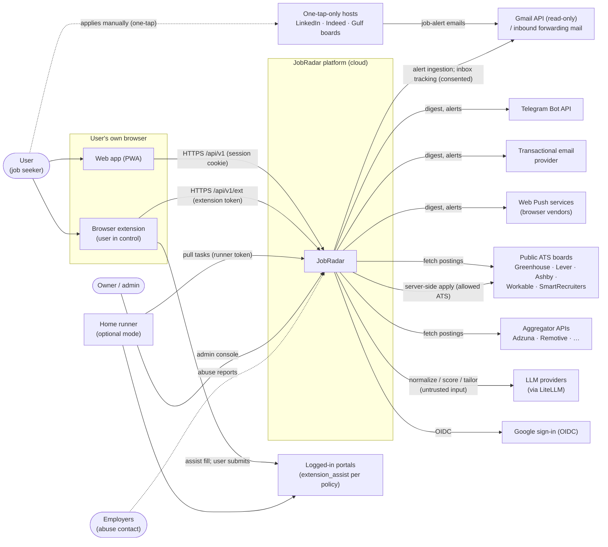
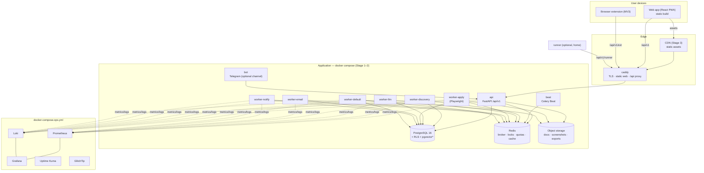
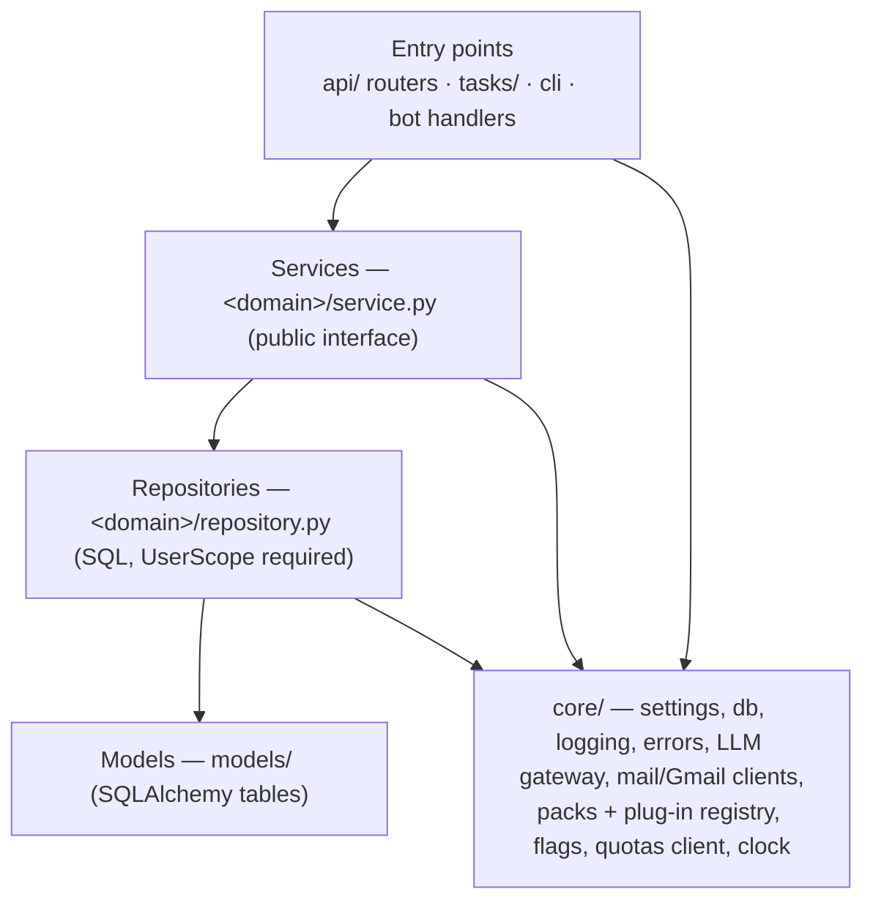
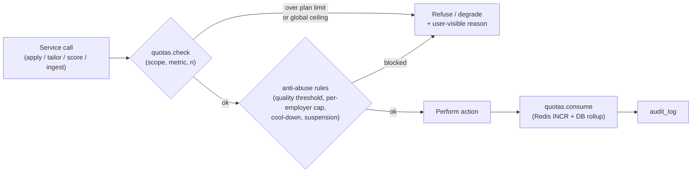
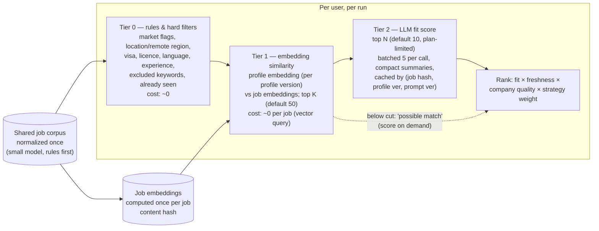
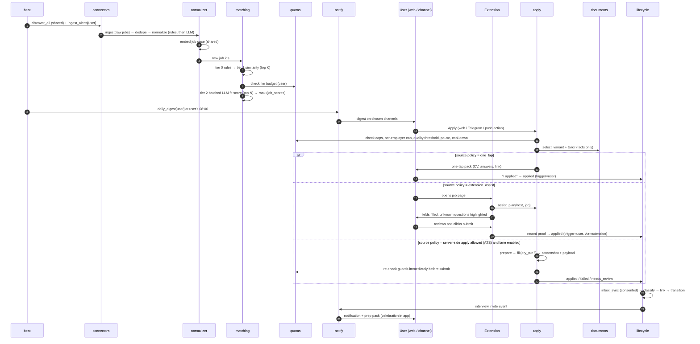
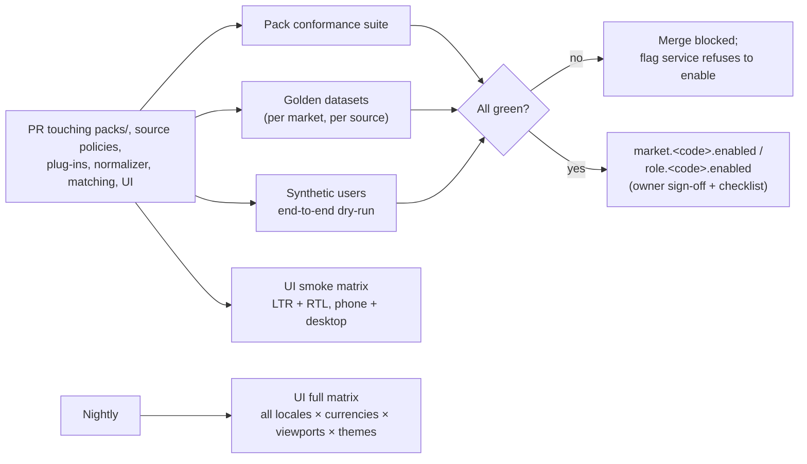

# JobRadar — High-Level Design (HLD)

| | |
|---|---|
| Status | Draft for owner review |
| Version | **0.3 (2026-10-30)**: tiered matching pipeline (§8a) and revised cost model with per-MAU target (§13); quality gates and multi-market testing architecture (§13a); extension side panel on one-tap hosts |
| Previous | 0.2: product for everyone (web app, auth, extension, tenancy, quotas, channels). 0.1: single-user HLD |
| Inputs | `CLAUDE.md`, `docs/prd.md` v0.4, `docs/PRODUCT_STANDARDS.md`, `docs/decisions-log.md` |
| Decisions | `docs/adr/` (ADR-0001 … ADR-0024) |

Principle (PRODUCT_STANDARDS): **design for scale, build for one.** The diagrams describe the
target shape. Section 11 states what is actually deployed at each stage.

---

## 1. System context



### Trust boundaries
1. **User's browser ↔ platform.** Web app uses an HttpOnly, Secure, SameSite session cookie on
   the same origin as the API, plus CSRF protection. The extension uses its own scoped,
   revocable token (§4.3). Every request resolves to exactly one tenant.
2. **Extension ↔ third-party pages.** The extension runs in the user's browser with the user's
   session. It requests host permissions **only** for hosts whose source policy allows
   `extension_assist`. It never uploads cookies or credentials, never submits on its own, and
   treats page content as untrusted data. On `one_tap`-only hosts it has **no** host permission
   and no content script: it never reads, fills or clicks anything there. Only the browser
   **side panel** (extension UI, outside the page) shows the prepared pack with copy buttons.
   "Save this job" reads only the tab URL and title on an explicit user click (`activeTab`).
   A build-time test checks the manifest against the source policy registry.
3. **Platform ↔ third parties.** Outbound only; timeouts, rate limits per source policy, clear
   User-Agent. Job text, emails and form fields are untrusted data.
4. **Platform ↔ LLM.** Minimum PII in prompts; outputs schema-validated; the LLM has no tool
   that can submit, send or change state.
5. **Home runner ↔ platform (optional).** Pull model; scoped token; credentials stay local.
6. **Tenant ↔ tenant.** Service-layer scoping plus Postgres row-level security (§5).
7. **Admin ↔ user content.** Admin roles see operational data only, unless a user grants
   time-limited support access (audit-logged).

## 2. Containers



| Container | Responsibility | Scales by |
|---|---|---|
| `caddy` | TLS, security headers, serves the static web build with SPA fallback, proxies `/api` | Replicas / CDN in front |
| Web app (static) | React + TS SPA/PWA built by Vite; hashed immutable assets; service worker | CDN |
| `api` | REST `/api/v1` for web, extension, bot, runner; auth, quotas, validation; calls services | Stateless replicas |
| `bot` | Telegram channel adapter: commands and buttons → `api`; optional per user | One poller / webhook |
| `beat` | Emits schedules; per-user schedules expand into per-user tasks | Exactly one |
| `worker-*` | One process per queue with its own concurrency (§6) | Per-queue replicas |
| `postgres` | System of record; RLS on user-owned tables | Vertical → managed → replicas → partitioning |
| `redis` | Broker, locks, quota counters, rate-limit buckets, short cache | Vertical → managed → cluster |
| Object storage | Resumes, generated documents, screenshots, payload snapshots, exports | Local volume (Stage 1) → S3-compatible |
| Extension | MV3 extension, shares UI tokens/components with the web app | Browser stores |
| `runner` | Optional home mode for unattended logged-in tasks | One per opted-in user |

\* pgvector stores job and profile embeddings (ADR-0023; approved 2026-10-30). Compose uses the
official `pgvector/pgvector:0.8.0-pg16` image.

Streamlit is removed (ADR-0014). Every client — web, extension, bot, runner — goes through the
API, so authorization, quotas, anti-abuse rules and audit logging live in one place.

## 3. Frontend build and delivery (ADR-0014, ADR-0015)

```
frontend/                      (pnpm workspace)
├── packages/tokens/           design tokens → CSS variables + Tailwind preset (light/dark, LTR/RTL)
├── packages/ui/               shadcn/ui on Radix, Motion presets, charts; Storybook lives here
├── packages/api-client/       TypeScript types + client generated from the OpenAPI spec
├── packages/i18n/             ICU message catalogues, locale/RTL helpers
├── apps/web/                  Vite + React + TanStack Query; PWA (service worker, manifest)
└── apps/extension/            MV3 extension (popup, content scripts for allowed hosts)
```

- **Build:** Vite production build → content-hashed assets + `index.html`. Storybook builds
  alongside for review. Generated API client is regenerated from `docs/openapi.yaml` and a CI
  check fails if it is stale.
- **Delivery:** Caddy serves `index.html` with `Cache-Control: no-cache` and `/assets/*` with
  `immutable, max-age=1y`; SPA fallback for client routes. API is same-origin under `/api`, so
  no CORS for the web app and cookies stay `SameSite=Lax`. Stage 3 adds a CDN in front of
  static assets; the API stays behind Caddy.
- **PWA:** installable manifest; service worker caches the app shell and the last-viewed feed
  read-only for offline; mutations made offline are queued and replayed with conflict checks.
- **Quality gates in CI:** typecheck, ESLint (including token lint: no raw colours, sizes or
  durations), unit tests (Vitest), Storybook build, Playwright visual regression (light/dark,
  LTR/RTL, key viewports 360 / 768 / 1280 / 1920), Lighthouse CI budgets ≥ 90 for
  performance, accessibility, best practices.
- **Versioning:** web and extension report their build version in `X-Client-Version`; the API
  can return `426 Upgrade Required` below a minimum version (extension version skew, F23).

## 4. Auth, accounts and tokens (ADR-0017)

### 4.1 Identity
- Email + password (argon2id) and Google sign-in (OIDC). Email verification, password reset,
  optional TOTP (required for `admin`/`owner`).
- Signup modes by flag: `closed` (Stage 1), `invite` (Stage 2), `open` (Stage 3, rate-limited,
  abuse-checked).
- Roles: `user`, `admin`, `owner`. Role checks in services, not only in routers.

### 4.2 Web sessions
- Server-side sessions table (hashed session ID), HttpOnly + Secure + SameSite=Lax cookie,
  rolling expiry, rotation on login and privilege change, revocable from settings ("sign out
  everywhere").
- CSRF: double-submit token header on state-changing requests.

### 4.3 Client tokens
| Client | How obtained | Scope | Lifetime |
|---|---|---|---|
| Extension | Pairing: user clicks "Connect extension" in the web app → short-lived code → extension exchanges it for a token | `ext:read_profile_view`, `ext:save_job`, `ext:assist`, `ext:record_proof` — per allowed host | 90 days, rotating; revocable |
| Telegram | Account linking: one-time code in web app → `/link <code>` in bot | `notify:receive`, `actions:apply_skip_save`, `control:pause` | Until unlinked |
| Runner | Created in settings (opt-in) | `runner:pull`, `runner:report` | 90 days; revocable |
| Admin API | Created by owner | Admin scopes | Short-lived |

All tokens are stored hashed, carry a scope list and owner `user_id`, and every use is
rate-limited and audit-logged for sensitive scopes.

## 5. Multi-tenant isolation (ADR-0017)

- **Every user-owned table has `user_id`** (non-null, indexed). Shared tables (jobs,
  job_sources, companies, packs, source_runs) contain no personal data.
- **Request scope:** each entry point resolves a `UserScope(user_id, roles)` and passes it
  explicitly into services; repositories require it as a parameter (no global "current user").
- **Postgres RLS (defence in depth):** user-owned tables have `ENABLE ROW LEVEL SECURITY` with
  policies on `user_id = current_setting('app.user_id')::uuid`. The session sets it with
  `SET LOCAL` per transaction. The application DB role is not a superuser and does not bypass
  RLS. Shared-corpus workers use a separate role that has no grants on user-owned tables.
- **Workers** run user tasks with the user's scope taken from the task's arguments (user ID
  only, never PII).
- **Admin access** uses an admin service path limited to operational tables; reading user
  content requires an active support grant from the user.
- **Tests:** a generated two-user test hits every endpoint and task with user B's scope against
  user A's resources and expects 404/403; RLS tests run raw SQL with the wrong `app.user_id`.

## 6. Module boundaries and layering

### 6.1 Layers (import-linter in CI; ADR-0012)



- Entry points call services only. Domains call other domains only through their service
  interface. Only repositories issue SQL. `core` imports no domain.
- Pure logic (rules, eligibility, ranking, compensation, anti-abuse decisions) is I/O-free and
  called by services.

### 6.2 Domains

| Domain | Owns tables | Public interface (indicative; typed in LLD) | Depends on |
|---|---|---|---|
| `accounts` | users, credentials, sessions, roles, invites, client_tokens, support_grants | `signup`, `login`, `verify_email`, `issue_token(scope)`, `resolve(request) -> UserScope`, `revoke` | core |
| `privacy` | consents, export_jobs, deletion_jobs | `grant_consent`, `revoke_consent`, `has_consent(scope, source)`, `export(user)`, `delete(user)` | accounts, all domains via deletion hooks |
| `quotas` | plans, user_plans, usage_counters, abuse_signals | `check(scope, metric, n)`, `consume(...)`, `budget_left(scope)`, `evaluate_abuse(scope)` | core |
| `profile` | profiles, resume_variants, answer_bank | `get_profile`, `parse_resume_draft`, `find_answer`, `save_answer` | core |
| `connectors` | source_runs, companies, alert_messages | `run_source`, `ingest_alerts(user)`, `verify_companies` | core (http, Gmail/inbound), privacy |
| `normalizer` | jobs, job_sources | `ingest(raw)`, `normalize(job_id)` | core (LLM, packs) |
| `matching` | job_scores | `score_new(profile)`, `top_matches`, `explain` | profile, normalizer, strategy, quotas |
| `documents` | document_renders | `select_variant`, `tailor(variant, job, toggles)` | profile, quotas |
| `apply` | apply_attempts, pending_questions | `prepare`, `fill(plan, dry_run)`, `one_tap_pack`, `assist_plan(url)` (extension), `confirm_manual_apply`, `record_extension_proof` | profile, documents, lifecycle, quotas, core (flags, source policies) |
| `lifecycle` | applications (create + state; only writer), application_events, emails, interviews, offers, contacts | `create_application`, `transition`, `sync_inbox`, `run_followups` | profile, privacy, connectors (mailbox) |
| `notify` | notifications (outbox), notification_prefs, push_subscriptions, channel_links | `publish(event)`, `build_digest`, `ask_question`, `set_prefs` | matching, lifecycle |
| `strategy` | search_plans | `current_plan`, `propose_replan` | profile, insights, packs |
| `insights` | metrics_daily, product_events | `weekly_report`, `funnel` | lifecycle |
| `runner` | runner_tasks | `pull_task`, `report_result`, `heartbeat` | apply, lifecycle |
| `admin` | — (reads via other services) | `connector_status`, `queues`, `dead_letters.replay`, `users_overview` (no content) | all via services |

Cross-cutting tables in `core`: `settings_flags` (global + per-user), `audit_log`, `llm_calls`,
`dead_letters`.

### 6.3 Plug-in points (G9; ADR-0006, ADR-0021, ADR-0022)

| Plug-in | Interface | Registered by |
|---|---|---|
| `MarketPack`, `RolePack`, `PersonaPack` | Pydantic schemas (YAML) | Files in `packs/` |
| `SourcePolicy` | Pydantic schema (YAML) | `config/source_policies.yaml` |
| `CompensationModel` | `to_comparable(amount, currency, period, basis, profile) -> CompBreakdown` | Entry point `jobradar.compensation` |
| `EligibilityRule` | `evaluate(job, profile, market, role) -> RuleResult` | `jobradar.eligibility` |
| `AlertEmailParser` | `matches(msg) -> bool`, `parse(msg) -> list[RawJob]` | `jobradar.alert_parsers` |
| `CvFormatter` | `render(content, toggles, locale) -> Document` | `jobradar.cv_formatters` |
| `Connector` | `fetch() -> list[RawJob]` | `jobradar.connectors` |
| `ApplyAdapter` | `prepare`, `fill`, `assist_plan` | `jobradar.apply_adapters` |
| `NotificationChannel` | `send(user, message) -> DeliveryResult` | `jobradar.channels` |
| `AlertInbox` | `fetch_new(user, since) -> list[Message]` | Gmail (Phase 2), forwarding inbox (Phase 11) |

Core code never branches on a market, role, source or channel name.

## 7. Queue topology

```mermaid
flowchart LR
    beat(["beat"]) -->|2h| d1
    beat -->|per-user local times| a1 & n1
    beat -->|15 min| e1
    beat -->|daily/weekly| f1 & i1 & r1 & q1

    subgraph discovery["discovery"]
        d1["discover_all (shared corpus)"] --> d2["run_source[src]"]
        d3["ingest_alerts[user]"]
        r1["refresh_sponsor_registers"]
    end
    subgraph llm["llm (token buckets per provider + per-user budget)"]
        l1["normalize_new (shared, small model)"] --> l0["embed_jobs (shared, once per job)"]
        l0 --> l2["match_user[profile]<br/>tier 0 rules → tier 1 similarity →<br/>tier 2 batched LLM top N"]
        l3["tailor_document[app]"]
    end
    subgraph apply["apply (Playwright, per-user lock)"]
        a1["auto_apply_batch[user]"] --> a2["apply_one[app]"]
    end
    subgraph email["email (per-user lock)"]
        e1["inbox_sync[user] (consented)"] --> e2["classify_email[msg]"]
    end
    subgraph notify["notify (per-channel rate limits)"]
        n1["daily_digest[user]"] --> n2["deliver[notification, channel]"]
    end
    subgraph default["default"]
        f1["followups_and_ghosting"]
        i1["weekly_insights[user]"]
        q1["quota_rollup · abuse_scan · export/delete jobs"]
    end
    dlq[("dead_letters + admin replay")]

    d2 --> l1
    d3 --> l1
    l2 --> n1
    a2 & e2 -->|events| n2
    d2 & d3 & l1 & l2 & a2 & e2 & n2 -. "retries exhausted" .-> dlq
```

| Queue | Concurrency (Stage 1) | Retry policy | Time limit (soft/hard) | Fairness |
|---|---|---|---|---|
| `discovery` | 4 | backoff + jitter, max 5, transient only | 120 / 180 s | Shared corpus; per-source politeness |
| `llm` | 2 | backoff, provider fallback, max 3 | 60 / 90 s | Per-user budget check before enqueue and before call |
| `apply` | 1 | **no auto-retry after submit click**; pre-submit failures max 2 | 300 / 360 s | Per-user lock; round-robin across users |
| `email` | 1 | backoff, max 5 | 120 / 180 s | Per-user lock |
| `notify` | 2 | backoff, max 5; permanent errors (410 push, blocked bot) disable the channel | 30 / 60 s | Per-channel rate limits (e.g. Telegram global send rate) |
| `default` | 2 | backoff, max 3 | 60 / 90 s | — |

Conventions (ADR-0011): `acks_late`, `reject_on_worker_lost`, idempotent tasks keyed by natural
keys, task args are IDs only, correlation ID in headers, dead letters with replay, per-user Redis
locks, `worker_max_tasks_per_child` per queue. Notifications use an **outbox** table: a domain
writes the `notifications` row in its own transaction; `deliver` sends it and records the result,
so a crash never loses or duplicates a message (dedupe key per event).

## 8. Quotas, budgets and anti-abuse (ADR-0019)



- **Limits:** plan limits (config) ≤ global ceilings (config, not overridable). Metrics:
  `applications.auto/day`, `applications.assisted/day`, `applications.per_employer/30d`,
  `documents.tailored/day`, `llm.tokens/day`, `llm.cost/month`, `alerts.ingested/day`,
  `storage.bytes`.
- **Counters:** Redis for hot counters (atomic INCR with period TTL); nightly rollup to
  `usage_counters`; Redis loss → counters rebuilt from DB events (conservative: deny when unsure
  for apply metrics).
- **LLM budget:** the LLM gateway estimates tokens before the call and refuses when the user's
  remaining budget is too low; actual usage recorded after. Shared normalization is billed to
  `system`, not to users.
- **Degradation order when a user's LLM budget runs out:** tailoring → rules-only scoring with a
  visible badge → digest still delivered. Tracking and notifications never stop for budget reasons.
- **Abuse scan (daily + on event):** rejection-without-response rate, bursts, employer reports
  → cool-down (automated lanes off for N days) and admin review queue.

## 8a. Tiered matching pipeline (ADR-0023)

LLM scoring is the dominant per-user cost. Each tier is cheaper than the next and narrows the
candidate set, so the LLM only sees each user's best candidates.



| Tier | Input | Output | Model | Cost driver | Cache key |
|---|---|---|---|---|---|
| Normalize (shared) | New raw job | Normalized fields | Rules → `llm.models.small` for unresolved fields only | New jobs/day × share needing LLM | Job content hash + prompt version |
| Embed (shared) | Normalized job text (title, skills, summary ≤ 512 tokens) | Vector | Embedding model (`llm.models.embedding`) | New or changed jobs | Job content hash + embedding model |
| Tier 0 (user) | Corpus since last run | Eligible candidates + reasons | None | — | — |
| Tier 1 (user) | Eligible candidates | Top K by cosine similarity | None (vector index) | — | Profile version |
| Tier 2 (user) | Top N | Fit score, matched/missing, rationale | `llm.models.standard`, batched | N × users × runs | (job hash, profile version, prompt version) |
| Tailor (user) | Chosen job | Document | `standard`, or `premium` if plan allows | Applications | (variant, job hash, toggles, prompt version) |

Implementation notes:
- **Embedding store:** pgvector column on `job_embeddings` (shared) and `profile_embeddings`
  (user-owned, RLS), with an HNSW index. Stage 1 can run exact search; the index is added when
  the corpus exceeds ~50k active jobs.
- **Batching:** Tier 2 sends up to `matching.batch_size` (default 5) compact job summaries with
  one profile block. The response schema is an array keyed by job ID, and a malformed item is
  retried alone.
- **Incremental runs:** each user run only considers jobs first seen since their last run, plus
  jobs whose content hash changed. A profile change invalidates Tier 1/2 caches for that user
  only.
- **Provider batch APIs:** where a provider offers discounted asynchronous batch processing,
  overnight re-scoring uses it. Config flag, off by default.
- **Quality guard:** the Tier 2 coverage metric (share of applied jobs that were in the top N)
  and owner thumbs feed the eval set. If coverage drops below 90%, raise N for that persona or
  re-tune the embedding text.

## 9. Notification channels

- Channels are plug-ins (`in_app`, `email`, `web_push`, `telegram`), chosen per user and per
  event type, with quiet hours in the user's time zone.
- Linking: email verified at signup; web push via PWA subscription (VAPID); Telegram via
  one-time link code. Each link is a consent record.
- Digest content is built once (`build_digest`) and rendered per channel (rich in-app/email,
  compact Telegram with buttons, short push with deep link).
- Action buttons (Apply / Skip / Save, answer a question) call the same API endpoints as the web
  app, carrying a signed short-lived action token.

## 10. Data flow: new job → applied → interview



## 11. Failure modes and handling

| # | Failure | Detection | Handling | User impact |
|---|---|---|---|---|
| F1 | Source down / 5xx / timeout | `source_runs` errors | Backoff retries; other sources continue; alert if down > 6 h | Fewer new jobs |
| F2 | Source schema drift | Validation error count | Skip bad items; `degraded`; alert + runbook | Partial jobs |
| F3 | Alert email format changed | 0 jobs from matched alert | Keep message ID as `unparsed` for replay; parser `degraded` | Coverage drop |
| F4 | Gmail token expired/revoked | 401 | Stop that user's Gmail tasks; notify "reconnect"; others continue | Ingestion paused for that user |
| F5 | LLM provider down / 429 | Errors, latency | Fallback provider → rules-only; scores deferred | "Scoring delayed" badge |
| F6 | Invalid LLM JSON / unsupported claims | Schema + claim-to-fact check | One repair retry, then reject; untailored variant used | Less tailoring |
| F7 | User or deployment LLM budget exhausted | Gateway pre-check | Degradation order (§8); alerts at 50/80/100% | Visible usage meter |
| F8 | Prompt injection (job text, email, page) | Untrusted framing; schema; no tools | Output validated; anomalies logged | None |
| F9 | ATS form changed | Playwright / assist error before submit | Screenshot + `failed` reason; adapter flagged; offer one-tap | Becomes one-tap |
| F10 | Crash after submit click | Attempt `submitting` without result | **No auto-resubmit**; `needs_review` | Manual check, never a duplicate |
| F11 | Duplicate apply attempt | Unique keys + lock | Refused, guardrail event logged | None |
| F12 | Pause mid-batch | Submit-time guard | Remaining items stay queued | Expected |
| F13 | Worker crash / OOM | Redelivery; watchdog | Idempotent re-run; child recycling | None |
| F14 | Redis down | `/ready` | Processing stops; API reads from Postgres; apply quotas fail **closed** | No new processing |
| F15 | Postgres down | `/ready` | Degraded; restore runbook | Outage |
| F16 | A notification channel down | Send errors | Outbox retries; other channels and in-app unaffected | Late message |
| F17 | Home runner offline (optional mode) | Heartbeat > 2 h | Tasks stay queued with TTL; never moved to cloud | That lane paused |
| F18 | Wrong email ↔ application link | Low match confidence | Ask the user to confirm | One tap |
| F19 | Stale pack facts | `last_verified` > 90 d | Warning in admin; notes flagged "verify" | Flag shown |
| F20 | Stale FX rate | `fx.as_of` > max age | "Stale rate" badge; reminder | Flag shown |
| F21 | Google sign-in unavailable | OIDC errors | Password login still works; message on sign-in screen | Minor |
| F22 | Session or token theft | Anomalies (new device/IP burst), user report | Rotation; "sign out everywhere"; per-token revoke; scopes limit blast radius | Re-login |
| F23 | Extension/web version skew | `X-Client-Version` below minimum | `426` + upgrade prompt; API supports N-1 versions | Prompt to update |
| F24 | Extension token leaked | Usage from unexpected origin/volume | Revoke; tokens host-scoped and cannot read user content beyond assist needs | Re-pair |
| F25 | Quota exceeded | `quotas.check` | Refuse or degrade with clear reason and reset time | Visible limit |
| F26 | Abuse detected | Abuse scan / employer report | Cool-down; admin review; suspension | Automated lanes off |
| F27 | Cross-tenant query bug | RLS denies; isolation tests; alert on RLS violation errors | Request fails closed; SEV1 investigation | Error, no leak |
| F28 | Deletion requested while tasks in flight | Tombstone flag on user | Tasks check tombstone and exit; deletion job retries until clean; verification test | None |
| F29 | Static deploy mismatch | Missing chunk errors | Hashed assets; previous build kept for 24 h; `index.html` no-cache; client reloads on chunk error | Reload |
| F30 | Noisy neighbour (one user floods queues) | Per-user queue share metric | Per-user fairness and caps; budget limits | None for others |
| F31 | Push subscription expired | 404/410 from push service | Remove subscription; fall back to other channels | None |

## 12. Scaling path

Key property: **the job corpus is shared; per-user work is not.** Discovery and normalization
grow with sources and companies; scoring, tailoring and applying grow with users × candidate
jobs, and most cost is LLM scoring. Rules and cheap pre-filters run before any LLM call.

| Concern | Stage 1: 1 user | Stage 2: ~100 users (friends) | 1,000 users (public) | 10,000 users |
|---|---|---|---|---|
| Hosting | 1 small VM, compose | 1–2 VMs; managed Postgres; object storage | Container platform; autoscaled workers per queue; CDN | Multi-node, multi-AZ; services split |
| Services | Modular monolith, many process roles | Same | Extract **apply engine** and **connectors**; notify as own deployable | + scoring service; API gateway |
| Web delivery | Caddy serves static build | Same + CDN optional | CDN for assets; API behind LB | Multi-region CDN; API per region |
| Auth | Single owner, signup closed | Invite-only; TOTP for admins | Open signup with rate limits and abuse checks | Add enterprise SSO only if needed |
| Tenancy | `user_id` + RLS + isolation tests | Same | Same + per-tenant encryption keys for documents | + data residency (India, EU) |
| Postgres | Container, nightly dump | Managed, PITR | Read replica for insights/admin; monthly partitions for events, `llm_calls`, `audit_log` | Hash-partition user tables; analytics export to warehouse |
| Redis / queues | Single Redis | Managed Redis | Redis cluster or RabbitMQ; per-user fair queuing | Broker per domain; priority + backpressure |
| Discovery | Poll per company every 2 h | Shared across users | Adaptive polling, conditional requests | Sharded scheduler; partner feeds |
| Alert inbox | Gmail API (owner) | Gmail API (test users ≤ Google's limit) | Forwarding-address inbound mail | Same, horizontally scaled inbound |
| LLM | Tiered matching from day one; free tier + cache | Paid small/standard models; per-user budgets | Provider batch APIs for re-scoring; HNSW vector index | Self-hosted small model for normalization/classification; paid model for Tier 2 and tailoring only |
| Apply | Serial Playwright | Per-user serial, N users in parallel | Browser pool service; per-ATS shared politeness | Dedicated apply cluster |
| Extension | Owner only | Unlisted store listing | Public listing | Same; staged rollouts |
| Notifications | In-app + email/Telegram | Outbox + rate-limited workers | Dedicated notify service | Sharded bots; provider failover |
| Ops | Lean ops compose | Alert tuning | SLO dashboards, on-call | SRE practice, multi-region DR |

Move to the next column when: queue latency > 15 min sustained, Postgres CPU > 70%, LLM cost
per active user above target, apply backlog growing for > 1 day, or p95 API latency > 500 ms.

## 13. Cost model

Cost per **monthly active user (MAU)** = shared costs ÷ MAU + per-user variable costs.
These are planning estimates to validate in Stage 2, not quotes. LLM prices change often, so
re-check them against the provider's current price list before each stage. Prices are inputs
(`P_in`, `P_out` per million tokens per model tier), never constants in code.

### 13.1 Target (ADR-0023)
**Stage 3 target: ≤ 0.8 M generative LLM tokens and ≤ US$0.20 LLM cost (generative +
embeddings) per MAU per month**, including the user's share of shared normalization and
embeddings. All-in infra + LLM target:
**≤ US$0.50 per MAU per month at ≥ 1,000 MAU.**

### 13.2 Before / after (per user per month, 30 days)

| Line item | Before (HLD v0.2: score every pre-filtered job) | After (tiered pipeline) |
|---|---|---|
| Jobs reaching LLM scoring per day | 40 | **10** (top N after embedding tier) |
| Tokens per scored job | 2,500 in + 300 out (full posting, one job per call) | ~1,000 in + 200 out (compact summary; profile block shared across a batch of 5 → +120 in per job) |
| Scoring tokens / month | 30 × 40 × 2.8k ≈ **3.36 M** | 30 × 10 × 1.32k ≈ **0.40 M** |
| Cache hit rate on scoring (re-sightings, unchanged jobs) | not modelled | ~15% → ≈ **0.34 M** |
| Tailored documents / day | 3 × 5.5k (full CV + full posting) | 2 × 3.3k (structured facts + compact summary; plan-limited) |
| Tailoring tokens / month | ≈ **0.50 M** | ≈ **0.20 M** |
| Shared normalization (user's share) | not modelled | 10k new jobs/day × 30% need LLM × 1.5k tokens on the small model, ÷ 1,000 MAU ≈ **0.14 M** |
| Shared job embeddings (user's share) | — | 10k jobs/day × 400 tokens ÷ 1,000 MAU ≈ **0.12 M** embedding tokens (very cheap tier) |
| **Generative LLM tokens / MAU / month** | **≈ 3.86 M** | **≈ 0.68 M** (0.34 scoring + 0.20 tailoring + 0.14 normalization share) |
| Embedding tokens / MAU / month | — | ≈ 0.12 M |
| **Illustrative LLM cost / MAU / month**¹ | ≈ **US$0.80** (scoring $0.67 + tailoring $0.14, standard model) | ≈ **US$0.15** (scoring $0.07 + tailoring $0.05 + normalization $0.02 + embeddings < $0.01) |

¹ Illustrative prices, to be replaced with current list prices: small model P_in = $0.10,
P_out = $0.40; standard model P_in = $0.15, P_out = $0.60; embeddings $0.02 per million
tokens. A large/premium model for tailoring multiplies the tailoring line by roughly 10–20×,
which is why it is plan-gated.

**Reduction: ~82% fewer generative tokens and ~80% lower LLM cost per MAU**, leaving ~15%
headroom under the token target and ~25% under the cost target. The main levers, in order:
Tier 1 cut from 40 to 10 jobs, compact summaries, batching, caching, small model for
normalization.

### 13.3 By stage

| Stage | Infra (monthly, indicative) | LLM | Other |
|---|---|---|---|
| 1 user | Free/small VM; free-tier LLM | ≈ 0 (free tier) | Domain, backup storage |
| ~100 users | 1–2 VMs + managed Postgres + object storage | ≈ 100 × per-user cost; shared normalization share is higher per user at low MAU | Transactional email; error tracking |
| 1,000 users | Container platform, CDN, replicas | At or below target; batch APIs for re-scoring | Inbound mail; security assessment |
| 10,000 users | Multi-node, multi-AZ | Shared costs amortize further; self-hosted small model for normalization/classification | SRE time; compliance |

Budget controls: per-user `llm.cost/month` limit per plan; deployment-wide monthly budget with
alerts at 50/80/100% (PRODUCT_STANDARDS V); **cost per MAU** and **Tier 2 coverage** on the cost
dashboard; an alert when cost per MAU exceeds target for 3 consecutive days.

## 13a. Quality gates and multi-market testing (ADR-0024)



| Asset | Location | Runs | Contents |
|---|---|---|---|
| Conformance suite | `tests/conformance/` (parametrized over every pack) | Every PR | Schema, currency + `CompensationModel` round trips, locale/RTL + font coverage, CV render, visa rules, salary golden cases, eligibility golden cases, source parsing, persona sanity |
| Golden datasets | `tests/golden/<market>/{postings,alerts,expected}/` | Every PR | Synthetic or anonymized postings and `.eml` alerts with expected normalized JSON |
| Synthetic users | `tests/synthetic/profiles/syn-*.yaml` + `expected/` | Every PR (fixtures only; LLM calls replaced by recorded responses) | End-to-end dry-run: discover → normalize → match → documents → apply dry-run → digest |
| LLM recordings | `tests/llm_recordings/` keyed by (prompt version, input hash) | Every PR | Deterministic LLM responses for synthetic runs; re-recorded deliberately with `make record-llm` |
| UI matrix | `frontend/apps/web/e2e/matrix/` | Smoke on PR; full nightly and pre-release | Visual regression, axe, untranslated keys, overflow, `dir`, formatting |
| Rollout checklist | `docs/markets/<code>.md` | Before enabling a flag | The PRD §8a.5 checklist with evidence links and sign-off |

The flag service refuses to enable `market.<code>.enabled` or `role.<code>.enabled` unless the
latest conformance run for that pack on `main` is green. The admin console shows each market's
checklist status.

## 14. Cross-cutting concerns

- **Configuration:** pydantic-settings validated at startup; packs and source policies validated
  on load and in CI; runtime flags global and per user.
- **Security:** argon2id; scoped hashed tokens; RLS; secrets only in environment; tokens for
  Gmail/LLM/push encrypted at rest; strict CSP and security headers from Caddy; rate limits on
  auth and public endpoints; threat model in `docs/security/threat-model.md` (extension and
  multi-tenant threats included).
- **Observability:** structlog JSON with correlation IDs (web → API → task → outbound call);
  user IDs as opaque IDs only; Prometheus metrics (queues, sources, apply outcomes, quota denials,
  LLM tokens/cost per plan, Web Vitals from the client); Loki; GlitchTip for API and frontend.
- **LLM gateway:** LiteLLM behind an interface; versioned prompt files; strict schemas + one
  repair retry; cache by (prompt version, input hash); per-call metering with user attribution.
- **Proof and audit:** screenshots + payload snapshots + prompt/model versions per submission;
  `audit_log` for all sensitive actions.
- **Privacy:** consent records per source; minimal data; body discard for alert emails; export
  and deletion jobs; admins see no content without support grants.

## 15. Decision records

| ADR | Title |
|---|---|
| [0001](adr/0001-modular-monolith.md) | Modular monolith |
| [0002](adr/0002-home-runner-for-logged-in-portals.md) | Home runner for logged-in portals (amended by 0016: optional mode) |
| [0003](adr/0003-one-tap-lanes-for-linkedin-indeed-gulf-boards.md) | One-tap lanes for LinkedIn, Indeed and Gulf boards |
| [0004](adr/0004-private-repository.md) | Private repository |
| [0005](adr/0005-checkout-outside-onedrive.md) | Checkout at `C:\dev\jobradar`, outside OneDrive |
| [0006](adr/0006-pluggable-markets-india-uae-first.md) | Pluggable markets; India + UAE first (amended by 0013) |
| [0007](adr/0007-yaml-profile-and-facts-only-parsing.md) | YAML profile, PyYAML, facts-only resume parsing |
| [0008](adr/0008-gmail-job-alerts-as-main-uae-source.md) | Gmail job-alert ingestion as main UAE source (Phase 2) |
| [0009](adr/0009-compensation-comparison-fx-and-tax-defaults.md) | Compensation comparison: FX and tax defaults |
| [0010](adr/0010-uae-cv-field-defaults.md) | UAE CV field defaults with per-application toggle |
| [0011](adr/0011-celery-queues-and-idempotent-tasks.md) | Celery with per-domain queues and idempotent tasks |
| [0012](adr/0012-layered-modules-enforced-by-import-linter.md) | Layering enforced by import-linter |
| [0013](adr/0013-product-for-everyone.md) | Product for everyone; staged rollout |
| [0014](adr/0014-web-app-stack-replaces-streamlit.md) | Web app stack (React, TS, Vite, Tailwind, shadcn/Radix, Motion); Streamlit removed |
| [0015](adr/0015-design-system-tokens-and-visual-quality-gates.md) | Design system, tokens and visual quality gates |
| [0016](adr/0016-browser-extension-default-runner-optional.md) | Browser extension by default; home runner optional |
| [0017](adr/0017-auth-sessions-and-tenant-isolation.md) | Auth, sessions, scoped tokens and tenant isolation (RLS) |
| [0018](adr/0018-privacy-consent-and-email-access.md) | Privacy, per-source consent and email access strategy |
| [0019](adr/0019-quotas-budgets-and-anti-abuse.md) | Quotas, LLM budgets, plans and anti-abuse |
| [0020](adr/0020-i18n-rtl-and-fonts.md) | Internationalization, RTL and fonts |
| [0021](adr/0021-role-taxonomy-and-credentials.md) | Role taxonomy, field documents and credentials |
| [0022](adr/0022-source-policy-registry.md) | Source policy registry governs automation per host |
| [0023](adr/0023-tiered-matching-and-llm-cost-target.md) | Tiered matching pipeline and LLM cost target |
| [0024](adr/0024-market-and-role-quality-gates.md) | Market and role quality gates, synthetic users and rollout flags |
| [0025](adr/0025-brand-direction-calm-compass.md) | Brand direction "Calm Compass" with celebration from "Bright Momentum" |
