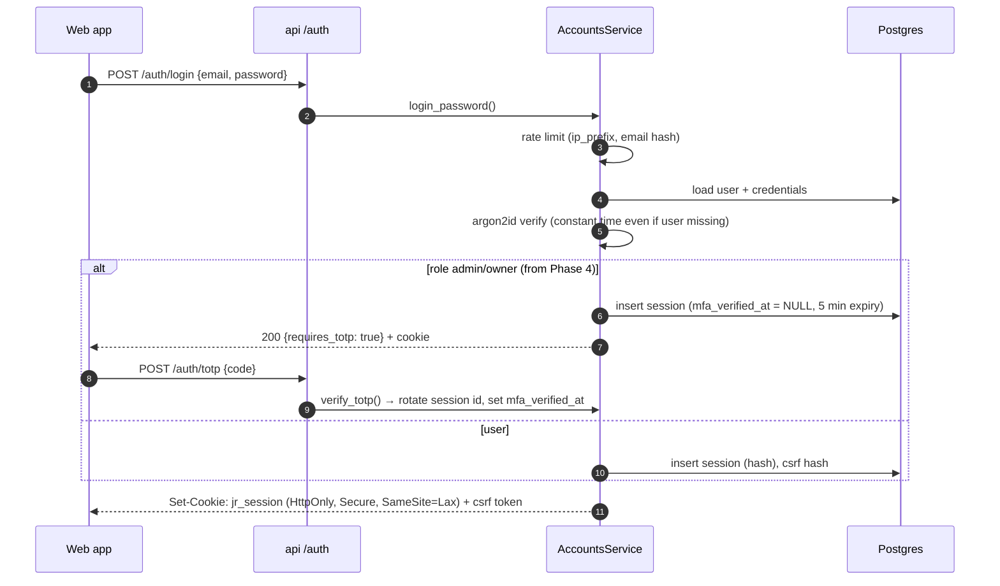

# LLD — accounts

| | |
|---|---|
| Status | Draft for owner review |
| Version | 0.1 (2026-10-30) |
| Owner module | `jobradar.accounts` |
| PRD stories | US-4.2, US-10.1, US-10.4 (isolation), US-8.3 AC1 (pairing), US-4.4 (Telegram link) |
| ADRs | 0017 (auth, sessions, tokens, tenancy), 0016 (extension pairing), 0018 (support access), 0012 (layering) |
| Phase | 4 (owner sign-in, signup `closed`), 10 (invite signup, TOTP, support grants), 11 (open signup) |

## 1. Responsibilities

- Sign up, sign in and sign out with email + password (argon2id) and Google sign-in (OIDC).
- Email verification and password reset via one-time challenges.
- TOTP enrolment and verification, required for `admin` and `owner`.
- Web sessions: create, rotate, expire, revoke ("sign out everywhere"), CSRF tokens.
- Client tokens for the extension, Telegram, runner and admin API: issue, scope, rotate, revoke.
- Pairing and linking codes (`pair_extension`, `link_telegram`) through `auth_challenges`.
- Resolve every incoming request or task to exactly one `UserScope`, and open DB transactions with
  `SET LOCAL app.user_id`.
- Roles (`user`, `admin`, `owner`) and role checks used by services.
- Invites and the signup mode flag (`signup.mode`: `closed` → `invite` → `open`).
- Support grants: user-granted, time-limited (≤ 72 h) admin access to content, audited.
- Rate limiting of authentication endpoints.

### Must NOT do
- Must not store passwords, session secrets, token secrets or codes in plain text. Only hashes.
- Must not expose whether an email is registered (sign-in, reset and signup responses are uniform).
- Must not provide an ambient "current user" (no global/contextvar user for repositories).
- Must not grant admins access to user content without an active support grant.
- Must not call other domains' repositories. Deletion of accounts is orchestrated by `privacy`.
- Must not send email directly. It publishes `security` notifications through `notify`.
- Must not decide quotas or plans (that is `quotas`), except assigning the invite's plan at signup.

## 2. Public interface (typed)

```python
class SignupMode(StrEnum):
    CLOSED = "closed"
    INVITE = "invite"
    OPEN = "open"


class Role(StrEnum):
    USER = "user"
    ADMIN = "admin"
    OWNER = "owner"


class ClientTokenKind(StrEnum):
    EXTENSION = "extension"
    TELEGRAM = "telegram"
    RUNNER = "runner"
    ADMIN_API = "admin_api"


class ChallengePurpose(StrEnum):
    VERIFY_EMAIL = "verify_email"
    RESET_PASSWORD = "reset_password"
    PAIR_EXTENSION = "pair_extension"
    LINK_TELEGRAM = "link_telegram"


class SignupRequest(BaseModel):
    email: EmailStr
    password: SecretStr  # min 12 chars, checked against a breached-password list (offline file)
    display_name: str | None = None
    locale: str = "en"
    timezone: str = "Asia/Kolkata"
    invite_code: SecretStr | None = None
    accepted_terms_version: str  # recorded via privacy.grant_consent("terms")
    accepted_privacy_version: str  # recorded via privacy.grant_consent("privacy_policy")


class SessionIssued(BaseModel):
    session_secret: SecretStr  # goes into the HttpOnly cookie, never into JSON bodies
    csrf_token: SecretStr  # returned to the SPA, sent back in X-CSRF-Token
    expires_at: datetime
    requires_totp: bool


class IssuedToken(BaseModel):
    token_id: UUID
    secret: SecretStr  # shown once
    scopes: frozenset[str]
    hosts: tuple[str, ...] | None
    expires_at: datetime


class AccountsService(Protocol):
    async def signup(self, req: SignupRequest, *, client: ClientInfo) -> UUID:
        ...
        # Raises: PermissionDeniedError(signup_closed|invite_invalid), ValidationFailedError, RateLimitedError

    async def login_password(
        self, email: str, password: SecretStr, *, client: ClientInfo
    ) -> SessionIssued:
        ...
        # Raises: PermissionDeniedError(invalid_credentials|suspended), RateLimitedError

    async def login_google(
        self, id_token: SecretStr, nonce: str, *, client: ClientInfo
    ) -> SessionIssued: ...
    async def verify_totp(
        self, session_secret: SecretStr, code: str
    ) -> SessionIssued: ...  # rotates session
    async def enroll_totp(self, scope: UserScope) -> TotpEnrollment: ...
    async def confirm_totp(self, scope: UserScope, code: str) -> None: ...
    async def logout(self, session_secret: SecretStr) -> None: ...
    async def logout_everywhere(
        self, scope: UserScope
    ) -> int: ...  # revokes sessions + optional tokens
    async def start_email_verification(self, scope: UserScope) -> None: ...
    async def complete_challenge(
        self, purpose: ChallengePurpose, code: SecretStr, **kw: object
    ) -> ChallengeResult: ...
    async def request_password_reset(self, email: str) -> None: ...  # always succeeds outwardly
    async def reset_password(
        self, code: SecretStr, new_password: SecretStr
    ) -> None: ...  # revokes all sessions

    async def start_pairing(self, scope: UserScope, kind: ClientTokenKind) -> PairingCode:
        ...
        # PAIR_EXTENSION / LINK_TELEGRAM; 8-char code, 10-minute expiry, max 5 attempts

    async def exchange_pairing(
        self, code: SecretStr, kind: ClientTokenKind, *, install: InstallInfo
    ) -> IssuedToken: ...
    async def issue_token(
        self,
        scope: UserScope,
        kind: ClientTokenKind,
        scopes: frozenset[str],
        hosts: Sequence[str] | None = None,
        label: str | None = None,
    ) -> IssuedToken: ...
    async def rotate_token(
        self, token_secret: SecretStr
    ) -> IssuedToken: ...  # old token valid 5 more minutes
    async def revoke_token(self, scope: UserScope, token_id: UUID) -> None: ...
    async def list_tokens(self, scope: UserScope) -> list[ClientTokenView]: ...

    async def resolve_session(
        self, session_secret: SecretStr, csrf: str | None, *, method: str
    ) -> UserScope: ...
    async def resolve_token(
        self, token_secret: SecretStr, *, required_scope: str, host: str | None = None
    ) -> UserScope:
        ...
        # Raises: PermissionDeniedError(token_invalid|scope_missing|host_not_allowed)

    async def create_invite(
        self, scope: UserScope, email: str | None, plan_code: str
    ) -> InviteCode: ...  # admin/owner
    async def grant_support(
        self, scope: UserScope, admin_id: UUID, scopes: frozenset[str], reason: str, hours: int
    ) -> UUID: ...  # hours ≤ 72
    async def revoke_support(self, scope: UserScope, grant_id: UUID) -> None: ...
    async def check_support(
        self, admin: UserScope, subject_user_id: UUID, needed: str
    ) -> SupportGrantRef:
        ...
        # Raises: PermissionDeniedError(no_support_grant); every success writes audit `support_grant.used`

    # Used by privacy (deletion) and admin/quotas (suspension); never by request handlers directly
    async def set_user_status(
        self,
        actor: UserScope | SystemScope,
        user_id: UUID,
        status: Literal["active", "suspended", "pending_deletion"],
    ) -> None:
        ...
        # pending_deletion also revokes all sessions and client tokens; audited

    async def delete_account(
        self, system: SystemScope, user_id: UUID
    ) -> None: ...  # privacy deletion hook (last)


def require_role(scope: UserScope, *roles: Role) -> None: ...  # pure; raises PermissionDeniedError
```

**Entry-point dependency (FastAPI):** `get_scope()` reads the session cookie (web) or
`Authorization: Bearer` (clients), calls `resolve_*`, binds `user_id` (opaque) and
`correlation_id` to structlog, and opens the request's DB transaction with
`SET LOCAL app.user_id = :uid`. Celery tasks build the scope from the task's `user_id` argument
through `scope_for_task(user_id)`, which checks `users.status`.

### API request/response models

Mirrors `docs/openapi.yaml` `components/schemas`: same names, fields, enums and optionality (Step 4 review: the LLD is the single source of truth, the spec must match it). Optional fields are `T | None = None` and serialized with `exclude_none`; `XPage = Page[X]` is the cursor envelope from `docs/lld/README.md`; `# read-only` fields are ignored on input. Types not defined here come from their owning module (see the shared-model ownership table in `docs/lld/README.md`).

```python
class Browser(StrEnum):
    CHROME = "chrome"
    EDGE = "edge"
    FIREFOX = "firefox"
    OTHER = "other"


class ClientToken(BaseModel):
    id: UUID  # read-only
    kind: ClientTokenKind
    label: str | None = None
    scopes: list[str]
    hosts: list[str] | None = None
    expires_at: datetime
    last_used_at: datetime | None = None
    revoked_at: datetime | None = None
    created_at: datetime  # read-only


class ClientTokenCreate(BaseModel):
    model_config = ConfigDict(extra="forbid")
    kind: Literal["runner", "admin_api"]
    label: str
    scopes: list[str] | None = None


class ClientTokenCreated(BaseModel):
    """Secret shown once."""
    token: str
    client_token: ClientToken


ClientTokenPage = Page[ClientToken]


class GoogleAuthRequest(BaseModel):
    model_config = ConfigDict(extra="forbid")
    code: str
    state: str
    code_verifier: str


class LoginRequest(BaseModel):
    model_config = ConfigDict(extra="forbid")
    email: EmailStr
    password: str


class LoginResponse(BaseModel):
    requires_totp: bool
    user: Me | JsonValue | None = None


class Me(BaseModel):
    id: UUID  # read-only
    email: EmailStr
    email_verified: bool
    display_name: str | None = None
    role: Role
    status: UserStatus
    locale: str
    timezone: str
    comparison_currency: CurrencyCode  # ISO 4217 currency
    preferences: UserPreferences
    mfa_enabled: bool
    plan_code: str | None = None
    created_at: datetime  # read-only


class MeUpdate(BaseModel):
    model_config = ConfigDict(extra="forbid")
    display_name: str | None = None
    locale: str | None = None
    timezone: str | None = None
    comparison_currency: CurrencyCode | None = None  # ISO 4217 currency
    preferences: UserPreferences | None = None


class PairExchangeRequest(BaseModel):
    model_config = ConfigDict(extra="forbid")
    code: str
    browser: Browser
    client_version: str


class PairExchangeResponse(BaseModel):
    """Token is returned once; the extension stores it in browser storage."""
    token: str
    expires_at: datetime
    scopes: list[str]
    hosts: list[str]


class PairStartResponse(BaseModel):
    code: str
    expires_at: datetime


class PasswordResetComplete(BaseModel):
    model_config = ConfigDict(extra="forbid")
    code: str
    new_password: str


class PasswordResetRequest(BaseModel):
    model_config = ConfigDict(extra="forbid")
    email: EmailStr


class SupportGrant(BaseModel):
    id: UUID  # read-only
    granted_to: UUID
    scope: list[str]
    reason: str
    expires_at: datetime
    revoked_at: datetime | None = None
    created_at: datetime  # read-only


class SupportGrantCreate(BaseModel):
    model_config = ConfigDict(extra="forbid")
    granted_to: UUID
    scope: list[str]
    reason: str
    expires_at: datetime


class TotpConfirmRequest(BaseModel):
    model_config = ConfigDict(extra="forbid")
    code: str


class TotpEnrollResponse(BaseModel):
    """Secret is shown once during enrolment only."""
    otpauth_uri: str
    secret: str
    expires_at: datetime


class TotpVerifyRequest(BaseModel):
    model_config = ConfigDict(extra="forbid")
    code: str


class UserPreferences(BaseModel):
    ghosting_days: int | None = None
    digest_local_time: str | None = None
    analytics_opt_out: bool | None = None
    telegram_show_pay: bool | None = None
    followup_days: list[int] | None = None


class UserStatus(StrEnum):
    ACTIVE = "active"
    SUSPENDED = "suspended"
    PENDING_DELETION = "pending_deletion"


class VerifyEmailRequest(BaseModel):
    model_config = ConfigDict(extra="forbid")
    code: str
```

## 3. Internal design

```mermaid
classDiagram
    class AccountsService
    class PasswordHasher { +hash(SecretStr) str +verify(str, SecretStr) bool +needs_rehash(str) bool }
    class OidcVerifier { +verify(id_token, nonce) OidcClaims }
    class TotpVerifier { +verify(secret, code, now) bool }
    class SecretCodec { +new_secret() SecretStr +hash(SecretStr) bytes }
    class AuthRateLimiter { +hit(key, limit, window) None }
    class UserRepository
    class SessionRepository
    class TokenRepository
    class ChallengeRepository
    class InviteRepository
    class SupportGrantRepository
    class ScopeResolver { +from_session() UserScope +from_token() UserScope }
    AccountsService --> PasswordHasher
    AccountsService --> OidcVerifier
    AccountsService --> TotpVerifier
    AccountsService --> SecretCodec
    AccountsService --> AuthRateLimiter
    AccountsService --> UserRepository
    AccountsService --> SessionRepository
    AccountsService --> TokenRepository
    AccountsService --> ChallengeRepository
    AccountsService --> InviteRepository
    AccountsService --> SupportGrantRepository
    ScopeResolver --> SessionRepository
    ScopeResolver --> TokenRepository
```



Secrets are 32 random bytes (URL-safe base64). Stored as SHA-256 hashes (`token_hash`,
`code_hash`, `csrf_hash`); lookups are by hash with constant-time compare. Codes shown to humans
(pairing, Telegram link) are 8 characters from an unambiguous alphabet and are rate-limited.

### Sign-in with TOTP (admin/owner)



### Request resolution

```mermaid
sequenceDiagram
    participant C as Client
    participant D as get_scope()
    participant R as ScopeResolver
    participant DB as Postgres
    C->>D: request (cookie or bearer)
    D->>R: resolve
    R->>DB: lookup hash (not revoked, not expired), user.status = active
    R-->>D: UserScope(user_id, roles, via, token_scopes)
    D->>DB: BEGIN; SET LOCAL app.user_id = user_id
    D->>D: CSRF check for unsafe methods (web only)
```

## 4. Data owned

Tables (see `database.md` §3.1): `users`, `credentials`, `oauth_identities`, `sessions`,
`client_tokens`, `auth_challenges`, `invites`, `support_grants`.

| Write | Columns |
|---|---|
| users | all; `status` changes only through `set_user_status` (`suspended` from admin/quotas, `pending_deletion` from privacy) |
| sessions | `token_hash`, `csrf_hash`, `user_agent` (≤ 200 chars), `ip_prefix` (/24 or /48), `expires_at`, `last_seen_at` (updated at most once per 5 min), `revoked_at` |
| client_tokens | `kind`, `token_hash`, `scopes`, `hosts`, `label`, `expires_at`, `last_used_at` (throttled), `revoked_at` |

Indexes relied on: `uq_users_email`, `uq_oauth_identities_provider_subject`,
`ix_sessions_user_id_expires_at`, `ix_client_tokens_user_id_kind`, unique `token_hash` /
`code_hash` lookups. `invites` has no RLS and is reached only through the admin path.

Scope catalogue (strings in `client_tokens.scopes`):

| Kind | Scopes |
|---|---|
| extension | `ext:read_profile_view`, `ext:save_job`, `ext:assist`, `ext:record_proof` |
| telegram | `notify:receive`, `read:summary` (`/status`, `/today`, `/stats`), `actions:apply_skip_save`, `actions:answer_question`, `actions:confirm_applied`, `actions:confirm_link`, `control:pause`, `control:user_flags` (user-scoped flags only; global flags need an owner session or `admin:flags`) |
| runner | `runner:pull`, `runner:report` |
| admin_api | `admin:read`, `admin:flags`, `admin:dead_letters` |

## 5. Error handling, retries, idempotency

| Situation | Behaviour |
|---|---|
| Wrong password / unknown email | `PermissionDeniedError(invalid_credentials)`; same timing and response |
| Too many attempts | `RateLimitedError(retry_after)` → HTTP 429. Limits: 5 logins/15 min per email hash, 20/15 min per IP prefix; 3 resets/hour per email; 5 attempts per challenge |
| Expired/used challenge | `ValidationFailedError(challenge_invalid)` |
| Google OIDC down | `ExternalServiceError(google, retryable)`; password login unaffected (F21) |
| Token used after revoke | `PermissionDeniedError(token_invalid)` → 401; extension re-pairs |
| Concurrent rotation | old secret accepted for 5 minutes, then invalid |
| Suspended user | sessions resolve to `PermissionDeniedError(suspended)` except `GET /me` and export/delete endpoints |

Idempotency: `signup` keyed by email (unique); `exchange_pairing` single-use code;
`logout` and `revoke_token` are no-ops if already revoked. No retries inside the service; the
client retries on 5xx only.

## 6. Config and feature flags

| Setting | Default | Notes |
|---|---|---|
| `auth.session_ttl_days` | 14 (rolling) | absolute max 30 |
| `auth.totp_required_roles` | `[admin, owner]` | |
| `auth.argon2` | memory 64 MiB, time 3, parallelism 1 | rehash on login when params change |
| `auth.google.client_id` | — | secret in env |
| `auth.breached_passwords_file` | path | offline k-anonymity-free list |
| `auth.support_grant_max_hours` | 72 | hard ceiling |
| Flag `signup.mode` | `closed` | global; changed by owner, audited |

Libraries (argon2-cffi, an OIDC/JWT verifier, a TOTP library) need owner approval at Phase 4
(CLAUDE.md §11).

## 7. Metrics and log events

Metrics: `auth_logins_total{method,result}`, `auth_signup_total{mode,result}`,
`auth_rate_limited_total{endpoint}`, `tokens_active{kind}`,
`sessions_active`, `support_grants_active`.

Log events: `auth.login_succeeded`, `auth.login_failed` (reason code, no email),
`auth.session_rotated`, `auth.token_issued` (kind, scopes), `auth.token_revoked`,
`auth.challenge_failed`, `auth.support_grant_used`. Audit actions: `user.signed_up`,
`user.role_changed`, `token.issued`, `token.revoked`, `support_grant.created`,
`support_grant.used`, `signup.mode_changed`.

## 8. Security and privacy notes

- All secrets hashed; session cookie `HttpOnly; Secure; SameSite=Lax; Path=/`; CSRF double-submit
  header on `POST/PUT/PATCH/DELETE`.
- Session ID rotated on login, TOTP verification and role change.
- Only IP prefixes stored. User agent truncated.
- Cross-tenant access returns `NotFoundError` (404), never 403, to avoid revealing existence.
- Token `hosts` limits the extension to hosts that the user granted and source policy allows.
- Email addresses in logs: never. Use `user_id` only.

## 9. Test plan

Unit:
- Password hasher: verify, wrong password, rehash when params change.
- Uniform login failure for unknown email vs wrong password (response body and status equal).
- Challenge: expiry, single use, attempts limit → locked.
- `require_role` matrix for every role.
- Token scope check: missing scope → denied; host not in `hosts` → denied.

Integration (testcontainers Postgres + Redis):
- Signup in each mode: `closed` refused, `invite` needs valid unexpired code and assigns its plan,
  `open` allowed and rate-limited.
- Admin login without TOTP → session pending; TOTP completes and rotates the session ID.
- `logout_everywhere` → all sessions of that user revoked, other users unaffected.
- Password reset revokes all sessions.
- Pairing: code exchanged once; second exchange fails; expired code fails.
- Token rotation grace window of 5 minutes.
- `SET LOCAL app.user_id`: a request for user A can't read user B rows even through a raw SQL
  repository call (RLS).
- Support grant: admin read without grant → `PermissionDeniedError`; with grant → allowed + audit
  row; after expiry → denied; > 72 h request rejected.

Isolation (generated suite, US-10.4): every endpoint called with user B's session or token against
user A's resource IDs returns 404.

Security: CSRF missing/wrong → 403; cookie attributes asserted; rate limit returns 429 with
`Retry-After`.

## 10. Open questions

1. Exact library choices (argon2, OIDC verification, TOTP): approval at Phase 4.
2. Whether to offer passkeys (WebAuthn) at Stage 3.
