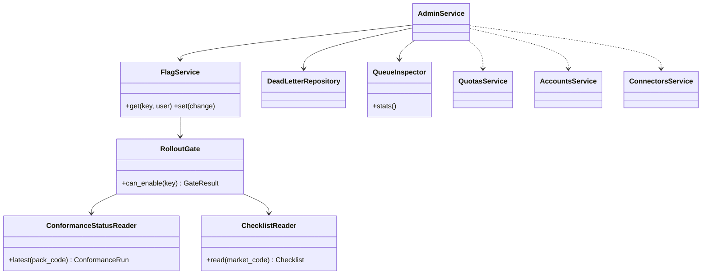
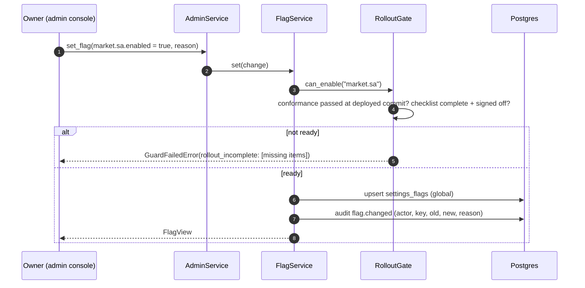
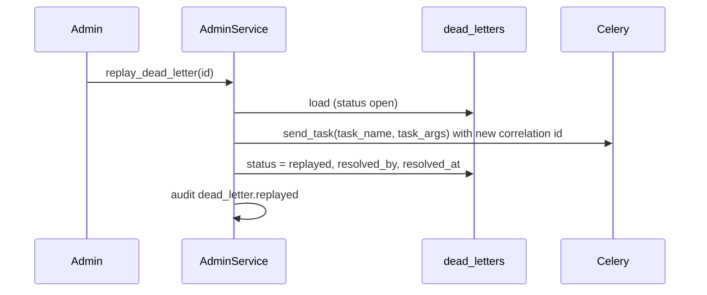

# LLD — admin

| | |
|---|---|
| Status | Draft for owner review |
| Version | 0.1 (2026-10-30) |
| Owner module | `jobradar.admin` (services) + admin console screens in the web app |
| PRD stories | US-4.6, US-10.8, US-10.10, US-7.1 (ops visibility) |
| ADRs | 0017 (roles, support grants), 0019 (abuse), 0023 (cost per MAU), 0024 (rollout flags), 0011 (dead letters) |
| Phase | 4 (flag service, pause), 7 (ops views), 10 (full console: users, abuse, invites, support grants, TOTP) |

## 1. Responsibilities

- Read-only operational views: connector health, queues, dead letters, LLM usage and cost per MAU,
  users overview (no content), abuse review queue, market/role rollout status.
- Admin actions: replay or discard dead letters, change feature flags, apply or lift restrictions,
  change plan overrides, create invites, review company suggestions shared across users (catalogue
  only).
- **Flag service** with guard rules: refuse to enable `market.<code>.enabled` or
  `role.<code>.enabled` unless the pack's latest conformance run on `main` is green and its rollout
  checklist is complete (ADR-0024).
- Content access only through an active **support grant** (accounts), every use audited.

### Must NOT do
- Must not read user content (profiles, CVs, documents, emails, answers, applications' payloads)
  without an active support grant covering the needed scope.
- Must not impersonate users or act on their behalf (no "log in as user").
- Must not submit, transition or delete applications (admin state corrections go through
  `lifecycle.transition` with trigger `admin`, reason required, audited — owner only).
- Must not bypass global ceilings or RLS; it uses the `jobradar_admin` role and services.
- Must not expose secrets (tokens, encrypted columns) in any view.

## 2. Public interface (typed)

```python
class FlagChange(BaseModel):
    key: str
    scope: Literal["global", "user"]
    user_id: UUID | None = None
    value: JsonValue
    reason: str


class AdminService(Protocol):
    async def connector_status(self, scope: UserScope) -> list[ConnectorHealth]:
        ...
        # last run, status, freshness, found/new 7-day series, degraded reason

    async def queues(self, scope: UserScope) -> list[QueueStats]: ...  # depth, oldest age, workers
    async def dead_letters(
        self, scope: UserScope, status: str = "open", page: PageReq = ...
    ) -> Page[DeadLetterView]: ...
    async def replay_dead_letter(
        self, scope: UserScope, dead_letter_id: UUID
    ) -> UUID: ...  # new task id
    async def discard_dead_letter(
        self, scope: UserScope, dead_letter_id: UUID, reason: str
    ) -> None: ...

    async def flags(self, scope: UserScope, user_id: UUID | None = None) -> list[FlagView]: ...
    async def set_flag(self, scope: UserScope, change: FlagChange) -> FlagView:
        ...
        # Raises GuardFailedError(rollout_incomplete | conformance_failing) for market/role flags

    async def users_overview(self, scope: UserScope, q: UserQuery) -> Page[UserOpsView]:
        ...
        # id, created_at, status, role, plan, last_active, usage ratios, restriction flags — no content

    async def set_role(self, scope: UserScope, user_id: UUID, role: Role) -> None: ...  # owner only
    async def set_plan(
        self, scope: UserScope, user_id: UUID, plan_code: str, overrides: PlanLimits | None
    ) -> None: ...

    async def abuse_queue(self, scope: UserScope) -> list[AbuseCase]: ...
    async def review_abuse(self, scope: UserScope, case_id: UUID, decision: AbuseDecision) -> None:
        ...
        # confirm employer report, apply cooldown/suspend, lift restriction

    async def llm_usage(self, scope: UserScope, period: DateRange) -> LlmUsageReport:
        ...
        # tokens/cost by task, tier, plan; cost per MAU; Tier 2 coverage; budget status

    async def rollout_status(self, scope: UserScope) -> list[RolloutStatus]:
        ...
        # per market and role: conformance (last run, commit), golden, synthetic, UI matrix, translations, sign-off

    async def view_user_content(
        self, scope: UserScope, user_id: UUID, what: ContentScope
    ) -> ContentView:
        ...
        # requires accounts.check_support(); audited `support_grant.used`
```

All methods call `require_role(scope, ADMIN, OWNER)`; `set_role` and admin state corrections need
`OWNER`. From Phase 4 (TOTP ships with sign-in, database.md §9) admin/owner sessions must also have
`mfa_verified_at` set. `llm_usage` delegates to `insights.system_cost` and
`insights.tier2_coverage`; `connector_status` to `connectors.list_sources`.

### API request/response models

Mirrors `docs/openapi.yaml` `components/schemas`: same names, fields, enums and optionality (Step 4 review: the LLD is the single source of truth, the spec must match it). Optional fields are `T | None = None` and serialized with `exclude_none`; `XPage = Page[X]` is the cursor envelope from `docs/lld/README.md`; `# read-only` fields are ignored on input. Types not defined here come from their owning module (see the shared-model ownership table in `docs/lld/README.md`).

```python
class AbuseKind(StrEnum):
    BURST = "burst"
    LOW_RESPONSE_RATE = "low_response_rate"
    EMPLOYER_REPORT = "employer_report"
    DUPLICATE_ATTEMPT = "duplicate_attempt"
    CAP_PROBE = "cap_probe"


class AbuseReview(BaseModel):
    model_config = ConfigDict(extra="forbid")
    decision: Literal["dismiss", "cooldown", "suspend"]
    days: int | None = None
    reason_key: str


class AbuseReviewResult(BaseModel):
    signal: AbuseSignal
    restriction: Restriction | JsonValue | None = None


class AbuseSignal(BaseModel):
    id: UUID  # read-only
    user_id: UUID
    kind: AbuseKind
    severity: int
    detail: dict[str, JsonValue]
    created_at: datetime  # read-only
    reviewed_at: datetime | None = None


AbuseSignalPage = Page[AbuseSignal]


class AdminUserRow(BaseModel):
    """Directory data only; never profile or application content."""
    id: UUID  # read-only
    email: EmailStr
    role: Role
    status: UserStatus
    plan_code: str | None = None
    created_at: datetime  # read-only


AdminUserRowPage = Page[AdminUserRow]


class AuditEntry(BaseModel):
    id: UUID  # read-only
    actor_user_id: UUID | None = None
    subject_user_id: UUID | None = None
    action: str
    target_type: str | None = None
    target_id: UUID | None = None
    detail: dict[str, JsonValue]
    correlation_id: UUID | None = None
    created_at: datetime  # read-only


AuditEntryPage = Page[AuditEntry]


class CompanyCheck(BaseModel):
    company_id: UUID
    name: str
    ats: str | None = None
    result: Literal["valid", "not_found", "no_target_postings", "error"]


class ConnectorStatus(BaseModel):
    connector: str
    enabled: bool
    status: SourceRunStatus
    last_run_at: datetime | None = None
    last_success_at: datetime | None = None
    jobs_found_7d: int
    jobs_new_7d: int
    error_rate_7d: float
    degraded_reason: str | None = None


ConnectorStatusPage = Page[ConnectorStatus]


class DeadLetter(BaseModel):
    id: UUID  # read-only
    task_name: str
    task_args: dict[str, JsonValue]
    user_id: UUID | None = None
    error_type: str
    error_message: str
    attempts: int
    status: DeadLetterStatus
    created_at: datetime  # read-only
    resolved_at: datetime | None = None


DeadLetterPage = Page[DeadLetter]


class DeadLetterStatus(StrEnum):
    OPEN = "open"
    REPLAYED = "replayed"
    DISCARDED = "discarded"


class Flag(BaseModel):
    key: str
    scope: Literal["global", "user"]
    value: dict[str, JsonValue]
    updated_at: datetime  # read-only
    updated_by: UUID | None = None


FlagPage = Page[Flag]


class FlagUpdate(BaseModel):
    """`value` is the flag's JSON value (boolean for toggles)."""
    model_config = ConfigDict(extra="forbid")
    value: dict[str, JsonValue]


class InviteCreate(BaseModel):
    model_config = ConfigDict(extra="forbid")
    email: EmailStr | None = None
    plan_code: str
    expires_at: datetime


class InviteCreated(BaseModel):
    """Invite code shown once."""
    id: UUID  # read-only
    code: str
    expires_at: datetime


class LaneStatus(BaseModel):
    lane: Lane
    enabled: bool
    live_submit: bool
    applied_today: int
    daily_cap: int | None = None


class LlmUsage(BaseModel):
    range: DateRange
    tokens_total: int
    cost_usd: Decimal  # Decimal as string
    cost_per_mau_usd: Decimal | None = None  # Decimal as string
    mau: int
    tier2_coverage: RateStat
    by_task: dict[str, int]
    by_model_tier: dict[str, int]
    cache_hit_rate: float | None = None


class PauseRequest(BaseModel):
    model_config = ConfigDict(extra="forbid")
    scope: Literal["user", "global"] | None = None
    reason: str | None = None


class PlanAssignment(BaseModel):
    model_config = ConfigDict(extra="forbid")
    plan_code: str
    overrides: dict[str, int] | None = None
    reason: str


class QueueStats(BaseModel):
    queue: str
    depth: int
    oldest_task_age_s: float
    p95_latency_s: float | None = None
    workers: int


QueueStatsPage = Page[QueueStats]


class Restriction(BaseModel):
    id: UUID  # read-only
    kind: RestrictionKind
    reason_key: str
    starts_at: datetime
    ends_at: datetime | None = None


class RestrictionKind(StrEnum):
    COOLDOWN_AUTOMATION = "cooldown_automation"
    SUSPEND = "suspend"


class RoleUpdate(BaseModel):
    model_config = ConfigDict(extra="forbid")
    role: Role
    reason: str


class RolloutChecklistItem(BaseModel):
    code: str
    done: bool
    evidence: str | None = None


class RolloutStatus(BaseModel):
    kind: Literal["market", "role"]
    code: str
    enabled: bool
    conformance_green: bool
    checklist: list[RolloutChecklistItem]
    blocked_by: list[Literal["rollout_incomplete", "conformance_failing"]]


RolloutStatusPage = Page[RolloutStatus]


class SourceRunStatus(StrEnum):
    RUNNING = "running"
    OK = "ok"
    PARTIAL = "partial"
    FAILED = "failed"
    DEGRADED = "degraded"


class StatusSummary(BaseModel):
    paused: bool
    global_paused: bool
    lanes: list[LaneStatus]
    applied_today: int
    open_questions: int
    followups_due: int
    interviews_today: int
    restriction: MessageRef | JsonValue | None = None


class UserContent(BaseModel):
    """Returned only under an active support grant; limited to the granted scope; every read is audited."""
    grant_id: UUID
    scope: list[str]
    profile: ProfileResponse | JsonValue | None = None
    applications: list[ApplicationView] | None = None
    expires_at: datetime


class UserPlan(BaseModel):
    user_id: UUID
    plan_code: str
    overrides: dict[str, int] | None = None
    started_at: datetime


class VerifyCompaniesResult(BaseModel):
    checked: int
    results: list[CompanyCheck]
```

## 3. Internal design



`FlagService` is the single writer of `settings_flags`; Telegram `/flag` and `/pause` and the web
pause button call it too, so every change has the same audit and gate logic. It lives in `core`
(used by all domains to read flags); the admin domain exposes the write path.

**Conformance status source:** CI publishes `conformance-results.json` (pack code, commit SHA,
checks, passed) as a release artifact; the deploy step loads it into the app's config volume.
`RolloutGate` refuses when the file is missing, stale (commit ≠ deployed commit), or the pack's
entry failed. **Checklist source:** `docs/markets/<code>.md` front matter (all items `done` +
`signed_off_by` + date), packaged with the deploy.

### Enabling a market



### Dead-letter replay



Tasks are idempotent (ADR-0011), so replay is safe; `apply_one` dead letters are replayable only
when the attempt never reached `submitting`.

## 4. Data owned

Writes (through owning services where they exist): `settings_flags` (via `FlagService`),
`dead_letters` (`status` in `open`,`replayed`,`discarded`; `resolved_at`, `resolved_by`),
`invites` (via accounts), `user_plans` and `user_restrictions` (via quotas), `abuse_signals.reviewed_*`
(via quotas). Reads: `source_runs`, `llm_calls`, `users` (ops columns only), `audit_log`.

Indexes relied on: `ix_source_runs_connector_started_at`, `ix_llm_calls_task_created_at`,
`ix_llm_calls_user_id_created_at`, `ix_audit_log_action_created_at`, settings_flags unique indexes.

## 5. Error handling, retries, idempotency

- Gate refusal → `GuardFailedError` with a list of missing checklist items (API 409).
- Replay of an already replayed dead letter → `ConflictError`.
- Flag writes are idempotent (same value → no-op, no audit row).
- Queue inspection errors (Redis down) → partial view with an "unavailable" marker, never a 500 for
  the whole console.

## 6. Config and feature flags

| Setting | Default |
|---|---|
| `admin.conformance_results_path` | `/app/release/conformance-results.json` |
| `admin.markets_checklists_dir` | `docs/markets/` (packaged) |
| `admin.users_page_size` | 50 |
| Flags managed | the full list in `docs/lld/README.md` → Canonical identifiers → Flags |

## 7. Metrics and log events

Metrics: `admin_actions_total{action}`, `dead_letters_open`, `flags_changed_total{key_prefix}`,
`rollout_gate_refusals_total{kind}`.

Log/audit events: `flag.changed`, `dead_letter.replayed`, `dead_letter.discarded`,
`restriction.applied`, `restriction.lifted`, `plan.changed`, `role.changed`, `invite.created`,
`support_grant.used`, `application.corrected`.

## 8. Security and privacy notes

- Admin endpoints under `/api/v1/admin`, require role + TOTP-verified session or `admin_api`
  token with matching scope.
- Users overview never shows email, name or content; IDs and ops data only. Email lookup for
  support uses an exact-match search that returns a user ID only, and is audited.
- Content views require a support grant; the user sees grant usage in their audit view.
- Rate limits on admin write endpoints.

## 9. Test plan

Unit: `RolloutGate` with missing results file, stale commit, failing pack, incomplete checklist,
complete → allowed; flag scope constraint (`global` requires no user_id).

Integration:
- Admin without TOTP → 403 on every admin endpoint (from Phase 4).
- `users_overview` response schema has no content fields (schema assertion) for a user with full data.
- `view_user_content` without grant → denied; with grant → allowed + audit; expired grant → denied.
- Enabling `market.sa.enabled` with failing conformance → refused; with green + signed checklist →
  enabled and audited.
- Dead-letter replay creates a task with the same args and marks the row `replayed`; second replay
  → conflict; `apply_one` letter past `submitting` → refused.
- `PAUSE_ALL` set via admin is immediately visible to apply guards (cache TTL ≤ 5 s).
- LLM usage report: cost per MAU equals sum of `llm_calls.cost_usd_micros` ÷ active users on fixture data.

Isolation: a `user`-role session gets 404 on every admin endpoint (no existence leak).

## 10. Open questions

1. Whether `admin` (not only `owner`) may change plans and restrictions in Stage 2.
2. Hosting the conformance results: release artifact (proposed) vs a table written by CI.
