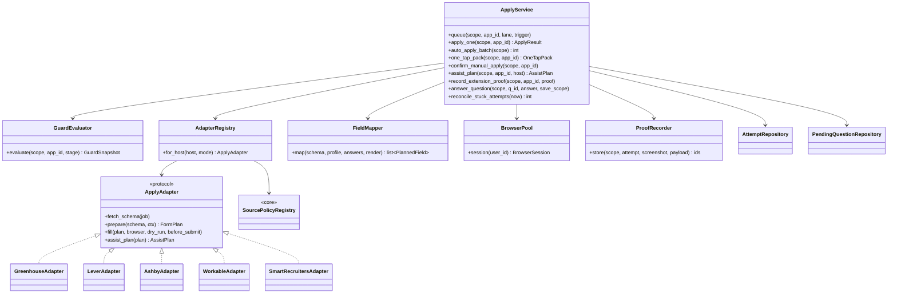

# LLD — Apply

| | |
|---|---|
| Status | Draft for owner review |
| Version | 0.1 (2026-10-30) |
| Owner module | `jobradar.apply` |
| PRD stories | US-5.3, US-5.4, US-5.5, US-6.1, US-8.2/8.3 (assist plans, served to the extension) |
| ADRs | 0003 (one-tap lanes), 0011 (queues), 0016 (extension), 0019 (quotas, anti-abuse), 0022 (source policies) |
| Phase | 5 (dry-run), 6 (live), 8 (assist) |

## 1. Responsibilities

- Run the **apply pipeline** for queued applications by lane:
  - `auto` and `careful`: server-side Playwright adapters, careful through the runner in Phase 8
  - `assisted`: an assist plan for the extension, and the user submits
  - `one_tap`: a prepared pack, and the user applies manually
- `ApplyAdapter` plug-ins: `prepare(job) -> FormPlan`, `fill(plan, dry_run) -> ApplyResult`,
  `assist_plan(host, job) -> AssistPlan`. Greenhouse, Lever and Ashby come first, then Workable
  and SmartRecruiters.
- **Evaluate guards** (state-machine.md §7) when queueing and **again immediately before
  submit**.
- **Proof:** screenshot plus a payload snapshot plus prompt and model versions for every dry-run
  and submission.
- **Unknown screening questions:** create `pending_questions`, notify the user, pause with
  `state_reason=awaiting_answer`, and resume once answered.
- **Reconcile** attempts stuck in `submitting` to `needs_review`. It never resubmits.
- Record outcomes through `lifecycle.transition` and consume quotas.

### Must NOT do
- **Must not contain submit, autofill, page-reading or click code for any host whose source
  policy is `one_tap` only** (LinkedIn, Indeed, Bayt, Naukrigulf, GulfTalent, and unknown hosts).
  The adapter registry refuses such registrations, and a test enforces it.
- Must not submit when any guard fails, when `dry_run` is true, or without the lane's live-submit
  flag.
- Must not retry automatically after the submit click.
- Must not let LLM output decide to submit, pick a lane, or fill a field with content that isn't
  from the profile, the answer bank or a document render.
- Must not answer screening questions with generated text. Answers come only from the answer bank
  or profile facts, through deterministic mapping.
- Must not store portal credentials or cookies. Server adapters only target public ATS forms that
  don't need a login.
- Must not write `applications.state` directly.

## 2. Public interface

```python
class Lane(StrEnum):
    AUTO = "auto"; CAREFUL = "careful"; ASSISTED = "assisted"; ONE_TAP = "one_tap"

class FieldSource(BaseModel):
    kind: Literal["profile", "answer_bank", "document", "constant_consent"]
    ref: str                          # profile path, answer_bank id, document_render id
    toggle: str | None = None         # CV field toggle name if gated

class PlannedField(BaseModel):
    field_id: str                     # ATS field identifier
    label: str                        # untrusted, from the form schema
    field_type: Literal["text", "textarea", "select", "multiselect", "boolean",
                        "number", "date", "file"]
    required: bool
    value_source: FieldSource | None  # None = unknown question
    value_preview: str | None         # resolved value (not logged)

class FormPlan(BaseModel):
    adapter: str
    job_id: UUID
    application_id: UUID
    apply_url: str
    fields: list[PlannedField]
    unknown_required: list[str]       # field_ids with no source
    document_render_id: UUID | None
    schema_hash: str                  # hash of the ATS form schema used

class ApplyResult(BaseModel):
    attempt_id: UUID
    status: Literal["dry_run_done", "submitted", "failed", "needs_review",
                    "awaiting_answer", "aborted"]
    error_code: str | None = None
    screenshot_file_id: UUID | None
    payload_file_id: UUID | None
    guard_snapshot: GuardSnapshot | None   # lifecycle.GuardSnapshot (state-machine.md §6)

class AssistField(BaseModel):
    selector_hint: SelectorHint       # label text, name, ATS field ID; never raw CSS from an LLM
    field_type: Literal["text", "textarea", "select", "multiselect", "boolean",
                        "number", "date", "file"]
    value: str | list[str] | None     # from profile/answer bank/document; None = unknown
    source: Literal["profile", "answer_bank", "document", "unknown"]
    question_text: str | None         # escaped; set for unknown questions

class AssistPlan(BaseModel):
    """Served to the extension for hosts whose policy allows extension_assist. No submit instruction."""
    application_id: UUID
    host: str
    adapter: str                      # greenhouse, lever, ashby, workable, smartrecruiters
    fields: list[AssistField]
    files: list[SignedFileRef]        # CV / cover note renders, 10-minute signed URLs
    guards: GuardSummary              # allowed + reason keys if not
    plan_version: str

class ExtensionProof(BaseModel):      # sent by the extension after the user clicked submit
    screenshot: UploadRef
    submitted_values: dict[str, str | list[str] | None]   # field_id -> value as filled/typed
    plan_version: str
    client_version: str

class ExternalAttemptResult(BaseModel):   # runner outcome, passed on by runner.report_result
    attempt_id: UUID
    outcome: Literal["submitted", "dry_run_done", "failed", "needs_review", "aborted"]
    error_code: str | None = None
    unknown_questions: list[UnknownQuestion] = []
    screenshot_file_id: UUID | None = None
    payload_file_id: UUID | None = None

async def queue(scope: UserScope, application_id: UUID, *, lane: Lane,
                trigger: TransitionTrigger) -> None:
    """matched → queued via lifecycle.transition(to=queued, lane=lane) after guard evaluation
    (system trigger) or user action. `GuardEvaluator` wraps lifecycle.evaluate_guards.

    Raises: GuardFailedError, NotFoundError.
    """

async def apply_one(scope: UserScope, application_id: UUID) -> ApplyResult:
    """Celery task body (queue `apply`). Idempotent per application and attempt."""

async def auto_apply_batch(scope: UserScope) -> int:
    """Picks queued auto-lane applications for this user under caps; returns count started."""

async def one_tap_pack(scope: UserScope, application_id: UUID) -> OneTapPack:
    """Delegates content to documents; sets state_reason=awaiting_user."""

async def confirm_manual_apply(scope: UserScope, application_id: UUID) -> None:
    """"I applied" from web, Telegram or the extension side panel → lifecycle applied (U)."""

async def assist_plan(scope: UserScope, url: HttpUrl) -> AssistPlan:
    """Resolves the job by URL (normalizer.find_job_by_url), creates or reuses the application
    (lane `assisted`, via lifecycle), runs guards (stage `assist`) and builds the plan.

    Raises PermissionDeniedError if the host policy does not allow extension_assist.
    """

async def record_extension_proof(scope: UserScope, application_id: UUID,
                                 proof: ExtensionProof) -> ApplicationView:
    """After the user submits in the browser: creates an attempt (mode `assist`, status
    `submitted`) with proof, consumes `applications.assisted`, then
    lifecycle.transition(queued -> applied, trigger=extension, applied_via=extension)."""

async def complete_external_attempt(scope: UserScope, result: ExternalAttemptResult) -> None:
    """Runner outcome (Phase 8): updates the attempt, creates pending_questions, keeps or
    releases quota, and calls lifecycle.transition (trigger=runner, applied_via=runner)."""

async def open_question_count(scope: UserScope) -> int: ...   # digest counts (notify)

async def answer_question(scope: UserScope, question_id: UUID, answer: str,
                          save_scope: Literal["global", "market", "company"]) -> None:
    """Saves to answer bank via profile, marks question answered, resumes when none open."""

async def reconcile_stuck_attempts(now: datetime) -> int:   # system task
```

Plug-in protocol (entry point group `jobradar.apply_adapters`):

```python
class ApplyAdapter(Protocol):
    code: str  # "greenhouse", "lever", ...
    hosts: frozenset[str]  # e.g. {"boards.greenhouse.io", "job-boards.greenhouse.io"}
    modes: frozenset[Literal["server_apply", "extension_assist"]]

    async def fetch_schema(self, job: JobView) -> FormSchema: ...  # public endpoint, httpx
    def prepare(self, schema: FormSchema, ctx: MappingContext) -> FormPlan: ...  # pure
    async def fill(
        self,
        plan: FormPlan,
        browser: BrowserSession,
        *,
        dry_run: bool,
        before_submit: Callable[[], Awaitable[GuardSnapshot]],
    ) -> FillOutcome: ...
    def assist_plan(self, plan: FormPlan) -> AssistPlan: ...  # pure
```

The registry validates each adapter at startup. Every host must have a source policy entry
allowing each declared mode, otherwise startup fails. That makes adapters impossible to register
for `one_tap` hosts.

### API request/response models

Mirrors `docs/openapi.yaml` `components/schemas`: same names, fields, enums and optionality (Step 4 review: the LLD is the single source of truth, the spec must match it). Optional fields are `T | None = None` and serialized with `exclude_none`; `XPage = Page[X]` is the cursor envelope from `docs/lld/README.md`; `# read-only` fields are ignored on input. Types not defined here come from their owning module (see the shared-model ownership table in `docs/lld/README.md`).

```python
class AnswerQuestionRequest(BaseModel):
    model_config = ConfigDict(extra="forbid")
    answer: str | None = None
    dismiss: bool | None = None
    save_to_bank: bool | None = None
    scope: AnswerScope | None = None
    scope_value: str | None = None


class AttemptMode(StrEnum):
    DRY_RUN = "dry_run"
    LIVE = "live"
    ASSIST = "assist"
    ONE_TAP = "one_tap"


class AttemptStatus(StrEnum):
    PREPARING = "preparing"
    AWAITING_ANSWER = "awaiting_answer"
    FILLING = "filling"
    SUBMITTING = "submitting"
    SUBMITTED = "submitted"
    DRY_RUN_DONE = "dry_run_done"
    FAILED = "failed"
    NEEDS_REVIEW = "needs_review"
    ABORTED = "aborted"


class AttemptView(BaseModel):
    id: UUID  # read-only
    adapter: str
    mode: AttemptMode
    status: AttemptStatus
    error_code: str | None = None
    screenshot: SignedFileRef | JsonValue | None = None
    payload: SignedFileRef | JsonValue | None = None
    started_at: datetime
    finished_at: datetime | None = None


AttemptViewPage = Page[AttemptView]


class ConfirmAppliedRequest(BaseModel):
    model_config = ConfigDict(extra="forbid")
    applied_at: datetime | None = None
    note: str | None = None


class DryRunReview(BaseModel):
    reviewed_at: datetime
    attempt_ids: list[UUID]
    live_submit_unlocked: bool


class DryRunReviewRequest(BaseModel):
    model_config = ConfigDict(extra="forbid")
    attempt_ids: list[UUID]
    confirmed: bool


class FieldType(StrEnum):
    TEXT = "text"
    TEXTAREA = "textarea"
    SELECT = "select"
    MULTISELECT = "multiselect"
    BOOLEAN = "boolean"
    NUMBER = "number"
    DATE = "date"
    FILE = "file"


class Question(BaseModel):
    id: UUID  # read-only
    application_id: UUID
    question_text: UntrustedText
    field_type: FieldType
    options: list[str] | None = None
    status: Literal["open", "answered", "dismissed"]
    created_at: datetime  # read-only


QuestionPage = Page[Question]


class QueueRequest(BaseModel):
    model_config = ConfigDict(extra="forbid")
    lane: Lane
    resume_variant_id: UUID | None = None
    field_toggles: FieldToggles | None = None
```

## 3. Internal design



### 3.1 Server-side apply (auto lane)

```mermaid
sequenceDiagram
    autonumber
    participant B as beat (10/14/18 local)
    participant S as ApplyService
    participant Gd as GuardEvaluator
    participant L as lifecycle
    participant D as documents
    participant Ad as Adapter
    participant Br as Playwright
    participant Pr as ProofRecorder
    participant Q as quotas
    participant N as notify

    B->>S: auto_apply_batch(user)
    S->>S: acquire lock:apply:{user_id}
    loop queued auto-lane apps (oldest first, under caps)
        S->>Gd: evaluate(pre-start)
        alt guard fails
            S->>L: keep queued, state_reason=blocked_by_guard
        else ok
            S->>S: insert apply_attempt(status=preparing, mode=dry_run|live)
            S->>D: render(cv, job, toggles)
            S->>Ad: fetch_schema → prepare(FormPlan)
            alt unknown required questions
                S->>S: pending_questions rows; attempt=awaiting_answer
                S->>L: state_reason=awaiting_answer
                S->>N: question notification(s)
            else plan complete
                S->>Ad: fill(plan, browser, dry_run, before_submit)
                Ad->>Br: navigate, fill fields, upload CV (human-like delays)
                Ad->>S: before_submit() callback
                S->>Gd: evaluate(pre-submit) — re-read flags, caps, pause, restrictions
                alt dry_run or guard fails
                    Ad->>Br: screenshot (no click)
                    S->>Pr: store proof → attempt=dry_run_done | aborted
                else live and guards pass
                    S->>Q: consume(applications.auto, applications.total, applications.per_employer, idempotency_key=attempt_id)
                    alt any quota denied
                        S->>S: attempt=aborted, state_reason=blocked_by_guard, release earlier reservations
                    else reserved
                        S->>S: attempt=submitting (committed BEFORE click)
                        Ad->>Br: click submit, wait for confirmation
                        Ad->>Br: screenshot
                        S->>Pr: store proof → attempt=submitted (+ submitted_payload, document_render_id)
                        S->>L: transition(queued→applied, S, detail.attempt_id, applied_via=server)
                    end
                end
            end
        end
        S->>S: random delay (lane.delay_seconds range)
    end
    S->>S: release lock
```

### 3.2 Unknown-question flow

1. `FieldMapper` maps each form field in order:
   - exact `question_fingerprint` match in `answer_bank`
   - a scoped match: company, then market, then global
   - a fuzzy trigram match at or above `apply.answer_match_threshold` (0.85). The fuzzy match is
     **suggested to the user, never auto-used**.
   - deterministic profile mappings: name, email, phone, location, notice period, salary
     expectation in the job's currency if the user has one, links, CV file.
2. A required field with no source creates a `pending_questions` row with the escaped label,
   type and options. The attempt goes to `awaiting_answer`, and the application keeps
   `state_reason=awaiting_answer`.
3. A `question` notification goes out on the user's channels, with the answer UI and a save scope
   that defaults to `market` for the job's market.
4. `answer_question` saves the answer through `profile.save_answer(scope, question, answer, ctx,
   scope_kind=save_scope)` (always stored with `source = user`). When no
   questions remain open, `apply_one` is re-enqueued. The same attempt resumes from `preparing`
   with a new form plan, because the form schema may have changed and its `schema_hash` is
   compared.
5. Optional non-required fields without a source are left empty. They are never guessed.

### 3.3 One-tap and assisted lanes

- **One-tap** is used when the host policy is `one_tap` only, or the user picked it:
  - `documents.one_tap_pack` produces the CV, cover note, prepared answers and link.
  - The application gets `state_reason=awaiting_user`.
  - "I applied" (web, Telegram, extension side panel) → `confirm_manual_apply` →
    `lifecycle.transition(queued→applied, U)` with `applied_via=manual`.
  - A reminder goes out after 3 days.
- **Assisted** is used when the host policy allows `extension_assist` and the user has the
  extension:
  - `assist_plan` returns field values and selector hints. It contains no submit instruction.
  - The extension fills the fields and the user reviews and submits.
  - `record_extension_proof` stores the proof and transitions with trigger `X`,
    `applied_via=extension`.
  - The guards run in `assist_plan` and again in `record_extension_proof`. If the second check
    fails, the proof is still stored, because the user already submitted. The transition is
    recorded and the guard failure is logged as a guardrail event; from Phase 10 (when
    `abuse_signals` exists) it is also recorded via `quotas.record_signal(kind=cap_probe)`.
- **Careful** (Phase 8, runner only): `queue` with lane `careful` creates an attempt and calls
  `runner.enqueue(scope, application_id, attempt_id, kind=apply_careful)`; the runner's outcome comes back
  through `complete_external_attempt`. Quota `applications.assisted` is reserved at lease time and
  released if the outcome is not `submitted`.

### 3.4 Reconciler

`reconcile_stuck_attempts` runs every 10 minutes. It finds attempts with `status='submitting'`
and `started_at` older than the hard time limit (360 s), sets them to `needs_review`, sets the
application `state_reason=needs_review`, and notifies the user with the last screenshot, if any.
The user confirms the outcome: applied (`U`), or failed, which they may re-queue. It never
resubmits automatically (F10).

## 4. Data owned

| Table | Access | Notes |
|---|---|---|
| `apply_attempts` (database.md §3.8) | read/write | statuses as listed there; `ix_apply_attempts_status_submitting` for the reconciler |
| `pending_questions` (§3.8) | read/write | |
| `applications` | read only. `lane` is set by `lifecycle.transition(→ queued, lane=…)`; `applied_via` and the proof/document/payload columns are copied by lifecycle from the attempt referenced in `detail.attempt_id` on `→ applied` | `uq_applications_idempotency_key`, per-employer index for caps |
| `files` | write via `FileStore` | kinds `screenshot`, `payload_snapshot` |
| `answer_bank` | via profile service | |

jsonb models defined here:
- `apply_attempts.form_plan: FormPlan`. Values are not stored; only the source refs are.
- `apply_attempts.guard_snapshot`: `GuardSnapshot` (model owned by lifecycle)
- `apply_attempts.submitted_payload`: `SubmittedPayload` (below); `apply_attempts.document_render_id`
- `applications.submitted_payload: SubmittedPayload`. It holds the field ID → value as
  submitted, the field toggles, the answer-bank IDs used, the document render ID, the
  prompt/model versions of the render, the adapter code and version, and the schema hash. The
  full payload JSON also goes to object storage (`payload_snapshot`).

## 5. Error handling, retries, idempotency

| Situation | Handling |
|---|---|
| Schema fetch: 429, 5xx or timeout | Retry with backoff + jitter, max 2 (pre-submit only). Then `failed` with `error_code=schema_unavailable`; the user is offered one-tap. |
| Form changed (`schema_hash` differs mid-flow) | Re-prepare once, then fail with `form_changed` and flag the adapter `degraded` |
| Selector missing or Playwright error **before** the click | Screenshot, `failed` with `error_code`, transition `queued→failed` (S), offer one-tap |
| Error **after** the click or no confirmation seen | Attempt stays `submitting` → reconciler → `needs_review`. No retry. |
| Guard fails before submit | `aborted` attempt, `state_reason=blocked_by_guard`; retried by the next batch when the guard clears |
| Worker lost (OOM, crash) | `acks_late` redelivers. `apply_one` checks the latest attempt: `submitting` → leave it for the reconciler; `preparing`/`filling` → start a new attempt; `submitted` → no-op |
| Duplicate task | Redis lock `lock:apply:{user_id}` (TTL 420 s) plus the idempotency key `sha256(user_id, job_id)` unique on applications. A second `applied` transition is a no-op. |
| Quota or counter store unavailable | **Fail closed**: the guard `cap_reached` fails |

**Time limits:**
- the `apply` queue: soft 300 s / hard 360 s
- Playwright: navigation 30 s, each action 10 s, confirmation wait 20 s

**Browser hygiene:** `worker_max_tasks_per_child = 20` for apply workers. A fresh browser context
per attempt, with no persistent profile on the server.

## 6. Config and feature flags

| Key | Default | Notes |
|---|---|---|
| `lane.<lane>.enabled` (global and user flags) | `auto`: off, `careful`: off, `assisted`: on, `one_tap`: on | |
| `apply.live_submit.enabled` (global and user, per lane) | off | `dry_run: false` equivalent; requires a completed dry-run review (`apply.dry_run_reviewed_at` user flag) |
| `PAUSE_ALL` (global and user) | off | |
| Daily caps | plan limits `applications.auto`, `applications.assisted`, `applications.total` (quotas.md) | ≤ global ceilings |
| Per-employer cap | plan limit `applications.per_employer` (rolling 30 days; quotas.md) | default 3, global ceiling 5 |
| `apply.delay_seconds.<lane>` | auto: [45, 180], careful: [120, 600] | random uniform |
| `apply.answer_match_threshold` | 0.85 | fuzzy suggestions only |
| `apply.reconcile_after_seconds` | 360 | |
| `apply.duplicate_title_window_days` | 90 | (user, employer, normalized title) |
| `apply.adapter.<code>.enabled` | on once its fixtures pass | per adapter |

Source policy modes used: `server_apply`, `extension_assist`, `one_tap`.

## 7. Metrics and log events

Metrics:
- `apply_attempts_total{adapter, mode, status}`
- `apply_guard_failures_total{guard}`
- `apply_unknown_questions_total{adapter}`
- `apply_needs_review_total`
- `apply_fill_duration_seconds{adapter}`
- `apply_queue_depth{lane}`
- `apply_duplicates_blocked_total`

Log events (no field values, no labels text):
- `apply.attempt_started` (user_id, application_id, attempt_id, adapter, mode)
- `apply.guard_evaluated` (attempt_id, stage=pre_start|pre_submit, failed_guards)
- `apply.unknown_questions` (attempt_id, count)
- `apply.submitted` (attempt_id, adapter, duration_ms)
- `apply.dry_run_done` (attempt_id)
- `apply.failed` (attempt_id, error_code)
- `apply.needs_review` (attempt_id)

Audit: `application.submitted` and `application.dry_run` with the attempt ID.

## 8. Security and privacy

- Form labels, options and page content are untrusted. They are shown escaped and are never sent
  to the LLM as instructions. The LLM isn't used in apply at all; only documents use it,
  upstream.
- The CV file is uploaded from encrypted storage through a short-lived decrypted temp file in
  the worker, deleted after the attempt.
- Screenshots may contain personal data. They are stored encrypted with `kind=screenshot` and
  follow the retention in database.md §6.
- Every service call is scoped. Per-user locks and RLS on `apply_attempts` and
  `pending_questions`.

## 9. Test plan

**Unit**
- `GuardEvaluator`: each guard independently failing (paused, lane_disabled, restricted,
  below_quality, cap_reached, duplicate, source_policy, consent_missing, deleting), plus all
  passing. Snapshot values are recorded.
- `FieldMapper`:
  - an exact fingerprint match is used
  - market-scoped beats global for a UAE job
  - a fuzzy 0.9 match gives a suggestion but leaves the field unknown
  - required with no source gives an unknown; optional with no source is left empty
- `AdapterRegistry`:
  - registering an adapter whose hosts include `www.linkedin.com`, `www.indeed.com`, `bayt.com`,
    `naukrigulf.com` or `gulftalent.com` fails startup
  - an unknown host resolves to one-tap

**Fixture tests per adapter** (no live sites)
- Saved form schemas (JSON) and saved HTML pages served by a local test server. Playwright fills
  in `dry_run=True`. Assert:
  - field values are as expected
  - the CV upload is present
  - there is no network request to the submit endpoint
  - a screenshot file is created

**Integration** (testcontainers, local form server)
- A live mode against the local server: the submit endpoint is called exactly once, and the
  application ends `applied` with proof.
- Crash after the click (the test kills the browser after the click) → attempt `submitting` →
  reconciler → `needs_review`. The submit endpoint is called once in total.
- `PAUSE_ALL` set between pre-start and pre-submit → `aborted`, no submit call.
- Per-employer cap: the 4th application to the same company within 30 days is blocked
  (`cap_reached`).
- Duplicate: two `apply_one` tasks for one application → one attempt.
- Unknown-question flow end to end: question created, answered, resumed, submitted (dry-run).

**Policy tests (CI)**
- Grep-style test: no module under `apply/adapters/` references a host whose policy is `one_tap`
  only.
- The extension manifest test (owned by the extension LLD) uses the same policy registry.

**Synthetic**
- `syn-01` dry-run on Greenhouse and Lever fixtures produces expected payload snapshots. The
  phase acceptance test runs dry-run on 5 recorded real forms.

**Isolation**
- User B calling `assist_plan`, `answer_question` or `confirm_manual_apply` on user A's IDs gets
  `NotFoundError`.

## 10. Open questions

1. Server-side `careful` lane: before Phase 8, should the careful lane exist only through the
   runner? Proposed: yes. The careful lane is runner-only, and server adapters serve `auto` only.
2. The dry-run review requirement for live submit: is one reviewed dry-run per adapter per user
   enough? Proposed: yes, plus re-review after any adapter version change.
