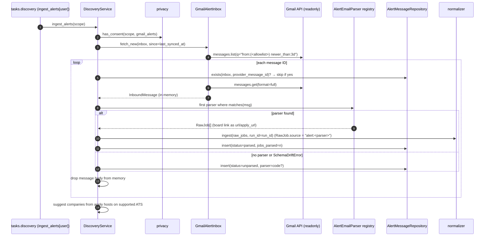

# LLD — `connectors`

| | |
|---|---|
| Status | Draft for owner review |
| Version | 0.1 (2026-10-30) |
| Owner module | `src/jobradar/connectors/` (+ `core/http.py`, `core/gmail.py`) |
| PRD stories | US-2.1, US-2.2, US-2.4, US-2.5, US-2.6, US-2.7, US-2.8, US-2.9, US-11.2 |
| ADRs | 0003, 0008, 0011, 0018, 0022, 0024 |
| Phase | 2 (forwarding inbox: Phase 11) |

## 1. Responsibilities

- Fetch raw job postings from sources and hand them to `normalizer.ingest` as `RawJob` items.
- Run ATS connectors (Greenhouse, Lever, Ashby, Workable, SmartRecruiters) per company in the
  catalogue, and aggregators (Adzuna for covered countries, Remotive).
- Ingest job-alert emails through the `AlertInbox` interface (Gmail now, forwarding address
  later) and parse them with registered `AlertEmailParser`s (LinkedIn, Naukrigulf, Bayt,
  GulfTalent first). Discard bodies after parsing.
- Maintain the shared company catalogue, `jobradar companies verify`, and per-user company
  suggestions for review.
- Load, validate and enforce the **source policy registry** (ADR-0022) for every outbound call.
- Record every run in `source_runs`; detect `degraded` sources (schema drift, 0 jobs, > 70% drop).

### Must NOT do
- No scraping of HTML pages, no logged-in requests, no CAPTCHA handling, no access to any host
  whose policy does not allow the mode (`api`, `ats_feed`, `alert_email`).
- Never fetch or store email beyond the configured alert senders/labels; never store email
  bodies; never read inbox mail for application tracking (that is `lifecycle`, Phase 6, separate
  consent).
- Never normalize, score or dedupe (that is `normalizer`); never write `jobs`.
- Never add a company to the catalogue from a suggestion without user/admin confirmation.

## 2. Public interface (typed)

```python
class RawJob(BaseModel):
    source: SourceCode  # e.g. "greenhouse", "alert:linkedin"
    source_job_id: str  # stable ID from the source (or hash of URL for alerts)
    company_name: str
    company_id: UUID | None = None  # known for ATS connectors
    title: Untrusted[str]
    description: Untrusted[str] | None
    url: HttpUrl
    apply_url: HttpUrl | None
    location_raw: str | None
    country_code: CountryCode | None = None  # only when the source states it (Phase 2d)
    city: str | None = None
    remote: bool | None = None
    posted_at: datetime | None
    salary_raw: str | None = None
    employment_type_raw: str | None = None
    raw: dict[str, JsonValue]  # job payload only; never email body


class SourceRunResult(BaseModel):
    run_id: UUID
    connector: str
    status: Literal["ok", "partial", "failed", "degraded"]
    jobs_found: int
    jobs_new: int
    jobs_updated: int
    items_invalid: int
    http_status_counts: dict[str, int]


class Connector(Protocol):  # plug-in, entry point "jobradar.connectors"
    code: ClassVar[str]
    mode: ClassVar[AccessMode]  # "api" | "ats_feed"
    hosts: ClassVar[tuple[str, ...]]  # must all have source policies

    async def fetch(self, ctx: FetchContext) -> FetchResult: ...


@dataclass(frozen=True)  # implemented 2d: a dataclass, because PoliteClient is not a model
class FetchContext:
    http: PoliteClient  # injected; enforces policy, timeouts, rate limits
    settings: ConnectorSettings  # endpoint config from config/connectors.yaml
    company: CompanyRef | None = None  # for ATS connectors
    # query: SourceQuery for aggregators arrives with Adzuna/Remotive (2e)


@dataclass
class FetchResult:  # implemented 2d
    jobs: list[RawJob]
    items_invalid: int  # items that failed validation (schema drift signal)
    pages: int


class AlertInbox(Protocol):  # entry point "jobradar.alert_inboxes"
    kind: ClassVar[Literal["gmail", "forwarding"]]

    async def fetch_new(
        self, inbox: AlertInboxRow, since: datetime | None
    ) -> AsyncIterator[InboundMessage]: ...


class InboundMessage(BaseModel):
    provider_message_id: str
    sender: str
    received_at: datetime
    subject: Untrusted[str]
    html: Untrusted[str] | None  # in memory only; dropped after parse
    text: Untrusted[str] | None


class AlertEmailParser(Protocol):  # entry point "jobradar.alert_parsers"
    code: ClassVar[str]  # "linkedin", "naukrigulf", "bayt", "gulftalent"

    def matches(self, msg: InboundMessage) -> bool: ...
    def parse(self, msg: InboundMessage) -> list[RawJob]: ...  # pure; raises SchemaDriftError


# SourcePolicy, AccessMode and SourcePolicyRegistry live in jobradar.core.source_policies
# (docs/lld/packs.md): pack schemas in core need AccessMode, and core may not import a domain.
# Fields: id, name, hosts (exact or "*.domain"), company_domains, modes, rate_limit
# (per_minute, burst, per_day), docs_url, terms_url, notes, last_reviewed.
# connectors re-exports policy_for / assert_allowed / hosts_with_mode below as its public API.


# --- service functions ---
async def run_source(connector: str, *, since: datetime | None = None) -> SourceRunResult: ...
async def run_company(company_id: UUID) -> SourceRunResult: ...
async def ingest_alerts(scope: UserScope, *, since: datetime | None = None) -> SourceRunResult: ...
async def list_sources() -> list[SourceInfo]: ...  # admin: status, freshness, degraded
async def verify_companies(company_ids: Sequence[UUID] | None = None) -> list[CompanyCheck]: ...
async def list_company_suggestions(scope: UserScope) -> list[CompanySuggestion]: ...
async def decide_company_suggestion(
    scope: UserScope, suggestion_id: UUID, accept: bool
) -> CompanyRef | None: ...
async def save_job_url(scope: UserScope, url: HttpUrl, title: str) -> UUID:
    ...
    # "Save this job" (web, extension): RawJob(source="saved", URL + title only, no page fetch)
    # → normalizer.ingest → returns job_id. No HTTP request is made to the URL.


async def open_mailbox(
    scope: UserScope, *, purpose: Literal["alerts", "inbox_tracking"]
) -> MailboxHandle:
    ...
    # Gives lifecycle (inbox_tracking, Phase 6) a consent-checked mailbox client built from the
    # user's alert_inboxes connection. purpose="alerts" requires gmail_alerts/forwarding_inbox
    # consent; purpose="inbox_tracking" requires gmail_inbox. The token never leaves connectors.


def policy_for(host: str) -> SourcePolicy: ...  # unknown host → one_tap only
def assert_allowed(host: str, mode: AccessMode) -> None: ...  # raises PermissionDeniedError
def hosts_with_mode(
    mode: AccessMode,
) -> frozenset[str]: ...  # extension manifest build + /ext/status


# Company logo proxy (Phase 4; privacy rule PRD §7.3). Logos are shared corpus data (no user data).
class CompanyLogo(BaseModel):
    content_type: Literal["image/png", "image/jpeg", "image/webp", "image/x-icon"]
    data: bytes
    etag: str  # sha256 of data
    fetched_at: datetime


async def company_logo(company_id: UUID) -> CompanyLogo | None: ...
    # Returns the cached logo from object storage, or None (client shows an initials badge).
    # Never fetches inline: a miss enqueues refresh_logo and returns None immediately.


async def refresh_logo(company_id: UUID) -> None: ...
    # Task on the discovery queue, SYSTEM_SCOPE. Fetches only from https://<companies.domain>
    # (icon links on the homepage, then /apple-touch-icon.png, then /favicon.ico) through
    # PoliteClient under the `company_websites` policy (mode logo_fetch). Rejects SVG and anything
    # not PNG/JPEG/WebP/ICO by magic bytes; max 256 KB; stores under logos/<company_id>;
    # refreshes at most every 30 days; failures set logo_status = unavailable.
```

CLI (US-2.4): `jobradar discover [--source <code>] [--company <id>]` runs `run_source` /
`run_company` for enabled sources and prints per-source counts; it exits non-zero only if every
source failed. `jobradar companies sync|verify` manage the catalogue (US-2.7).

`ingest_alerts` requires an active consent for `gmail_alerts` or `forwarding_inbox`
(`privacy.has_consent`), else `ConsentRequiredError`. Each parsed message consumes
`quotas.consume(scope, alerts.ingested, 1, idempotency_key=provider_message_id)`; when the daily
limit is reached, remaining messages are left for the next run (enforcement `soft` in Stage 1).

### API request/response models

Mirrors `docs/openapi.yaml` `components/schemas`: same names, fields, enums and optionality (Step 4 review: the LLD is the single source of truth, the spec must match it). Optional fields are `T | None = None` and serialized with `exclude_none`; `XPage = Page[X]` is the cursor envelope from `docs/lld/README.md`; `# read-only` fields are ignored on input. Types not defined here come from their owning module (see the shared-model ownership table in `docs/lld/README.md`).

```python
class AccessMode(StrEnum):  # defined in jobradar.core.source_policies; re-exported here
    API = "api"
    ATS_FEED = "ats_feed"
    ALERT_EMAIL = "alert_email"
    EXTENSION_ASSIST = "extension_assist"
    SERVER_APPLY = "server_apply"
    ONE_TAP = "one_tap"
    LOGO_FETCH = "logo_fetch"  # company websites, for the logo proxy only
    NONE = "none"


class CompanySuggestion(BaseModel):
    id: UUID  # read-only
    company_name: str
    apply_host: str
    detected_ats: str | None = None
    detected_slug: str | None = None
    evidence_count: int
    status: SuggestionStatus
    created_at: datetime  # read-only


CompanySuggestionPage = Page[CompanySuggestion]


class GmailConnectRequest(BaseModel):
    model_config = ConfigDict(extra="forbid")
    redirect_uri: HttpUrl


class GmailConnectResponse(BaseModel):
    authorization_url: HttpUrl
    state: str


InboundMail = dict[str, JsonValue]


class InboundMailAccepted(BaseModel):
    accepted: bool


class Inbox(BaseModel):
    id: UUID  # read-only
    kind: InboxKind
    status: InboxStatus
    sender_allowlist: list[str]
    forwarding_address: EmailStr | None = None
    pending_confirmation: MessageRef | JsonValue | None = None
    last_synced_at: datetime | None = None
    consent_id: UUID


class InboxKind(StrEnum):
    GMAIL = "gmail"
    FORWARDING = "forwarding"


InboxPage = Page[Inbox]


class InboxStatus(StrEnum):
    ACTIVE = "active"
    PENDING_CONFIRMATION = "pending_confirmation"
    REAUTH_REQUIRED = "reauth_required"
    REVOKED = "revoked"


class SuggestionDecision(BaseModel):
    model_config = ConfigDict(extra="forbid")
    decision: Literal["accept", "reject"]
    ats_slug: str | None = None


class SuggestionStatus(StrEnum):
    PENDING = "pending"
    ACCEPTED = "accepted"
    REJECTED = "rejected"
```

## 3. Internal design

```mermaid
classDiagram
    class DiscoveryService {
        +run_source(connector, since) SourceRunResult
        +run_company(company_id) SourceRunResult
        +ingest_alerts(scope, since) SourceRunResult
        +verify_companies(ids) list~CompanyCheck~
    }
    class Connector {
        <<interface>>
        +code
        +mode
        +hosts
        +fetch(ctx) list~RawJob~
    }
    class GreenhouseConnector
    class LeverConnector
    class AshbyConnector
    class WorkableConnector
    class SmartRecruitersConnector
    class AdzunaConnector
    class RemotiveConnector
    class AlertInbox {
        <<interface>>
        +fetch_new(inbox, since)
    }
    class GmailAlertInbox
    class ForwardingAlertInbox
    class AlertEmailParser {
        <<interface>>
        +matches(msg) bool
        +parse(msg) list~RawJob~
    }
    class LinkedInAlertParser
    class NaukrigulfAlertParser
    class BaytAlertParser
    class GulfTalentAlertParser
    class PoliteClient {
        +get_json(url, model) T
        -policy: SourcePolicyRegistry
        -limiter: RedisTokenBucket
        -cache: ResponseCache
    }
    class SourcePolicyRegistry {
        +policy_for(host) SourcePolicy
        +assert_allowed(host, mode)
    }
    class HealthEvaluator {
        +evaluate(run, history) Status
    }
    class SourceRunRepository
    class CompanyRepository
    class AlertMessageRepository
    class SuggestionRepository
    Connector <|.. GreenhouseConnector
    Connector <|.. LeverConnector
    Connector <|.. AshbyConnector
    Connector <|.. WorkableConnector
    Connector <|.. SmartRecruitersConnector
    Connector <|.. AdzunaConnector
    Connector <|.. RemotiveConnector
    AlertInbox <|.. GmailAlertInbox
    AlertInbox <|.. ForwardingAlertInbox
    AlertEmailParser <|.. LinkedInAlertParser
    AlertEmailParser <|.. NaukrigulfAlertParser
    AlertEmailParser <|.. BaytAlertParser
    AlertEmailParser <|.. GulfTalentAlertParser
    DiscoveryService --> Connector
    DiscoveryService --> AlertInbox
    DiscoveryService --> AlertEmailParser
    DiscoveryService --> HealthEvaluator
    DiscoveryService --> SourceRunRepository
    DiscoveryService --> CompanyRepository
    DiscoveryService --> AlertMessageRepository
    DiscoveryService --> SuggestionRepository
    Connector --> PoliteClient
    PoliteClient --> SourcePolicyRegistry
```



### Connectors and endpoints

All endpoints are public job-board APIs; exact URLs live in each connector's config entry
(`config/connectors.yaml`), never hard-coded, and each host has a source policy.

| Connector | Mode | Unit of work | Notes |
|---|---|---|---|
| Greenhouse | `ats_feed` | company (`ats_slug`) | public job board API with `content=true` |
| Lever | `ats_feed` | company | public postings API (`mode=json`) |
| Ashby | `ats_feed` | company | public job board API |
| Workable | `ats_feed` | company | public widget/accounts jobs API |
| SmartRecruiters | `ats_feed` | company | public postings API; detail call per posting, capped |
| Adzuna | `api` | (country, role alias) | app ID/key from env; **covered countries list in config**; others skipped with `connectors.adzuna_country_not_covered` log, not an error (UAE skipped) |
| Remotive | `api` | category | remote jobs only; respects their attribution terms |

### Sequence — scheduled discovery

```mermaid
sequenceDiagram
    autonumber
    participant B as beat (every 2 h)
    participant T as tasks.discovery
    participant D as DiscoveryService
    participant P as PoliteClient
    participant S as Source API
    participant R as SourceRunRepository
    participant N as normalizer
    B->>T: discover_all
    T->>T: fan out run_source[src] / run_company[id] (enabled flags only)
    T->>D: run_company(company_id)
    D->>R: insert source_runs(status=running)
    D->>P: get_json(url) — assert_allowed(host, ats_feed)
    P->>P: token bucket (policy.rate_limit), cache (ETag / If-Modified-Since)
    P->>S: GET (timeout, User-Agent)
    S-->>P: 200 JSON
    P-->>D: validated page model (Pydantic)
    D->>D: map → RawJob[]; invalid items counted
    D->>N: ingest(raw_jobs, run_id)
    N-->>D: IngestResult(new, updated)
    D->>D: HealthEvaluator(run, 7-day history)
    D->>R: finish run (counts, status, http_status_counts)
```

### Sequence — alert email ingestion (main UAE source)



Company suggestions: for each parsed job whose apply URL host maps to a supported ATS
(`boards.greenhouse.io/<slug>`, `jobs.lever.co/<slug>`, …), upsert a `company_suggestions` row
(increment `evidence_count`). Accepting one creates or links a `companies` row and adds the
market's country to `countries`.

### Health evaluation (US-2.6)

`degraded` if any of: `items_invalid > 0` with ≥ 20% of items invalid (schema drift); for
sources whose 7-day average is ≥ 5 jobs, 0 jobs found or fewer than 30% of the average (> 70%
drop). Quieter sources never trigger drop alerts, because their counts swing too much (refined in
Phase 2d). For alert
parsers: a matched message yielding 0 jobs marks the parser degraded. Degraded sources raise an
ops alert with the runbook link; they keep running.

## 4. Data owned

| Table | database.md | Notes |
|---|---|---|
| `companies` | §3.5 | catalogue; seeded from `config/companies.yaml` via `jobradar companies sync` |
| `company_suggestions` | §3.5 | per user |
| `source_runs` | §3.5 | `user_id` set only for alert ingestion runs |
| `alert_inboxes` | §3.5 | Gmail refresh token in `oauth_token_enc`; `consent_id` required |
| `alert_messages` | §3.5 | IDs and counts only; unique (inbox_id, provider_message_id) |

Config files: `config/companies.yaml` (validated `CompanyEntry`: name, domain, ats, ats_slug,
countries, source, notes), `config/connectors.yaml` (base URLs, page sizes, Adzuna covered
countries), `config/source_policies.yaml` (`SourcePolicy` list), `config/alert_senders.yaml`
(sender addresses/labels per parser).

## 5. Error handling, retries, idempotency

| Error | Handling |
|---|---|
| Timeout, connection error, 5xx | tenacity: exponential backoff with jitter, max 5 attempts; then run `failed` (other sources continue) |
| 429 | honour `Retry-After`, else backoff; counted in `http_status_counts`; raises `RateLimitedError` after retries |
| 404 on company board | company check `not_found`; after 3 consecutive runs, `companies.status = not_found` |
| Response fails Pydantic model | `SchemaDriftError` counted per item; page-level failure → run `degraded` |
| Gmail 401/invalid_grant | `alert_inboxes.status = reauth_required`; notify user; stop that user's ingestion |
| Policy violation | `PermissionDeniedError` before any request; logged as guardrail event; a test asserts every connector host has a policy |

Idempotency: ATS/API items are keyed by (`source`, `source_job_id`) in `job_sources`; alert
messages by (`inbox_id`, `provider_message_id`); re-running the same window is a no-op apart from
`last_seen_at`. Tasks take IDs only and use a Redis lock `lock:source:{connector}:{company_id}`
to prevent overlapping runs.

## 6. Config and feature flags

| Setting / flag | Default | Use |
|---|---|---|
| `http.connect_timeout_s` / `read_timeout_s` | 5 / 20 | every request |
| `http.user_agent` | `JobRadar/<version> (+<contact URL>)` | default UA |
| `discovery.max_retries` | 5 | tenacity |
| `discovery.cache_ttl_s` | 3600 | response cache (Redis), plus conditional requests |
| `discovery.degraded_drop_ratio` | 0.7 | health rule |
| `alerts.lookback_days` | 3 | Gmail query window |
| flags `connector.<code>.enabled` | on for Phase 2 sources | per connector |
| flag `market.<code>.enabled` | india, uae on | queries only for enabled markets |
| flag `alerts.inbox.gmail.enabled` / `alerts.inbox.forwarding.enabled` | on / off | inbox kinds |
| Secrets (env) | `ADZUNA_APP_ID`, `ADZUNA_APP_KEY`, `GOOGLE_OAUTH_CLIENT_ID/SECRET` | never in config files |

## 7. Metrics and log events

Metrics: `source_runs_total{connector,status}`, `source_jobs_found_total{connector}`,
`source_items_invalid_total{connector}`, `source_http_responses_total{connector,status}`,
`source_freshness_seconds{connector}` (time since last ok), `alert_messages_total{parser,status}`,
`policy_denied_total{host,mode}`, `company_verify_total{result}`.

Log events: `connectors.source_run_started` / `connectors.source_run_finished {run_id, connector, company_id?, counts, status}`,
`connectors.source_degraded {connector, reason}`, `connectors.alerts_ingested {user_id, inbox_id, parsed, unparsed}`,
`connectors.alert_parser_drift {parser, provider_message_id}`, `connectors.policy_denied {host, mode, caller}`,
`connectors.adzuna_country_not_covered {country}`. Never logged: email subjects, senders' local parts,
bodies, job descriptions.

## 8. Security and privacy notes

- Gmail: scope `gmail.readonly`, query limited to the allow-list; refresh token encrypted;
  messages processed in memory and dropped; only parsed job fields reach `job_sources.raw`.
- All job content is `Untrusted`; parsers use HTML parsing (no script execution), strip tracking
  parameters from URLs, and never follow links.
- Outbound requests only to hosts with a policy; private IP ranges blocked in `PoliteClient`
  (SSRF guard), redirects limited to 3 and re-checked against policy.
- Logo proxy: fetched server-side only, so no third party sees which companies a user views;
  served from our origin with `Content-Type` from the validated magic bytes,
  `X-Content-Type-Options: nosniff`, `Content-Security-Policy: default-src 'none'; sandbox`,
  long cache with ETag. SVG is never accepted (script risk). Same SSRF guard as connectors.
- Forwarding inbox (Phase 11): unguessable local part per user; messages from senders outside the
  allow-list are ignored, except the provider's forwarding-confirmation message, which is shown
  to the user.

## 9. Test plan

| Kind | Cases |
|---|---|
| Fixture tests (per connector) | `tests/fixtures/<connector>/*.json`: normal page, empty board, pagination, missing optional fields, unexpected extra fields, invalid item (counted, not fatal), 404 board |
| HTTP behaviour (respx) | timeouts → retries → failed; 429 with `Retry-After`; ETag 304 served from cache; redirect to disallowed host blocked; private IP blocked |
| Policy | every registered connector host has a policy; `one_tap` hosts rejected for `ats_feed`; unknown host → one_tap only; policy YAML schema errors fail load |
| Alert parsers (golden) | `tests/golden/uae/alerts/{linkedin,naukrigulf,bayt,gulftalent}/*.eml` and `tests/golden/india/alerts/...` with `expected/*.json`; multi-job digests; non-English and RTL subjects; a changed template → `SchemaDriftError` → `unparsed` |
| Body discard | after ingest, no table contains fixture body text (DB-wide search in test) |
| Idempotency | re-running the same alerts creates no new `alert_messages` or `job_sources` |
| Health | 0 jobs vs 7-day average, 75% drop, 25% invalid items → `degraded`; small boards (average < 5) not flagged for 0 jobs |
| Companies | `companies verify` against fixtures (valid / not found / no postings in market); suggestion from LinkedIn alert with Greenhouse apply URL → pending; accept creates company once |
| Adzuna | uncovered country (AE) skipped with log, run `ok` |
| Conformance | every market pack's sources map to a connector or parser with a policy and a golden dataset |
| Synthetic users | `syn-01` alert fixtures feed the end-to-end pipeline |
| Load (US-11.4, Phase 11) | synthetic 1,000-company discovery run against a local fixture server: completes within the 2 h window at configured rate limits; `source_runs` and dedupe stay correct |
| Isolation | user B cannot list A's suggestions, inboxes or alert messages; `ingest_alerts` for B never reads A's inbox |

## 10. Open questions

1. Workable and SmartRecruiters public endpoint terms: confirm and record `last_reviewed` before
   enabling `ats_feed` for them.
2. Inbound mail provider for forwarding addresses (Phase 11).

## 11. Implementation notes (Phase 2d–2e)

- **Connector kinds:** `company` (one run per catalogued ATS board) and `query` (aggregators: one
  run per connector covering every `SourceQuery`). Queries are planned from packs
  (`connectors/queries.py`): one per (country market × role), with the role's title aliases as
  search terms. The corpus is shared, so queries cover configured markets and roles, not one user.
- **Adzuna:** `what_phrase` per alias, `max_days_old: 3`, up to `max_pages` pages; markets without
  a `countries` entry (the UAE) are skipped with `connectors.adzuna_country_not_covered`.
  Predicted salaries (`salary_is_predicted = 1`) are never stored. Duplicates across aliases are
  dropped within a run. Needs `ADZUNA_APP_ID`/`ADZUNA_APP_KEY`; otherwise discovery reports it as
  skipped. Display rule for Phase 4: Adzuna results carry attribution.
- **Remotive:** one request per mapped role-field category; naive timestamps treated as UTC;
  company logos are never stored or loaded.
- **Daily budgets:** before an aggregator runs, the requests it made today (UTC, sum of
  `source_runs.http_status_counts`) are compared with its policy's `per_day`; at or over budget
  it is skipped with a reason. A run may overshoot by at most one run's requests.
- **Logging:** httpx/httpcore loggers are kept at WARNING because they print full URLs, and query
  strings can hold API keys.
