# LLD — Database

| | |
|---|---|
| Status | Draft for owner review |
| Version | 0.1 (2026-10-30) |
| Inputs | `docs/architecture.md` v0.3 §5–§8a, `docs/prd.md` v0.4, ADR-0017, ADR-0019, ADR-0023 |
| Engine | PostgreSQL 16, SQLAlchemy 2.x typed models, Alembic |

This file is the **single source of truth for tables, columns, indexes and constraints**.
Module LLDs (`docs/lld/<module>.md`) list the tables they own and must match this file. A
change to a table changes this file in the same PR.

---

## 1. Conventions

| Topic | Rule |
|---|---|
| Names | `snake_case`, plural table names, singular column names. FK column = `<singular>_id`. |
| Primary keys | `id uuid` generated in the application as **UUIDv7** (time-ordered, index-friendly). No serial IDs exposed in the API. |
| Timestamps | `timestamptz` everywhere, stored in UTC. Every table has `created_at` (default `now()`); mutable tables also have `updated_at` (set by the repository, not a trigger). |
| Enumerations | `text` + `CHECK (col IN (...))`, never Postgres `ENUM` (easier expand/contract migrations). Allowed values are listed per column and mirrored by a Python `StrEnum`. |
| Money | `numeric(14,2)` + `currency char(3)` (ISO 4217) + `period` (`hour`,`day`,`month`,`year`). Never floats. |
| JSON | `jsonb` only for (a) raw source payloads, (b) LLM structured outputs, (c) sparse extension data. Anything filtered or joined on is a real column. Every jsonb column has a Pydantic model documented in the owning LLD. |
| Soft delete | Not used for user content (deletion is real, ADR-0018). `status`/`archived_at` columns for business lifecycle only. |
| Tenancy | Every **user-owned** table has `user_id uuid NOT NULL REFERENCES users(id) ON DELETE CASCADE`, is indexed with `user_id` as the leading column of its main index, and has RLS enabled (§4). |
| Shared tables | Hold **no personal data**: jobs, job_sources, job_embeddings, companies, source_runs (system rows), plans. |
| Constraint names | Alembic naming convention: `pk_%(table)s`, `fk_%(table)s_%(column)s_%(referred_table)s`, `uq_%(table)s_%(columns)s`, `ck_%(table)s_%(constraint)s`, `ix_%(table)s_%(columns)s`. |
| Encryption | Columns suffixed `_enc` hold application-encrypted bytes (`bytea`, AES-GCM via a key from settings with key ID prefix for rotation). |

Legend in the tables below: **PK** primary key · **FK** foreign key · **U** unique · **N**
nullable (otherwise NOT NULL) · **RLS** row-level security on.

## 2. ERD overview

Attributes are omitted for readability; full definitions follow in §3.

```mermaid
erDiagram
    users ||--o{ sessions : has
    users ||--o{ credentials : has
    users ||--o{ oauth_identities : has
    users ||--o{ client_tokens : issues
    users ||--o{ auth_challenges : has
    users ||--o{ support_grants : grants
    invites }o--o| users : "accepted by"
    users ||--o{ consents : gives
    users ||--o{ export_jobs : requests
    users ||--o| deletion_jobs : requests
    plans ||--o{ user_plans : assigned
    users ||--|| user_plans : on
    users ||--o{ usage_counters : accrues
    users ||--o{ abuse_signals : triggers
    users ||--o{ user_restrictions : "subject to"

    users ||--|| profiles : owns
    profiles ||--o{ profile_embeddings : "embedded as"
    profiles ||--o{ resume_variants : has
    users ||--o{ answer_bank : owns
    users ||--o{ files : stores

    companies ||--o{ jobs : posts
    jobs ||--o{ job_sources : "seen at"
    jobs ||--o| job_embeddings : "embedded as"
    source_runs ||--o{ job_sources : found
    users ||--o{ alert_inboxes : connects
    alert_inboxes ||--o{ alert_messages : receives
    users ||--o{ company_suggestions : reviews

    profiles ||--o{ job_scores : scores
    jobs ||--o{ job_scores : "scored in"
    users ||--o{ job_feedback : gives

    jobs ||--o{ applications : "applied to"
    profiles ||--o{ applications : uses
    resume_variants ||--o{ applications : sent
    applications ||--o{ application_events : logs
    applications ||--o{ apply_attempts : tries
    applications ||--o{ pending_questions : asks
    applications ||--o{ document_renders : uses
    applications ||--o{ interviews : schedules
    applications ||--o{ offers : receives
    applications ||--o{ emails : "linked to"
    companies ||--o{ contacts : employs
    users ||--o{ contacts : knows

    users ||--o{ notifications : receives
    users ||--o{ notification_prefs : sets
    users ||--o{ channel_links : links
    users ||--o{ push_subscriptions : subscribes
    users ||--o{ search_plans : plans
    users ||--o{ metrics_daily : measured
    users ||--o{ product_events : emits
    users ||--o{ runners : runs
    runners ||--o{ runner_tasks : executes
    users ||--o{ extension_installs : installs

    users ||--o{ llm_calls : "billed for"
    users ||--o{ audit_log : "actor of"
```



## 3. Tables

### 3.1 Accounts (`accounts` domain) — ADR-0017

**users** (RLS on `id`)
| Column | Type | Notes |
|---|---|---|
| id | uuid | PK |
| email | citext | U; verified address |
| email_verified_at | timestamptz | N |
| display_name | text | N |
| role | text | CHECK in (`user`,`admin`,`owner`); default `user` |
| status | text | CHECK in (`active`,`suspended`,`pending_deletion`); default `active` |
| locale | text | BCP 47, default `en` |
| timezone | text | IANA, default `Asia/Kolkata` |
| comparison_currency | char(3) | default from first target market |
| preferences | jsonb | `UserPreferences`: `ghosting_days` (default 21), `digest_local_time` (default `08:00`), `analytics_opt_out` (default false), `telegram_show_pay` (default false), `followup_days` override (N). Unset keys fall back to persona pack, then global defaults |
| created_at, updated_at, last_login_at (N) | timestamptz | |
Indexes: `uq_users_email`. `citext` extension required (already in Postgres contrib).

**credentials** (RLS)
| Column | Type | Notes |
|---|---|---|
| id | uuid | PK |
| user_id | uuid | FK users, U (one password credential per user) |
| password_hash | text | argon2id encoded string |
| totp_secret_enc | bytea | N; required for admin/owner |
| password_changed_at | timestamptz | |

**oauth_identities** (RLS)
| Column | Type | Notes |
|---|---|---|
| id | uuid | PK |
| user_id | uuid | FK users |
| provider | text | CHECK in (`google`) |
| subject | text | provider's stable subject ID |
| created_at | timestamptz | |
Indexes: `uq_oauth_identities_provider_subject`.

**sessions** (RLS)
| Column | Type | Notes |
|---|---|---|
| id | uuid | PK |
| user_id | uuid | FK users |
| token_hash | bytea | U; SHA-256 of the session secret |
| csrf_hash | bytea | |
| user_agent | text | N; truncated |
| ip_prefix | inet | N; /24 (IPv4) or /48 (IPv6) only — no full IP stored |
| expires_at, last_seen_at, revoked_at (N) | timestamptz | |
| mfa_verified_at | timestamptz | N; a session for an `admin`/`owner` without this is limited to the TOTP step (short expiry) |
Indexes: `ix_sessions_user_id_expires_at`.

**client_tokens** (RLS)
| Column | Type | Notes |
|---|---|---|
| id | uuid | PK |
| user_id | uuid | FK users |
| kind | text | CHECK in (`extension`,`telegram`,`runner`,`admin_api`) |
| token_hash | bytea | U |
| scopes | text[] | e.g. `{ext:assist,ext:save_job}` |
| hosts | text[] | N; extension host allow-list snapshot |
| label | text | N; user-visible name |
| expires_at, last_used_at (N), revoked_at (N) | timestamptz | |
Indexes: `ix_client_tokens_user_id_kind`.

**auth_challenges** (RLS) — email verification, password reset, extension pairing, Telegram link codes
| Column | Type | Notes |
|---|---|---|
| id | uuid | PK |
| user_id | uuid | FK users |
| purpose | text | CHECK in (`verify_email`,`reset_password`,`pair_extension`,`link_telegram`) |
| code_hash | bytea | U |
| expires_at, used_at (N) | timestamptz | |
| attempts | smallint | default 0; max enforced in service |

**invites** (no RLS; admin-only access path)
| Column | Type | Notes |
|---|---|---|
| id | uuid | PK |
| code_hash | bytea | U |
| invited_by | uuid | FK users |
| email | citext | N |
| plan_code | text | FK plans(code) |
| expires_at, accepted_at (N) | timestamptz | |
| accepted_user_id | uuid | N, FK users |

**support_grants** (RLS)
| Column | Type | Notes |
|---|---|---|
| id | uuid | PK |
| user_id | uuid | FK users (grantor) |
| granted_to | uuid | FK users (admin) |
| scope | text[] | e.g. `{profile:read,applications:read}` |
| reason | text | |
| expires_at, revoked_at (N) | timestamptz | max 72 h enforced in service |

### 3.2 Privacy (`privacy` domain) — ADR-0018

**consents** (RLS)
| Column | Type | Notes |
|---|---|---|
| id | uuid | PK |
| user_id | uuid | FK users |
| source | text | e.g. `gmail_alerts`, `gmail_inbox`, `forwarding_inbox`, `extension`, `telegram`, `web_push`, `runner`, `portal:<host>` |
| purpose | text | message key of the purpose text |
| scope | text[] | technical scopes granted |
| text_version | text | version of the consent text shown |
| granted_at | timestamptz | |
| revoked_at | timestamptz | N |
Indexes: `ix_consents_user_id_source`; partial unique `uq_consents_user_id_source_active` on (user_id, source) WHERE revoked_at IS NULL.

**export_jobs** (RLS)
| Column | Type | Notes |
|---|---|---|
| id | uuid | PK |
| user_id | uuid | FK users |
| status | text | CHECK in (`queued`,`running`,`ready`,`expired`,`failed`) |
| file_id | uuid | N, FK files |
| requested_at, completed_at (N), expires_at (N) | timestamptz | |

**deletion_jobs** (no FK cascade target — survives user deletion for proof)
| Column | Type | Notes |
|---|---|---|
| id | uuid | PK |
| user_ref | bytea | SHA-256 of the user ID (no personal data retained) |
| status | text | CHECK in (`scheduled`,`running`,`completed`,`failed`) |
| requested_at, scheduled_for, completed_at (N) | timestamptz | grace period configurable (default 7 days) |
| report | jsonb | per-domain deleted row counts |

### 3.3 Quotas and fair use (`quotas` domain) — ADR-0019

**plans** (shared)
| Column | Type | Notes |
|---|---|---|
| code | text | PK, e.g. `free`, `supporter`, `friends_beta`, `owner` |
| name_key | text | i18n message key |
| limits | jsonb | `PlanLimits` model: metric → limit; validated ≤ global ceilings at load |
| active | boolean | |
| updated_at | timestamptz | |

**user_plans** (RLS)
| Column | Type | Notes |
|---|---|---|
| user_id | uuid | PK, FK users |
| plan_code | text | FK plans |
| overrides | jsonb | N; per-user limit overrides (still ≤ global ceilings) |
| started_at | timestamptz | |

**usage_counters** (RLS)
| Column | Type | Notes |
|---|---|---|
| user_id | uuid | FK users |
| metric | text | e.g. `applications.auto`, `llm.tokens`, `llm.cost_usd_micros` |
| period_start | date | day (or month for monthly metrics) in the user's time zone |
| period | text | CHECK in (`day`,`month`,`rolling_30d`) |
| value | bigint | |
| updated_at | timestamptz | |
PK: (user_id, metric, period, period_start).

**abuse_signals** (RLS)
| Column | Type | Notes |
|---|---|---|
| id | uuid | PK |
| user_id | uuid | FK users |
| kind | text | CHECK in (`burst`,`low_response_rate`,`employer_report`,`duplicate_attempt`,`cap_probe`) |
| severity | smallint | 1–3 |
| detail | jsonb | |
| created_at, reviewed_at (N) | timestamptz | |
| reviewed_by | uuid | N, FK users |

**user_restrictions** (RLS)
| Column | Type | Notes |
|---|---|---|
| id | uuid | PK |
| user_id | uuid | FK users |
| kind | text | CHECK in (`cooldown_automation`,`suspend`) |
| reason_key | text | i18n key shown to the user |
| starts_at, ends_at (N), lifted_at (N) | timestamptz | |
| created_by | uuid | N (null = system) |
Indexes: `ix_user_restrictions_user_id_ends_at`.

### 3.4 Profile (`profile` domain)

**profiles** (RLS) — one active profile per user in v1
| Column | Type | Notes |
|---|---|---|
| id | uuid | PK |
| user_id | uuid | FK users, U |
| version | integer | incremented on every change; part of cache keys (ADR-0023) |
| persona | text | persona pack code |
| seniority | text | CHECK in (`intern`,`entry`,`junior`,`mid`,`senior`,`lead`,`principal`,`manager`,`director`,`executive`) |
| years_exp | numeric(4,1) | N |
| field_code, role_family_code | text | N; taxonomy codes |
| target_markets | text[] | market pack codes |
| target_roles | text[] | role pack codes |
| locations | jsonb | `[{"country":"IN","city":"Bengaluru","remote_ok":true}]` |
| skills | jsonb | `[{"name":"Java","years":6,"evidence":"…"}]` |
| credentials | jsonb | licences, registrations, certifications with market, number (encrypted ref), valid_until |
| salary_expectations | jsonb | list of `SalaryExpectation` entries: `{currency, min, max, period, basis}` (one or more per currency) |
| notice_period_days | integer | N |
| earliest_join_date | date | N |
| visa_status | jsonb | map keyed by **ISO 3166-1 alpha-2 country code** → status code (e.g. `{"AE":"needs_sponsorship","IN":"citizen"}`); YAML import maps market codes to ISO codes |
| languages | jsonb | `[{"code":"en","level":"C2"}]` |
| nationality | text | N; sensitive, optional |
| sensitive_fields | jsonb | N; photo file ID, date of birth, marital status — optional, never inferred |
| india_tax_regime | text | CHECK in (`new`,`old`); default `new` (used by the India compensation model) |
| min_fit_score | smallint | user minimum for automated lanes (≥ global floor, checked in service) |
| excluded_keywords | text[] | default `{}`; user exclusions used by the matching `excluded_keywords` rule |
| created_at, updated_at | timestamptz | |

**profile_embeddings** (RLS) — ADR-0023
| Column | Type | Notes |
|---|---|---|
| profile_id | uuid | PK part, FK profiles |
| user_id | uuid | FK users |
| profile_version | integer | PK part |
| model | text | embedding model ID |
| embedding | vector(n) | pgvector (approved 2026-10-30) |
| created_at | timestamptz | |

**resume_variants** (RLS)
| Column | Type | Notes |
|---|---|---|
| id | uuid | PK |
| user_id | uuid | FK users |
| profile_id | uuid | FK profiles |
| name | text | |
| market_format | text | CV format code from the market pack (`in`, `international_gulf`, `de`, …) |
| role_code | text | N |
| locale | text | BCP 47 |
| structured_content | jsonb | `CvContent` model — facts only, each with `source_ref` |
| file_id | uuid | N, FK files (uploaded original) |
| field_toggles_default | jsonb | from pack defaults; user-editable |
| created_at, updated_at | timestamptz | |
Indexes: `ix_resume_variants_user_id_market_format`.

**answer_bank** (RLS)
| Column | Type | Notes |
|---|---|---|
| id | uuid | PK |
| user_id | uuid | FK users |
| question_canonical | text | |
| question_variants | text[] | |
| question_fingerprint | text | normalized hash for exact matches |
| answer | text | |
| scope | text | CHECK in (`global`,`market`,`company`) |
| scope_value | text | N; market code or company ID |
| source | text | CHECK in (`user`,`imported`); never `llm` |
| last_used_at | timestamptz | N |
| created_at, updated_at | timestamptz | |
Indexes: `ix_answer_bank_user_id_question_fingerprint`; GIN trigram on `question_canonical` (requires `pg_trgm`, contrib) for fuzzy lookup.

**files** (RLS) — object-storage index for every user file
| Column | Type | Notes |
|---|---|---|
| id | uuid | PK |
| user_id | uuid | FK users |
| kind | text | CHECK in (`resume_upload`,`rendered_document`,`screenshot`,`payload_snapshot`,`export`,`photo`) |
| storage_key | text | U; opaque key, never contains personal data |
| content_type | text | |
| size_bytes | bigint | |
| sha256 | bytea | |
| encrypted | boolean | always true for `resume_upload`, `photo`, `export` |
| created_at, expires_at (N) | timestamptz | |

### 3.5 Discovery (`connectors` domain)

**companies** (shared)
| Column | Type | Notes |
|---|---|---|
| id | uuid | PK |
| name | text | |
| normalized_name | text | U together with `domain` |
| domain | text | N |
| ats | text | N; CHECK in (`greenhouse`,`lever`,`ashby`,`workable`,`smartrecruiters`,`workday`,`other`) |
| ats_slug | text | N |
| countries | text[] | ISO 3166-1 alpha-2 |
| sponsor_flags | jsonb | `{"uk_licensed":true,"source":"…","as_of":"…"}` |
| quality_score | smallint | N; 0–100 |
| verified_at | timestamptz | N; last successful `companies verify` |
| consecutive_not_found | smallint | default 0; reset on success; 3 → `status = not_found` |
| status | text | CHECK in (`active`,`not_found`,`disabled`) |
| created_at, updated_at | timestamptz | |
Indexes: `uq_companies_ats_ats_slug` (partial, ats_slug NOT NULL); GIN on `countries`.

**company_suggestions** (RLS)
| Column | Type | Notes |
|---|---|---|
| id | uuid | PK |
| user_id | uuid | FK users |
| company_name | text | |
| apply_host | text | |
| detected_ats | text | N |
| detected_slug | text | N |
| evidence_count | integer | sightings in alerts |
| status | text | CHECK in (`pending`,`accepted`,`rejected`) |
| created_at, decided_at (N) | timestamptz | |

**source_runs** (shared; `user_id` set only for per-user alert ingestion runs, RLS policy allows NULL rows to system role only)
| Column | Type | Notes |
|---|---|---|
| id | uuid | PK |
| connector | text | connector code |
| company_id | uuid | N, FK companies; set for per-company ATS board runs |
| user_id | uuid | N, FK users |
| started_at, finished_at (N) | timestamptz | |
| status | text | CHECK in (`running`,`ok`,`partial`,`failed`,`degraded`) |
| jobs_found, jobs_new, jobs_updated, items_invalid | integer | |
| http_status_counts | jsonb | `{"200":12,"429":1}` |
| error_summary | text | N; no PII |
Indexes: `ix_source_runs_connector_started_at`; `ix_source_runs_company_id_started_at` (partial, company_id NOT NULL).

**alert_inboxes** (RLS)
| Column | Type | Notes |
|---|---|---|
| id | uuid | PK |
| user_id | uuid | FK users |
| kind | text | CHECK in (`gmail`,`forwarding`) |
| oauth_token_enc | bytea | N; Gmail refresh token |
| forwarding_local_part | text | N, U; random, unguessable |
| sender_allowlist | text[] | alert senders/labels queried |
| status | text | CHECK in (`active`,`pending_confirmation`,`reauth_required`,`revoked`) |
| pending_confirmation | jsonb | N; forwarding inboxes only: the mail provider's forwarding-confirmation code/link (sender domain, code, received_at), shown to the user, cleared once confirmed |
| last_synced_at | timestamptz | N |
| consent_id | uuid | FK consents |

**alert_messages** (RLS) — bodies are never stored
| Column | Type | Notes |
|---|---|---|
| id | uuid | PK |
| user_id | uuid | FK users |
| inbox_id | uuid | FK alert_inboxes |
| provider_message_id | text | Gmail message ID or inbound message ID |
| sender | text | |
| parser | text | N; parser code |
| status | text | CHECK in (`parsed`,`unparsed`,`ignored`) |
| jobs_parsed | integer | |
| received_at, processed_at | timestamptz | |
Indexes: `uq_alert_messages_inbox_id_provider_message_id`.

### 3.6 Jobs corpus (`normalizer` domain; shared)

**jobs**
| Column | Type | Notes |
|---|---|---|
| id | uuid | PK |
| company_id | uuid | N, FK companies |
| company_name_raw | text | |
| title | text | |
| description | text | sanitized text; untrusted |
| url | text | canonical posting URL |
| apply_url | text | N |
| apply_host | text | N; drives source policy lookup |
| location_raw | text | N |
| country | char(2) | N |
| city | text | N |
| posted_at | timestamptz | N |
| field_code, role_family_code, role_code | text | N; taxonomy |
| seniority | text | N; same CHECK as profiles.seniority |
| employment_type | text | N; CHECK in (`full_time`,`part_time`,`contract`,`temporary`,`internship`,`freelance`) |
| remote_type | text | N; CHECK in (`onsite`,`hybrid`,`remote_country`,`remote_region`,`remote_global`) |
| allowed_regions | text[] | N |
| salary_min, salary_max | numeric(14,2) | N |
| salary_currency | char(3) | N |
| salary_period | text | N; CHECK in (`hour`,`day`,`month`,`year`) |
| salary_basis | text | N; CHECK in (`gross`,`ctc`,`package`,`basic`,`net`,`unknown`) |
| salary_annual_usd | numeric(14,2) | N; neutral comparison value at `fx_as_of`; user-facing values computed per user currency |
| fx_as_of | date | N |
| visa_sponsorship | text | CHECK in (`yes`,`no`,`unknown`); default `unknown` |
| visa_confidence | real | N; 0–1 |
| residency_required | boolean | N |
| nationality_restricted | boolean | default false |
| languages_required | text[] | N |
| credentials_required | text[] | N; credential codes |
| ghost_score, scam_score | smallint | N; 0–100 |
| content_hash | bytea | hash of normalized title + description + key fields; cache key |
| dedupe_hash | bytea | U; normalized (company, title, country, city) |
| normalization | jsonb | `NormalizationTrace`: field → {value, method: rule\|llm, confidence, prompt_version}, plus `llm_attempts` per content hash (max 3) |
| status | text | CHECK in (`active`,`expired`,`removed`); default `active` |
| first_seen_at, last_seen_at | timestamptz | |
| created_at, updated_at | timestamptz | |
Indexes: `uq_jobs_dedupe_hash`; `ix_jobs_country_status_last_seen_at`; `ix_jobs_role_family_code_status`; `ix_jobs_first_seen_at`; GIN on `allowed_regions`; `ix_jobs_apply_host`.

**job_sources**
| Column | Type | Notes |
|---|---|---|
| id | uuid | PK |
| job_id | uuid | FK jobs |
| source | text | connector code |
| source_job_id | text | |
| source_run_id | uuid | FK source_runs |
| raw | jsonb | raw payload (job data only; for alert sources, the parsed job fields, never the email) |
| first_seen_at, last_seen_at | timestamptz | |
Indexes: `uq_job_sources_source_source_job_id`; `ix_job_sources_job_id`.

**job_embeddings** — ADR-0023
| Column | Type | Notes |
|---|---|---|
| job_id | uuid | PK, FK jobs |
| content_hash | bytea | must equal jobs.content_hash to be current |
| model | text | |
| embedding | vector(n) | pgvector; HNSW index (`vector_cosine_ops`) added at ~50k active jobs |
| created_at | timestamptz | |

### 3.7 Matching (`matching` domain)

**job_scores** (RLS)
| Column | Type | Notes |
|---|---|---|
| id | uuid | PK |
| user_id | uuid | FK users |
| profile_id | uuid | FK profiles |
| job_id | uuid | FK jobs |
| profile_version | integer | |
| job_content_hash | bytea | |
| tier | smallint | 0, 1 or 2 — highest tier reached |
| eligible | boolean | |
| eligibility_reasons | jsonb | `[{"code":"visa_required","params":{…},"severity":"block"}]` (message keys) |
| similarity | real | N; Tier 1 cosine |
| fit_score | smallint | N; 0–100, Tier 2 only |
| matched_skills, missing_skills | text[] | N |
| missing_credentials | text[] | N |
| rationale_key | text | N; message key for rule/Tier 1 reasons (e.g. `match.similar_to_profile`); null for LLM results |
| rationale | text | N |
| rank_score | real | N |
| rank_components | jsonb | N; fit, freshness, company quality, strategy weight |
| model, prompt_version | text | N |
| created_at | timestamptz | |
Indexes: `uq_job_scores_profile_id_job_id_profile_version_job_content_hash`; `ix_job_scores_user_id_rank_score` (DESC, partial WHERE eligible); `ix_job_scores_user_id_created_at`.

**job_feedback** (RLS)
| Column | Type | Notes |
|---|---|---|
| id | uuid | PK |
| user_id | uuid | FK users |
| job_id | uuid | FK jobs |
| rating | smallint | CHECK in (-1, 1) |
| reason_code | text | N |
| created_at | timestamptz | |
Indexes: `uq_job_feedback_user_id_job_id`.

### 3.8 Applications and lifecycle (`lifecycle` owns, `apply` writes attempts)

**applications** (RLS)
| Column | Type | Notes |
|---|---|---|
| id | uuid | PK |
| user_id | uuid | FK users |
| job_id | uuid | FK jobs |
| profile_id | uuid | FK profiles |
| company_id | uuid | N, FK companies (denormalized for per-employer caps) |
| normalized_title | text | for (user, employer, title) duplicate guard |
| lane | text | CHECK in (`auto`,`careful`,`assisted`,`one_tap`) |
| state | text | see `docs/lld/state-machine.md`; CHECK in (`matched`,`queued`,`applied`,`acknowledged`,`assessment`,`interview`,`offer`,`skipped`,`failed`,`rejected`,`ghosted`,`withdrawn`,`hired`,`declined`) |
| state_reason | text | N; CHECK in (`awaiting_answer`,`needs_review`,`blocked_by_guard`,`cooldown`,`awaiting_user`) — see state-machine.md §5 |
| saved | boolean | default false |
| resume_variant_id | uuid | N, FK resume_variants |
| document_render_id | uuid | N, FK document_renders |
| idempotency_key | text | U; `sha256(user_id, job_id)` |
| submitted_payload | jsonb | N; `SubmittedPayload` incl. field toggles, answers used, prompt/model versions |
| screenshot_file_id, payload_file_id | uuid | N, FK files |
| applied_via | text | N; CHECK in (`server`,`extension`,`runner`,`manual`) |
| applied_at, last_event_at | timestamptz | N / not null |
| created_at, updated_at | timestamptz | |
Indexes: `uq_applications_idempotency_key`; `uq_applications_user_id_job_id`; `ix_applications_user_id_state_last_event_at`; `ix_applications_user_id_company_id_applied_at` (per-employer cap); `ix_applications_user_id_company_id_normalized_title`.

**application_events** (RLS; append-only; partition by month at 1,000 users)
| Column | Type | Notes |
|---|---|---|
| id | uuid | PK |
| user_id | uuid | FK users |
| application_id | uuid | FK applications |
| from_state | text | N (null on creation) |
| to_state | text | |
| trigger | text | CHECK in (`system`,`email`,`user`,`extension`,`runner`,`admin`) |
| detail | jsonb | `EventDetail`: reason code, email ID, attempt ID |
| created_at | timestamptz | |
Indexes: `ix_application_events_application_id_created_at`; `ix_application_events_user_id_to_state_created_at` (funnel and north star).

**apply_attempts** (RLS) — owned by `apply`
| Column | Type | Notes |
|---|---|---|
| id | uuid | PK |
| user_id | uuid | FK users |
| application_id | uuid | FK applications |
| adapter | text | adapter code |
| mode | text | CHECK in (`dry_run`,`live`,`assist`,`one_tap`) |
| status | text | CHECK in (`preparing`,`awaiting_answer`,`filling`,`submitting`,`submitted`,`dry_run_done`,`failed`,`needs_review`,`aborted`) |
| form_plan | jsonb | `FormPlan` (field → source mapping; no free-form LLM content) |
| document_render_id | uuid | N, FK document_renders (the CV/cover note used) |
| submitted_payload | jsonb | N; `SubmittedPayload` captured at submit (or from extension/runner proof); copied to `applications.submitted_payload` by `lifecycle.transition(→ applied)` |
| guard_snapshot | jsonb | values of every guard at submit time |
| error_code | text | N |
| screenshot_file_id, payload_file_id | uuid | N, FK files |
| started_at, finished_at (N) | timestamptz | |
Indexes: `ix_apply_attempts_application_id_started_at`; partial `ix_apply_attempts_status_submitting` WHERE status = 'submitting' (reconciler).

**pending_questions** (RLS) — owned by `apply`
| Column | Type | Notes |
|---|---|---|
| id | uuid | PK |
| user_id | uuid | FK users |
| application_id | uuid | FK applications |
| attempt_id | uuid | FK apply_attempts |
| question_text | text | untrusted; shown escaped |
| field_type | text | CHECK in (`text`,`textarea`,`select`,`multiselect`,`boolean`,`number`,`date`,`file`) |
| options | jsonb | N |
| answer_bank_id | uuid | N, FK answer_bank (set when answered) |
| status | text | CHECK in (`open`,`answered`,`dismissed`) |
| created_at, answered_at (N) | timestamptz | |

**emails** (RLS) — Phase 6 inbox tracking
| Column | Type | Notes |
|---|---|---|
| id | uuid | PK |
| user_id | uuid | FK users |
| provider_message_id, thread_id | text | |
| from_domain | text | sender domain only |
| from_name | text | N |
| subject | text | |
| received_at | timestamptz | |
| classification | text | CHECK in (`acknowledgement`,`assessment`,`interview_invite`,`rejection`,`recruiter_outreach`,`offer`,`other`) |
| classification_confidence | real | |
| application_id | uuid | N, FK applications |
| link_confidence | real | N |
| extracted | jsonb | `EmailExtract`: deadlines, meeting links, company, title |
| body_retained | boolean | default false; bodies not stored unless the user enables it |
Indexes: `uq_emails_user_id_provider_message_id`; `ix_emails_user_id_received_at`.

**interviews** (RLS)
| Column | Type | Notes |
|---|---|---|
| id | uuid | PK |
| user_id | uuid | FK users |
| application_id | uuid | FK applications |
| round | smallint | |
| type | text | CHECK in (`screen`,`technical`,`case`,`practical`,`panel`,`hr`,`final`,`other`) |
| scheduled_at | timestamptz | N |
| meeting_url | text | N |
| prep_pack | jsonb | N; `PrepPack` |
| outcome | text | N; CHECK in (`passed`,`failed`,`pending`,`cancelled`) |
| notes | text | N |

**offers** (RLS)
| Column | Type | Notes |
|---|---|---|
| id | uuid | PK |
| user_id | uuid | FK users |
| application_id | uuid | FK applications |
| currency | char(3) | |
| period | text | CHECK in (`month`,`year`) |
| base, variable, joining_bonus, allowances_total | numeric(14,2) | N |
| allowances | jsonb | N; housing, transport, … |
| equity | jsonb | N |
| ctc | numeric(14,2) | N |
| in_hand_monthly_est | numeric(14,2) | N; from the market's `CompensationModel` |
| comparison | jsonb | N; `CompBreakdown` with assumptions (FX rate + date, tax model) |
| joining_date, deadline | date | N |

**contacts** (RLS)
| Column | Type | Notes |
|---|---|---|
| id | uuid | PK |
| user_id | uuid | FK users |
| company_id | uuid | N, FK companies |
| name | text | |
| role | text | N |
| linkedin_url | text | N |
| email | citext | N |
| relation | text | CHECK in (`recruiter`,`hiring_manager`,`alumni`,`referrer`,`other`) |
| notes | text | N |
| source | text | CHECK in (`user`,`email`) |

### 3.9 Documents (`documents` domain)

**document_renders** (RLS)
| Column | Type | Notes |
|---|---|---|
| id | uuid | PK |
| user_id | uuid | FK users |
| resume_variant_id | uuid | FK resume_variants |
| job_id | uuid | N, FK jobs |
| kind | text | CHECK in (`cv`,`cover_note`,`one_tap_pack`) |
| locale | text | |
| field_toggles | jsonb | effective toggles (e.g. photo off) |
| content | jsonb | `CvContent` after tailoring; each item keeps `source_ref` |
| claim_check | jsonb | `ClaimCheckResult`: passed, unmapped claims |
| file_docx_id, file_pdf_id | uuid | N, FK files |
| model, prompt_version | text | N |
| cache_key | bytea | (variant, job content hash, toggles, prompt version) |
| created_at | timestamptz | |
Indexes: `uq_document_renders_user_id_cache_key`.

### 3.10 Notifications (`notify` domain)

**notifications** (RLS) — outbox
| Column | Type | Notes |
|---|---|---|
| id | uuid | PK |
| user_id | uuid | FK users |
| event | text | CHECK in (`digest`,`question`,`interview_invite`,`offer`,`followup_due`,`weekly_report`,`security`,`status_change`,`reminder`,`needs_review`,`apply_failed`) — mirrors `notify.NotificationEvent` |
| dedupe_key | text | |
| payload | jsonb | message key + params (rendered per channel and locale at send time) |
| channels | text[] | resolved from prefs at creation |
| status | text | CHECK in (`pending`,`partially_sent`,`sent`,`failed`,`suppressed`) |
| deliveries | jsonb | per channel: status, attempts, provider ID, error code |
| not_before | timestamptz | quiet hours |
| created_at, sent_at (N), read_at (N) | timestamptz | |
Indexes: `uq_notifications_user_id_dedupe_key`; `ix_notifications_status_not_before`; `ix_notifications_user_id_created_at`.

**notification_prefs** (RLS)
| Column | Type | Notes |
|---|---|---|
| user_id | uuid | PK part, FK users |
| event | text | PK part |
| channels | text[] | |
| quiet_hours | jsonb | N; `{"start":"22:00","end":"07:00"}` in the user's time zone |

**channel_links** (RLS)
| Column | Type | Notes |
|---|---|---|
| id | uuid | PK |
| user_id | uuid | FK users |
| channel | text | CHECK in (`telegram`,`email`) |
| address_enc | bytea | Telegram chat ID or alternate email, encrypted |
| status | text | CHECK in (`active`,`disabled`) |
| consent_id | uuid | FK consents |
| created_at | timestamptz | |
Indexes: `uq_channel_links_user_id_channel`.

**push_subscriptions** (RLS)
| Column | Type | Notes |
|---|---|---|
| id | uuid | PK |
| user_id | uuid | FK users |
| endpoint_hash | bytea | U |
| subscription_enc | bytea | endpoint + keys |
| user_agent | text | N |
| created_at, last_success_at (N), disabled_at (N) | timestamptz | |

### 3.11 Strategy and insights

**search_plans** (RLS)
| Column | Type | Notes |
|---|---|---|
| id | uuid | PK |
| user_id | uuid | FK users |
| version | integer | |
| status | text | CHECK in (`proposed`,`active`,`superseded`,`rejected`) |
| plan | jsonb | `SearchPlan` |
| diff_from_previous | jsonb | N |
| created_at, activated_at (N) | timestamptz | |
Indexes: partial unique `uq_search_plans_user_id_active` WHERE status = 'active'.

**metrics_daily** (RLS)
| Column | Type | Notes |
|---|---|---|
| user_id | uuid | PK part |
| day | date | PK part (user's time zone) |
| metric | text | PK part, e.g. `applied`, `interviews`, `callbacks` |
| dimension | text | PK part, e.g. `source:greenhouse`, `market:uae`, `variant:<id>`, `lane:one_tap`, or `all` |
| value | integer | |

**product_events** (RLS; retention 180 days)
| Column | Type | Notes |
|---|---|---|
| id | uuid | PK |
| user_id | uuid | FK users |
| name | text | e.g. `digest_opened`, `job_swiped`, `command_palette_used` |
| properties | jsonb | no PII |
| created_at | timestamptz | |
Indexes: `ix_product_events_user_id_created_at`, `ix_product_events_name_created_at`.

### 3.12 Clients (runner, extension)

**runners** (RLS)
| Column | Type | Notes |
|---|---|---|
| id | uuid | PK |
| user_id | uuid | FK users |
| token_id | uuid | FK client_tokens |
| name | text | |
| version | text | |
| last_heartbeat_at | timestamptz | N |
| status | text | CHECK in (`online`,`offline`,`revoked`) |

**runner_tasks** (RLS)
| Column | Type | Notes |
|---|---|---|
| id | uuid | PK |
| user_id | uuid | FK users |
| runner_id | uuid | N, FK runners (set when leased) |
| application_id | uuid | FK applications |
| attempt_id | uuid | FK apply_attempts (created by `apply` when enqueuing; the runner reports submit start by setting this attempt to `submitting`) |
| kind | text | CHECK in (`apply_careful`,`check_status`) |
| payload | jsonb | `RunnerTaskPayload` (no secrets) |
| status | text | CHECK in (`queued`,`leased`,`done`,`failed`,`expired`) |
| lease_expires_at | timestamptz | N |
| attempts | smallint | |
| result | jsonb | N |
| expires_at | timestamptz | TTL; never moved to cloud execution |
| created_at, updated_at | timestamptz | |
Indexes: `ix_runner_tasks_user_id_status_created_at`.

**extension_installs** (RLS)
| Column | Type | Notes |
|---|---|---|
| id | uuid | PK |
| user_id | uuid | FK users |
| token_id | uuid | FK client_tokens |
| browser | text | CHECK in (`chrome`,`edge`,`firefox`,`other`) |
| version | text | |
| granted_hosts | text[] | hosts the user has granted (mirrors browser permissions) |
| last_seen_at | timestamptz | |

### 3.13 Core / cross-cutting

**settings_flags**
| Column | Type | Notes |
|---|---|---|
| id | uuid | PK |
| key | text | e.g. `PAUSE_ALL`, `lane.auto.enabled`, `market.uae.enabled`, `signup.mode` |
| scope | text | CHECK in (`global`,`user`) |
| user_id | uuid | N, FK users; required when scope = `user` |
| value | jsonb | |
| updated_by | uuid | N, FK users |
| updated_at | timestamptz | |
Indexes: unique (key) WHERE scope = 'global'; unique (key, user_id) WHERE scope = 'user'. RLS: user rows visible to that user; global rows readable by all, writable only by the admin path.

**audit_log** (append-only; partition by month at 1,000 users; retention 2 years)
| Column | Type | Notes |
|---|---|---|
| id | uuid | PK |
| actor_user_id | uuid | N (null = system) |
| subject_user_id | uuid | N |
| action | text | e.g. `application.submitted`, `flag.changed`, `consent.revoked`, `export.created`, `support_grant.used` |
| target_type, target_id | text, uuid | N |
| detail | jsonb | no PII beyond IDs |
| correlation_id | uuid | N |
| created_at | timestamptz | |
Indexes: `ix_audit_log_subject_user_id_created_at`, `ix_audit_log_action_created_at`. RLS: users can read rows where `subject_user_id` = self.

**llm_calls** (partition by month at 1,000 users; retention 13 months)
| Column | Type | Notes |
|---|---|---|
| id | uuid | PK |
| user_id | uuid | N (null = `system`, e.g. shared normalization) |
| task | text | `normalize`, `classify_email`, `score`, `tailor`, `parse_resume`, `embed`, … |
| model_tier | text | CHECK in (`small`,`standard`,`premium`,`embedding`) |
| model | text | |
| prompt_version | text | |
| input_tokens, output_tokens | integer | |
| cost_usd_micros | bigint | from configured prices at call time |
| latency_ms | integer | |
| cache_hit | boolean | |
| outcome | text | CHECK in (`ok`,`repaired`,`invalid`,`error`,`budget_denied`) |
| batch_size | smallint | default 1 |
| correlation_id | uuid | N |
| created_at | timestamptz | |
Indexes: `ix_llm_calls_user_id_created_at`, `ix_llm_calls_task_created_at`.

**dead_letters**
| Column | Type | Notes |
|---|---|---|
| id | uuid | PK |
| task_name | text | |
| task_args | jsonb | IDs only |
| user_id | uuid | N |
| error_type | text | |
| error_message | text | scrubbed of PII |
| attempts | smallint | |
| status | text | CHECK in (`open`,`replayed`,`discarded`) |
| created_at, resolved_at (N) | timestamptz | |
| resolved_by | uuid | N |

## 4. Row-level security (ADR-0017)

```sql
-- applied to every user-owned table in its creating migration
ALTER TABLE <t> ENABLE ROW LEVEL SECURITY;
ALTER TABLE <t> FORCE ROW LEVEL SECURITY;
CREATE POLICY tenant_isolation ON <t>
  USING (user_id = current_setting('app.user_id', true)::uuid)
  WITH CHECK (user_id = current_setting('app.user_id', true)::uuid);
```

| DB role | Used by | RLS | Grants |
|---|---|---|---|
| `jobradar_app` | api, user-scoped tasks | Enforced | DML on all application tables |
| `jobradar_corpus` | discovery, normalization, embedding workers | Enforced (has no grants on user-owned tables anyway) | DML on shared tables only |
| `jobradar_admin` | admin service path | Enforced; separate policies allow operational tables and `support_grants`-checked reads | Limited |
| `jobradar_migrator` | Alembic only | Owner | DDL |

- The session sets `SET LOCAL app.user_id = '<uuid>'` at the start of every transaction from the
  `UserScope`. A missing setting yields **no rows** (fail closed), never all rows.
- Background jobs that span users (digest fan-out, ghosting) iterate user IDs from a narrow
  `jobradar_app` function `list_active_user_ids()` (SECURITY DEFINER, returns IDs only) and open
  one scoped transaction per user.
- The admin console's user directory uses a second SECURITY DEFINER function,
  `admin_user_directory(search text)`, executable only by `jobradar_admin`. It returns ID,
  email, role, status, plan and created_at only, never profile or application content, and every
  call is audit-logged by the admin service.
- `runner_tasks` does not track "submitting". A runner reports submit start through
  `apply_attempts.status = submitting`, which the reconciler handles like server-side attempts.
- An RLS violation (`insufficient_privilege` or `WITH CHECK` failure) is logged as a security
  event and alerts (SEV1 investigation; F27).

## 5. Constraints and invariants enforced in the database

| Invariant | Mechanism |
|---|---|
| One application per (user, job) | `uq_applications_user_id_job_id` + `uq_applications_idempotency_key` |
| One active consent per (user, source) | Partial unique index |
| One active search plan per user | Partial unique index |
| Job dedupe | `uq_jobs_dedupe_hash` |
| Score cache correctness | Unique (profile, job, profile_version, job_content_hash) |
| Valid states and enums | `CHECK` constraints |
| Money sanity | `CHECK (salary_min IS NULL OR salary_max IS NULL OR salary_min <= salary_max)`; non-negative amounts |
| Flags scope | `CHECK ((scope = 'global' AND user_id IS NULL) OR (scope = 'user' AND user_id IS NOT NULL))` |
| Append-only tables | `application_events`, `audit_log`: `jobradar_app` has INSERT and SELECT only (no UPDATE/DELETE grants); user deletion handled by cascade from `users` under the migrator-owned deletion function |

State-transition validity is enforced in the service layer (`lifecycle.transition`), not by
triggers; see `docs/lld/state-machine.md`.

## 6. Retention

| Data | Retention |
|---|---|
| User content (profile, applications, documents, emails metadata) | Until the user deletes it or their account |
| Alert email bodies | Never stored |
| Inbox email bodies | Not stored unless the user enables it; then 90 days |
| Screenshots and payload snapshots | Life of the application + 1 year, then deleted (user-configurable shorter) |
| `product_events` | 180 days |
| `llm_calls` | 13 months |
| `audit_log` | 2 years |
| `sessions` | 30 days after expiry |
| Backups | 7 daily + 4 weekly (PRODUCT_STANDARDS B); deleted users age out with backups |

## 7. Migration rules

1. **Alembic only.** Every schema change is a migration in `alembic/versions/`, generated then
   reviewed by hand; autogenerate output is never committed unreviewed.
2. **Expand → migrate → contract.** Add nullable columns or new tables first; backfill in a
   separate migration or task; switch reads; drop old columns only in a later release. No
   migration both adds and drops in one step for live tables.
3. **Backward compatible for one release:** the previous application version must run against the
   new schema (rolling deploys, ADR-0011 workers draining).
4. **Every migration has a working `downgrade()`**, except contract steps that drop data, which
   must say so in the docstring and require a backup checkpoint in the release notes.
5. **RLS in the same migration** as the user-owned table it creates (policy, `FORCE`, grants).
   A CI test lists all tables with a `user_id` column and fails if any lacks RLS.
6. **Locks:** set `lock_timeout = '5s'` and `statement_timeout` in migrations; build indexes on
   large tables with `CREATE INDEX CONCURRENTLY` in a non-transactional migration.
7. **Naming convention** from §1 is configured in SQLAlchemy `MetaData` so names are stable.
8. **No data-dependent logic in migrations** beyond small backfills; larger backfills are
   idempotent tasks.
9. **Extensions** (`citext`, `pg_trgm`, `vector`) are created in their own migration, guarded by
   `IF NOT EXISTS`. The `vector` extension is created in the Phase 3 migration (pgvector approved 2026-10-30; image `pgvector/pgvector:0.8.0-pg16`).
10. **Tests:** CI runs `alembic upgrade head`, `alembic downgrade -1`, `alembic upgrade head` on an
    empty database, then runs the model-vs-schema drift check (autogenerate diff must be empty).
11. **This file is updated in the same PR** as any migration.

## 8. Growth plan

| Stage | Action |
|---|---|
| 1 user | Single instance, nightly dump, all tables unpartitioned |
| ~100 users | Managed Postgres with PITR; `pg_stat_statements` reviewed monthly |
| 1,000 users | Monthly partitions: `application_events`, `audit_log`, `llm_calls`, `product_events`; read replica for insights/admin; HNSW on `job_embeddings` |
| 10,000 users | Hash partitioning of large user-owned tables by `user_id`; analytics export; archive `jobs` with `status = expired` older than 180 days to cold storage |

## 9. Incremental schema: migrations per phase

Each phase's migration creates **only the tables (and columns) that phase's stories use**. No
table is created before the phase that first writes to it. A table's RLS policy, grants and
indexes are created in the same migration as the table (§7 rule 5). Columns that only a later
phase needs are added in that later phase as an expand step.

| Phase | Migration (indicative name) | Creates | Why this phase (stories) |
|---|---|---|---|
| 0 | `0001_phase0` (exists) | — (empty baseline) | Scaffold |
| 1 | — | — | Profile and packs stay in YAML (US-1.1 … US-1.3) |
| 2 | `0002_phase2_discovery` | Extension `citext`; DB roles `jobradar_app`, `jobradar_corpus`; **users** (minimal columns: id, email, role, status, locale, timezone, comparison_currency, preferences, timestamps); **companies**, **source_runs**, **jobs**, **job_sources**; **alert_inboxes** (Gmail columns only), **alert_messages**, **company_suggestions**; **consents**; **settings_flags**; **audit_log**; **dead_letters** | Discovery and dedupe (US-2.1 … US-2.4), Gmail alert ingestion with consent (US-2.5), connector health (US-2.6), company catalogue and suggestions (US-2.7), market flags gated by conformance (US-2.9), audited consent and flag changes, Celery dead letters. The owner's `users` row is seeded by the migration's data step from settings |
| 3 | `0003_phase3_matching` | Extension `vector`; **profiles** (imported from `config/profile.yaml`), **profile_embeddings**, **files** (resume uploads for US-1.4), **job_embeddings**, **job_scores**, **llm_calls**, **plans**, **user_plans**, **usage_counters** | Normalization and matching (US-3.1 … US-3.5, US-3.7), LLM metering and soft per-user budget (US-3.6), resume draft parsing (US-1.4), synthetic users end to end (US-3.8). `matches --top` reads `job_scores`; no `applications` rows yet |
| 4 | `0004_phase4_web_notify` | **credentials** (incl. `totp_secret_enc`), **oauth_identities**, **sessions** (incl. `mfa_verified_at`), **auth_challenges**, **client_tokens** (Telegram first); **applications**, **application_events** (states `matched` … `queued`, `skipped` used); **job_feedback**; **notifications**, **notification_prefs**, **channel_links**, **push_subscriptions**; **product_events** | Sign-in with TOTP for the owner (US-4.2; the admin console is internet-facing from Phase 7), feed and job detail with Apply/Skip/Save (US-4.3), digest on chosen channels (US-4.4), pause (US-4.5), flags (US-4.6), thumbs feedback, usage events. Matching starts creating `matched` applications |
| 5 | `0005_phase5_documents_apply` | Extension `pg_trgm`; **resume_variants**, **answer_bank**, **document_renders**, **apply_attempts**, **pending_questions** | Variants and tailoring (US-5.1, US-5.2), dry-run adapters with proof (US-5.3), unknown questions (US-5.4), one-tap packs (US-5.5) |
| 6 | `0006_phase6_lifecycle` | **emails**, **interviews**, **offers**, **contacts** | Live apply (US-6.1, no new tables), inbox tracking (US-6.2), follow-ups and ghosting (US-6.3, uses `users.preferences`), recruiter contacts (US-6.4), interview and offer rows created by transitions, pipeline board (US-6.5) |
| 7 | — | — | Deploy only; partitioning not needed yet |
| 8 | `0008_phase8_clients` | **extension_installs**, **runners**, **runner_tasks** | Browser extension (US-8.2, US-8.3), optional home runner (US-8.1) |
| 9 | `0009_phase9_strategy_insights` | **search_plans**, **metrics_daily** | Weekly re-plan (US-9.2), weekly report and insights (US-9.1, US-9.5). Prep packs and offer comparison use Phase 6 tables |
| 10 | `0010_phase10_multi_user` | **invites**, **support_grants**, **export_jobs**, **deletion_jobs**, **abuse_signals**, **user_restrictions**; DB role `jobradar_admin`; function `admin_user_directory()` | Invite-only signup (US-10.1), support access, export and deletion (US-10.7), anti-abuse (US-10.6), admin console (US-10.8) |
| 11 | `0011_phase11_public` | Columns `alert_inboxes.forwarding_local_part`, `alert_inboxes.pending_confirmation`, status value `pending_confirmation` (expand step) | Forwarding-address inbox (US-11.2) |

Rules for this plan:
- **Guards before tables exist:** code that reads a table from a later phase must not exist yet.
  Where a guard depends on a later table (for example `restricted` → `user_restrictions` in
  Phase 10), the guard is added in that phase, not stubbed earlier.
- **Columns for later phases** listed above (forwarding inbox) are added by that
  phase's migration as nullable expand steps, never pre-created.
- **Functions and roles** follow the same rule: `list_active_user_ids()` arrives in Phase 4 (first
  per-user fan-out: digest); `admin_user_directory()` in Phase 10.
- **Partitioning** (§8) is a separate, later migration triggered by the growth plan, not by a phase.
- If a story moves between phases, its tables move with it, and this table is updated in the same PR.
