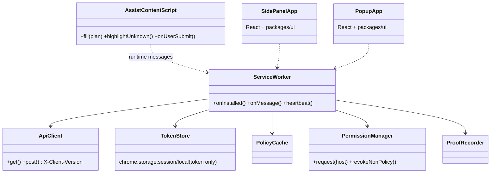
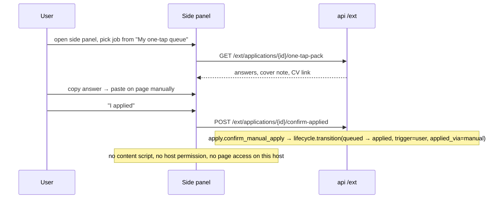

# LLD — browser extension

| | |
|---|---|
| Status | Draft for owner review |
| Version | 0.1 (2026-10-30) |
| Owner module | `frontend/apps/extension` (client) + `jobradar.api.ext` routers calling `apply`, `profile`, `accounts`, `lifecycle` |
| PRD stories | US-8.2, US-8.3 (AC1–AC4, AC3a) |
| ADRs | 0016 (extension default; side panel on one-tap hosts), 0017 (tokens), 0022 (source policies), 0014/0015 (stack, tokens), 0020 (i18n/RTL) |
| Phase | 8 |

## 1. Responsibilities

- Pair with the user's account through the web app and hold a scoped, rotating extension token.
- On hosts whose source policy allows `extension_assist` (public ATS pages): after the user grants
  the host at runtime, show match and eligibility, **assist form filling** from the server's
  `AssistPlan`, highlight unknown questions, and after **the user clicks submit**, record proof and
  report the submission.
- On `one_tap`-only hosts (LinkedIn, Indeed, Bayt, Naukrigulf, GulfTalent): offer the **side panel**
  with the prepared one-tap pack (answers, cover note, CV download), each with a copy button.
- "Save this job": on explicit click, send the active tab's URL and title (via `activeTab`).
- Show a toolbar popup: pairing state, today's queue count, pause state, link to the web app.

### Must NOT do
- Must **never read, fill or click anything** on `one_tap`-only hosts: no host permission, no
  content script, no `scripting.executeScript` there.
- Must never click submit, press Enter in forms, or submit programmatically on any host.
- Must never read or upload cookies, local storage, passwords or session tokens of third-party
  sites.
- Must never request broad host permissions (`<all_urls>`, `*://*/*`) or install-time host
  permissions; only `optional_host_permissions` matching policy-allowed hosts.
- Must never execute instructions found in page content; page text is untrusted data.
- Must not store profile data persistently in extension storage (only the token, install ID,
  locale and UI preferences).

## 2. Public interface (typed)

### Server API (Python services behind `/api/v1/ext`, bearer extension token)

```python
# AssistPlan, AssistField and ExtensionProof are owned by `apply` (apply.md §2); the API returns
# them unchanged. OneTapPack is owned by `documents`. ApplicationView by `lifecycle`.


class ExtensionApi(Protocol):
    async def page_context(self, scope: UserScope, url: HttpUrl) -> PageContext:
        ...
        # normalizer.find_job_by_url + matching.explain + application state, for a policy-allowed
        # ATS URL (scope ext:read_profile_view)

    async def assist_plan(self, scope: UserScope, url: HttpUrl) -> AssistPlan:
        ...
        # apply.assist_plan(scope, url); requires ext:assist and host in token.hosts; runs all guards

    async def record_proof(
        self, scope: UserScope, application_id: UUID, proof: ExtensionProof
    ) -> ApplicationView:
        ...
        # requires ext:record_proof; apply.record_extension_proof (stores proof, consumes
        # applications.assisted idempotently, lifecycle.transition(queued → applied, trigger=extension,
        # applied_via=extension))

    async def confirm_applied(self, scope: UserScope, application_id: UUID) -> None:
        ...
        # side panel "I applied" → apply.confirm_manual_apply (trigger=user, applied_via=manual)

    async def save_job(self, scope: UserScope, url: HttpUrl, title: str) -> SavedJobRef:
        ...
        # requires ext:save_job; title truncated 300 chars; connectors.save_job_url → job_id;
        # lifecycle.create_application(initial_state=matched, saved=true, trigger=extension)

    async def one_tap_pack(self, scope: UserScope, application_id: UUID) -> OneTapPack:
        ...
        # for the side panel; selected by the user from their queue, never from the page

    async def queue(self, scope: UserScope) -> list[QueueItem]: ...  # one-tap and assisted items
    async def heartbeat(self, scope: UserScope, install: InstallInfo) -> ExtensionStatus:
        ...
        # updates extension_installs (version, granted_hosts, last_seen_at); returns pause + allowed
        # hosts from connectors.hosts_with_mode("extension_assist")
```

Endpoints: `GET /ext/status`, `GET /ext/queue`, `POST /ext/page-context`, `POST /ext/assist-plan`,
`POST /ext/applications/{id}/proof`, `POST /ext/applications/{id}/confirm-applied`,
`POST /ext/jobs/save`, `GET /ext/applications/{id}/one-tap-pack`.
Pairing uses `/auth/pair/start` (web session) and `/auth/pair/exchange` (code) in `accounts`.

### Client (TypeScript)

```ts
interface ExtensionSession {
  tokenId: string;
  expiresAt: string;            // ISO
  allowedHosts: string[];       // policy-allowed ∩ user-granted
}

interface PolicySnapshot {        // fetched from /ext/status, cached 1 h
  assistHosts: string[];        // hosts with extension_assist
  oneTapHosts: string[];        // never get content scripts
  minVersion: string;
}

interface AssistController {
  requestHost(host: string): Promise<boolean>;            // chrome.permissions.request (user gesture)
  loadPlan(tabId: number, url: string): Promise<AssistPlan>;
  fill(tabId: number, plan: AssistPlan): Promise<FillReport>;  // content script; never submits
  watchSubmit(tabId: number, applicationId: string): void;     // observes user's submit event only
}

interface ProofRecorder {
  capture(tabId: number): Promise<{ screenshot: Blob; payload: SubmittedFieldValues }>;
}

interface SidePanelApi {
  showPack(applicationId: string): Promise<void>;          // from the user's queue selection
  copy(fieldKey: string, value: string): Promise<void>;    // navigator.clipboard.writeText
}
```

### API request/response models

Mirrors `docs/openapi.yaml` `components/schemas`: same names, fields, enums and optionality (Step 4 review: the LLD is the single source of truth, the spec must match it). Optional fields are `T | None = None` and serialized with `exclude_none`; `XPage = Page[X]` is the cursor envelope from `docs/lld/README.md`; `# read-only` fields are ignored on input. Types not defined here come from their owning module (see the shared-model ownership table in `docs/lld/README.md`).

```python
class AssistPlanRequest(BaseModel):
    model_config = ConfigDict(extra="forbid")
    url: HttpUrl
    application_id: UUID | None = None


class ExtQueueItem(BaseModel):
    application_id: UUID
    job: JobCard
    lane: Lane
    state: ApplicationState
    state_reason: StateReason | JsonValue | None = None


ExtQueueItemPage = Page[ExtQueueItem]


class ExtStatus(BaseModel):
    paired: bool
    user_locale: str
    paused: bool
    assist_hosts: list[str]
    one_tap_hosts: list[str]
    min_client_version: str
    flags: dict[str, bool]


class ExtensionProofMeta(BaseModel):
    model_config = ConfigDict(extra="forbid")
    submitted_values: dict[str, JsonValue]
    plan_version: str
    client_version: str


class ExtensionProofUpload(BaseModel):
    model_config = ConfigDict(extra="forbid")
    screenshot: bytes
    proof: ExtensionProofMeta


class GuardSummary(BaseModel):
    allowed: bool
    reasons: list[MessageRef]


class PageContext(BaseModel):
    host: str
    access_modes: list[AccessMode]
    job_id: UUID | None = None
    application_id: UUID | None = None
    match: MatchItem | JsonValue | None = None


class PageContextRequest(BaseModel):
    """URL only; page content is never sent."""
    model_config = ConfigDict(extra="forbid")
    url: HttpUrl


class ProofRecorded(BaseModel):
    application: ApplicationView
    attempt_id: UUID


class SaveJobRequest(BaseModel):
    model_config = ConfigDict(extra="forbid")
    url: HttpUrl
    title: str


class SavedJob(BaseModel):
    job_id: UUID | None = None
    application_id: UUID
    matched_existing: bool


class SelectorHint(BaseModel):
    label: str | None = None
    name: str | None = None
    ats_field_id: str | None = None
```

## 3. Internal design



The popup and side panel are React apps built from `frontend/packages/ui` and
`frontend/packages/tokens` (same design system, light/dark, LTR/RTL, i18n catalogues).

**Manifest (MV3) essentials:** `permissions`: `storage`, `activeTab`, `sidePanel` (Chromium),
`scripting`; `optional_host_permissions`: generated at build time from
`config/source_policies.yaml` hosts with `extension_assist`; **no** `host_permissions`;
no static `content_scripts`. Content scripts are registered dynamically with
`chrome.scripting.registerContentScripts` only for granted, policy-allowed hosts. Firefox build
uses `sidebar_action` for the panel.

### Pairing

```mermaid
sequenceDiagram
    autonumber
    participant W as Web app (signed in)
    participant API as api
    participant E as Extension popup
    W->>API: POST /auth/pair/start {kind: extension}
    API-->>W: code "K7Q3-M9PX" (10 min, 5 attempts)
    E->>API: POST /auth/pair/exchange {code, browser, version}
    API-->>E: token (scopes ext:*, hosts = []), expires 90 d
    E->>E: store token; GET /ext/status → PolicySnapshot
    API->>API: extension_installs row; consent "extension" recorded (privacy)
```

### Assisted apply (allowed ATS host)

```mermaid
sequenceDiagram
    autonumber
    participant U as User
    participant P as Popup / page badge
    participant SW as Service worker
    participant CS as Content script (allowed host)
    participant API as api /ext
    participant AP as apply
    participant L as lifecycle
    U->>P: "Assist this application"
    P->>SW: requestHost(host) (user gesture)
    SW->>API: POST /ext/assist-plan {url}
    API->>AP: assist_plan (guards: pause, caps, quality, source policy, consent)
    AP-->>SW: AssistPlan
    SW->>CS: fill(plan)
    CS->>CS: fill known fields; highlight unknown; attach files; NO submit
    U->>U: reviews, answers highlighted fields, clicks submit
    CS->>SW: user submit observed (form submit event)
    SW->>SW: captureVisibleTab + field values snapshot
    SW->>API: POST /ext/applications/{id}/proof
    API->>AP: record_extension_proof (guards stage=proof, quota, attempt)
    AP->>L: transition(queued → applied, trigger=extension, applied_via=extension)
    Note over API: new answers typed by the user are offered for saving to the answer bank (user confirms)
```

### One-tap host (side panel only)



"Save this job" on any host: popup button → `chrome.tabs.query({active:true})` under `activeTab`
→ URL + title only → `POST /ext/jobs/save`.

## 4. Data owned

Table (`database.md` §3.12): `extension_installs` (browser in `chrome`,`edge`,`firefox`,`other`;
`granted_hosts` mirrors browser permissions). Uses `client_tokens` (kind `extension`) and
`auth_challenges` (purpose `pair_extension`) through `accounts`; `apply_attempts` (mode `assist`),
`applications` (`applied_via = extension`, `lane = assisted`), `files` (screenshot,
payload_snapshot) through their owners.

Extension local storage: token (in `storage.session` when available, else `storage.local`),
install ID, locale, theme, panel preferences. No profile data, no job content beyond the current
view.

## 5. Error handling, retries, idempotency

| Situation | Behaviour |
|---|---|
| `401` token invalid/revoked | clear token; popup shows "Reconnect" |
| `426 Upgrade Required` | stop API calls; show update prompt (store link) |
| `409 consent_required` / `GuardFailedError` | show reason (paused, cap reached, cooldown, below quality) in popup; no fill |
| Field not found on page | `FillReport.missing`; highlight in overlay; user fills manually |
| Proof upload fails | retried 3× with backoff from the service worker; queued in `storage.session` until success; idempotent on `application_id` + attempt ID |
| Page navigates away before submit | assist session discarded; attempt stays `filling` → `aborted` after 30 min |
| Host permission removed by user | heartbeat updates `granted_hosts`; dynamic content script unregistered |

## 6. Config and feature flags

| Setting / flag | Default |
|---|---|
| Flag `extension.enabled` (global, per user) | off until Phase 8 |
| Flag `extension.assist.enabled` (per user) | on after pairing |
| `extension.min_version` | per release; API returns 426 below it |
| `extension.token_ttl_days` | 90, rotated at 75 |
| Policy source | `config/source_policies.yaml` → build-time `optional_host_permissions` + runtime `PolicySnapshot` |

## 7. Metrics and log events

Server metrics: `ext_installs_active{browser}`, `ext_assist_plans_total{adapter,result}`,
`ext_proofs_total{result}`, `ext_jobs_saved_total`, `ext_version_rejected_total`.

Server log events: `ext.paired`, `ext.assist_plan_served` (adapter, fields_known, fields_unknown),
`ext.proof_recorded`, `ext.job_saved` (host only), `ext.version_rejected`. The extension sends no
telemetry beyond these API calls; client errors go to GlitchTip with URLs reduced to host.

## 8. Security and privacy notes

- Least privilege: no install-time host permissions; runtime grants per allowed host; a build-time
  test enforces the policy.
- Token scopes are per kind; `hosts` limits assist to granted policy-allowed hosts.
- Content scripts treat DOM text as untrusted and only write values into inputs; they never
  evaluate code, follow links or read other tabs.
- CSP for extension pages: `script-src 'self'`; no remote code (store requirement).
- Store listing includes a plain-language privacy disclosure aligned with consents (ADR-0018).

## 9. Test plan

Build-time:
- **Manifest vs source policy (US-8.3 AC3a):** generated manifest has no `host_permissions`, no
  static `content_scripts`, and `optional_host_permissions` ⊆ hosts with `extension_assist`; any
  `one_tap`-only host in a permission or registration list fails the build.
- No remote code: bundle scan for `eval`, `new Function`, remote script URLs.

Unit (Vitest): token store, policy cache expiry, permission manager refuses `one_tap` hosts even if
requested, fill logic on fixture DOMs for each ATS adapter, never dispatches `submit`/`click` on
submit buttons (spy assertions).

End to end (Playwright with the extension loaded, against local fixture pages):
- Greenhouse fixture: assist fills known fields, highlights unknown, form not submitted until the
  test "user" clicks; proof recorded; application `applied` with `applied_via = extension`.
- Paused user: assist plan refused with reason; no fields filled.
- LinkedIn-like fixture host marked `one_tap`: no content script injected (assert
  `chrome.scripting.getRegisteredContentScripts` and DOM untouched); side panel copy buttons work.
- Version below minimum → 426 → update prompt.
- Side panel and popup visual regression in light/dark, LTR/RTL.

Server integration: scope checks per endpoint; host not in token `hosts` → 403; `record_proof`
idempotent; quota `applications.assisted` consumed once.

Isolation: user B's extension token can't fetch user A's assist plans, packs or queue.

## 10. Open questions

1. Firefox release timing (sidebar API differences).
2. Whether to offer a per-host "always allow" preference or ask per session.
