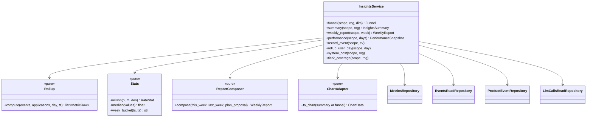
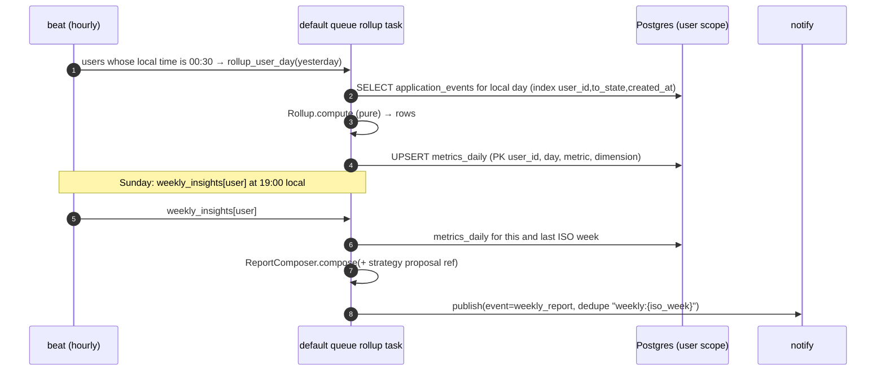

# LLD — insights

| | |
|---|---|
| Status | Draft for owner review |
| Version | 0.1 (2026-10-30) |
| Owner module | `jobradar.insights` |
| PRD stories | US-9.1, US-9.5; metrics in PRD §9 (north star, supporting, guardrails); US-3.7 AC7 (cost per MAU) |
| ADRs | 0013, 0019 (budgets), 0023 (Tier 2 coverage, cost target), 0015 (charts use tokens) |
| Phase | 3 (cost views from `llm_calls`), 4 (`product_events` intake), 6 (funnel computed directly from `application_events`), 9 (`metrics_daily` rollups, weekly report, insights screen) |

## 1. Responsibilities

- Daily rollups of per-user funnel metrics into `metrics_daily`, with dimensions source,
  market, CV variant and lane.
- The **north star**: interviews per week per user, in the user's time zone, with the median
  across active users.
- Callback rate, ghosting rate, time-to-first-response, source and variant conversion.
- System-level: **Tier 2 coverage** and **LLM cost per MAU** (ADR-0023), for the admin console
  and cost alerts.
- The **weekly report** content (Sunday 19:00 local), delivered via `notify`.
- `product_events` intake (no PII, 180-day retention).
- **Chart data contracts** for the web app's insights screen (charts are rendered client-side
  with token colours).
- Provide the `PerformanceSnapshot` that `strategy` uses.

### Must NOT do
- Never change application state, plans or flags. It is read-only on other domains' data.
- Never store PII in `product_events.properties` or metric dimensions (IDs and codes only).
- Never compute per-user cost from anything other than `llm_calls` attribution (no estimates
  shown to users as bills).
- Never send notifications directly; it publishes through `notify`.

## 2. Public interface

```python
class Range(BaseModel):
    start: date
    end: date  # inclusive, user's local dates


class FunnelStage(BaseModel):
    state: Literal[
        "matched", "queued", "applied", "acknowledged", "assessment", "interview", "offer"
    ]
    count: int
    conversion_from_previous: float | None


class Funnel(BaseModel):
    range: Range
    stages: list[FunnelStage]
    dimension: str | None


class RateStat(BaseModel):
    numerator: int
    denominator: int
    rate: float | None  # None when denominator == 0
    ci_low: float | None
    ci_high: float | None  # Wilson 95% interval


class InsightsSummary(BaseModel):
    range: Range
    interviews_per_week: list[WeekValue]  # north star series
    applications_per_week: list[WeekValue]
    callback_rate: RateStat
    ghosting_rate: RateStat
    median_days_to_first_response: float | None
    by_source: list[DimensionStat]
    by_market: list[DimensionStat]
    by_variant: list[DimensionStat]
    by_lane: list[DimensionStat]


class WeeklyReport(BaseModel):
    iso_week: str
    interviews: int
    interviews_change: int
    applications: int
    callback_rate: RateStat
    highlights: list[MessageRef]  # message keys + params
    recommendations: list[MessageRef]  # 1–2, from simple rules
    plan_proposal_version: int | None  # from strategy, if any


async def funnel(scope: UserScope, rng: Range, dimension: str | None = None) -> Funnel: ...
async def summary(scope: UserScope, rng: Range) -> InsightsSummary: ...
async def weekly_report(scope: UserScope, iso_week: str) -> WeeklyReport: ...
async def performance(
    scope: UserScope, *, days: int = 28
) -> PerformanceSnapshot: ...  # for strategy
async def record_event(scope: UserScope, ev: ProductEventInput) -> None: ...
async def rollup_user_day(scope: UserScope, local_day: date) -> int: ...  # task
async def chart(scope: UserScope, chart: ChartKind, rng: Range) -> ChartData: ...  # web app
# admin-only (admin service path; role check); admin.llm_usage delegates here
async def system_cost(scope: UserScope, rng: Range) -> SystemCostReport: ...
async def tier2_coverage(
    scope: UserScope, rng: Range
) -> RateStat: ...  # uses matching.tier2_scored_before
```

### Chart data contracts (API → web app)

All series are typed, unit-labelled and colour-free; the client maps `series_key` to design
tokens (ADR-0015).

```python
class ChartPoint(BaseModel):
    x: date | str
    y: float | None


class ChartSeries(BaseModel):
    series_key: str  # e.g. "interviews", "applications", "callback_rate"
    label_key: str  # i18n key
    unit: Literal["count", "ratio", "days", "currency"]
    currency: str | None = None
    points: list[ChartPoint]


class ChartData(BaseModel):
    chart: Literal[
        "funnel",
        "weekly_progress",
        "callback_by_dimension",
        "salary_comparison",
        "offer_comparison",
    ]
    range: DateRange
    series: list[ChartSeries]
    empty_reason_key: str | None  # drives the designed empty state
```

### API request/response models

Mirrors `docs/openapi.yaml` `components/schemas`: same names, fields, enums and optionality (Step 4 review: the LLD is the single source of truth, the spec must match it). Optional fields are `T | None = None` and serialized with `exclude_none`; `XPage = Page[X]` is the cursor envelope from `docs/lld/README.md`; `# read-only` fields are ignored on input. Types not defined here come from their owning module (see the shared-model ownership table in `docs/lld/README.md`).

```python
class ChartName(StrEnum):
    FUNNEL = "funnel"
    WEEKLY_PROGRESS = "weekly_progress"
    CALLBACK_BY_DIMENSION = "callback_by_dimension"
    SALARY_COMPARISON = "salary_comparison"
    OFFER_COMPARISON = "offer_comparison"


class DateRange(BaseModel):
    from: date
    to: date


class DimensionStat(BaseModel):
    dimension: str
    applications: int
    callbacks: int
    interviews: int
    callback_rate: RateStat


class ProductEvent(BaseModel):
    model_config = ConfigDict(extra="forbid")
    name: str
    properties: dict[str, JsonValue] | None = None
    occurred_at: datetime


class ProductEventBatch(BaseModel):
    model_config = ConfigDict(extra="forbid")
    events: list[ProductEvent]


class WeekValue(BaseModel):
    iso_week: str
    value: float
```

## 3. Internal design



### 3.1 Metric definitions (from PRD §9)

| Metric (`metrics_daily.metric`) | Definition | Dimensions |
|---|---|---|
| `matched`, `queued`, `applied`, `acknowledged`, `assessment`, `interview`, `offer`, `rejected`, `ghosted` | Count of `application_events` with that `to_state` on the user's local day (an interview row counts each round) | `all`, `source:<code>`, `market:<code>`, `variant:<id>`, `lane:<lane>` |
| `interviews_first` | Applications entering `interview` for the first time | same |
| `callbacks` | Applications whose first human-response event (`acknowledged` from a human-classified email, `assessment`, `interview`) happened that day | same |
| `first_response_days_sum`, `first_response_n` | For the median/mean of time-to-first-response | `all` |

- Source of a job = the `job_sources.source` of its first sighting. Market = the market pack
  matching `jobs.country`. Variant = `applications.resume_variant_id`. Lane = `applications.lane`.
- **North star:** `interviews_first` summed per ISO week in the user's time zone. The system
  median is across users with ≥ 1 application in the last 28 days (active users).
- **Callback rate** = callbacks ÷ applied over a rolling 30 days (Wilson interval).
- **Ghosting rate** = ghosted ÷ applied over 30 days.

### 3.2 Rollups



- Rollups are **recomputed** (UPSERT) for the day, so re-runs are idempotent. A late event
  (email arriving days later) triggers `rollup_user_day` for the affected day through the
  `applications.transitioned` domain event that lifecycle emits after commit (debounced: once per
  user per day per 10 min). Lifecycle does not import insights.
- The weekly report runs after `strategy.propose_replan` (18:30), so the proposal can be
  included.

### 3.3 Recommendations (pure rules, message keys)
- Best source by callback rate (minimum 10 applications) → "More of your callbacks came from
  {source}".
- Variant with a higher callback rate whose Wilson interval doesn't overlap → "Your {variant}
  CV gets more responses".
- Zero interviews in 3 weeks with ≥ 15 applications → suggest reviewing the profile and the
  minimum fit.
- At most 2 recommendations, never prescriptive about volume above the persona range.

### 3.4 System-level cost and quality (admin)
- **LLM cost per MAU** (monthly) = Σ `llm_calls.cost_usd_micros` for the month (user-attributed
  + `system` rows) ÷ MAU. MAU = users with any authenticated session or `applied` event in the
  month. Shown with the token split (generative vs embedding) against the ADR-0023 targets
  (≤ 0.8 M generative tokens, ≤ US$0.20).
- **Tier 2 coverage** = share of applications reaching `applied` in the range whose
  `job_scores.tier = 2` existed **before** the application was queued. The target is ≥ 90%. A
  persona-level breakdown is available.
- Exposed as Prometheus gauges (computed hourly) for the cost alert "cost per MAU above target 3
  days in a row".

### 3.5 Product events
- An allow-list of event names (`digest_opened`, `job_opened`, `job_swiped`, `apply_clicked`,
  `command_palette_used`, `undo_used`, `extension_side_panel_opened`, …) with Pydantic models
  for `properties` (codes, counts and IDs only). Unknown names → `ValidationFailedError`.
- Ingested via `POST /api/v1/events` (batched from the web app, max 50 per request,
  rate-limited).
- Retention job deletes rows older than 180 days daily.

## 4. Data owned

| Table (database.md §3.11) | Notes |
|---|---|
| `metrics_daily` | Upsert only by the rollup task |
| `product_events` | Insert + retention delete |

Read-only access, **through the owners' service functions** under the same `UserScope`:
`lifecycle.reporting_events` (application events with lane, variant and job ID),
`normalizer.job_dimensions` (source and market per job), `matching.tier2_scored_before` (Tier 2
coverage); admin path only: `llm_calls` through the core LLM metering read API.

## 5. Error handling, retries, idempotency

- Rollup tasks are idempotent (UPSERT); retry with backoff (max 3) on DB errors.
- The weekly report dedupe key `weekly:{iso_week}` prevents duplicates.
- Empty data → `RateStat.rate = None` and `ChartData.empty_reason_key` (for example
  `insights.empty.no_applications_yet`). Never divide by zero.
- A product event batch that partially fails validation: valid events are stored and invalid
  ones are counted and dropped (no PII is echoed in errors).

## 6. Config and feature flags

| Setting (prefix `INSIGHTS_`) | Default |
|---|---|
| `rollup_local_time` | 00:30 |
| `weekly_report_local_time` | Sunday 19:00 |
| `min_sample_for_recommendation` | 10 |
| `callback_window_days` | 30 |
| `product_events_retention_days` | 180 |
| `mau_definition` | `session_or_applied` |

Flags: `insights.weekly_report.enabled` (per user), `product_events.enabled` (global; respects
`users.preferences.analytics_opt_out`).

## 7. Metrics and log events

Prometheus (system): `insights_llm_cost_per_mau_usd`, `insights_llm_tokens_per_mau{kind=generative|embedding}`,
`insights_tier2_coverage_ratio`, `insights_north_star_median_interviews_per_week`,
`insights_rollup_duration_seconds`, `insights_weekly_reports_sent_total`.
Log events: `insights.rollup_completed` (user_id, day, rows), `insights.weekly_report_built`
(iso_week, recommendations), `insights.product_events_rejected` (count, reason).

## 8. Security and privacy

- All per-user reads run under `UserScope` and RLS. System metrics are aggregated without user
  identifiers in labels.
- Users can opt out of product analytics. Funnel metrics (needed for the product to work) remain.
- Admin cost views show aggregates only; per-user cost is visible to admins only as a top-N list
  of opaque user IDs for abuse investigation.

## 9. Test plan

- **Rollup (pure):** a synthetic event stream for `syn-01` across midnight in `Asia/Kolkata`
  versus `Asia/Dubai` buckets into the correct local days; interview rounds counted in
  `interview` but once in `interviews_first`; the dimension split sums to `all`.
- **Stats:** Wilson interval known values; zero denominators → None; median of empty → None.
- **North star:** ISO week boundaries in the user TZ (Sunday 23:30 IST is the previous week).
- **Report composer:** recommendations only with ≥ 10 samples; at most 2; message keys present in
  the `en` and `ar` catalogues.
- **Cost per MAU:** fixtures of `llm_calls` (user + system rows) produce the expected value; the
  alert threshold fires after 3 days above target.
- **Tier 2 coverage:** an application whose job was scored at Tier 2 after queueing does not count
  as covered.
- **Idempotency:** the rollup run twice gives identical rows; the weekly report published once.
- **Product events:** unknown name rejected; PII-looking property (email pattern) rejected by the
  model validators; retention deletes 181-day-old rows.
- **Chart contracts:** `ChartData` snapshots for funnel and weekly progress; empty states set
  `empty_reason_key`.
- **Isolation:** user B's summary never includes user A's events; the admin cost endpoint
  requires the admin role.

## 10. Open questions

1. MAU definition for cost (session or applied event vs digest delivered). Proposal: session or
   applied event, so passive digest-only users don't dilute cost per MAU.
