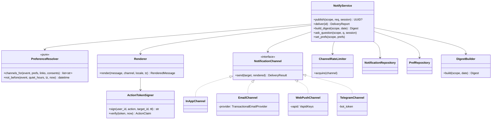
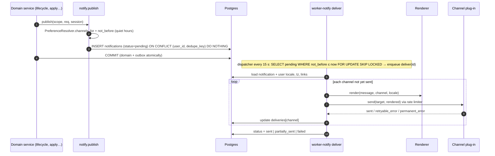

# LLD — notify

| | |
|---|---|
| Status | Draft for owner review |
| Version | 0.1 (2026-10-30) |
| Owner module | `jobradar.notify` (+ `bot` process for Telegram) |
| PRD stories | US-4.4, US-4.5, US-4.6 (Telegram `/flag`), US-5.4 (questions), US-9.1 (weekly report delivery), US-11.3 (localized and RTL messages) |
| ADRs | 0011 (notify queue + outbox), 0014 (web app primary), 0018 (consent per channel), 0020 (i18n) |
| Phase | 4 (in-app, email, Telegram, web push), extended later |

## 1. Responsibilities

- **Outbox:** accept notification events from any domain inside that domain's transaction
  (`publish`), and deliver them reliably on the `notify` queue (`deliver`).
- **Channels** as plug-ins: `in_app`, `email` (transactional provider abstraction), `web_push`
  (VAPID), `telegram`.
- **Preferences** per event type and channel, with quiet hours in the user's time zone.
- **Daily digest:** built once per user per day, then rendered per channel and locale from ICU
  message keys.
- **Questions to the user** (unknown screening questions, ambiguous email links) with answer
  actions.
- **Action tokens:** signed, short-lived tokens behind buttons in email, Telegram and push.
- **Telegram bot:** account linking and commands (`/pause`, `/resume`, `/status`, `/today`,
  `/stats`, `/flag`, `/link`), all of which call the API.
- Per-channel rate limits, and disabling a channel on permanent errors.

### Must NOT do
- Never decide **what** happens in the domain (no state changes, no applying). Buttons call the
  same API endpoints as the web app.
- Never send to a channel without an active link and consent (`telegram`, `web_push`) or a
  verified email.
- Never put personal data in push payloads beyond a title and a deep link (push services are
  third parties).
- Never render user-visible text from hard-coded strings. Always message keys + params, rendered
  in the user's locale.
- Never send marketing; only the event types in §2.

## 2. Public interface

```python
class NotificationEvent(StrEnum):
    DIGEST = "digest"
    QUESTION = "question"
    INTERVIEW_INVITE = "interview_invite"
    OFFER = "offer"
    FOLLOWUP_DUE = "followup_due"
    WEEKLY_REPORT = "weekly_report"
    SECURITY = "security"
    STATUS_CHANGE = "status_change"
    REMINDER = "reminder"
    NEEDS_REVIEW = "needs_review"
    APPLY_FAILED = "apply_failed"  # emitted by apply


class Message(BaseModel):
    key: str  # ICU message key, e.g. "notify.interview_invite.title"
    params: dict[str, str | int | float | date | datetime | MoneyAmount]
    deep_link: str  # app route, e.g. "/applications/{id}"
    actions: list[ActionSpec] = []  # rendered as buttons where supported


class ActionSpec(BaseModel):
    label_key: str
    action: Literal[
        "apply",
        "skip",
        "save",
        "answer",
        "confirm_link",
        "confirm_applied",
        "approve_plan",
        "reject_plan",
        "open",
    ]
    target_id: UUID
    value: str | None = None  # e.g. answer option id


class PublishRequest(BaseModel):
    event: NotificationEvent
    dedupe_key: str  # unique per user, e.g. "digest:2026-11-02"
    message: Message
    not_before: datetime | None = None
    urgent: bool = False  # bypasses quiet hours (security only)


async def publish(scope: UserScope, req: PublishRequest, *, session: AsyncSession) -> UUID | None:
    """Inserts an outbox row in the caller's transaction.

    Returns None if dedupe_key already exists.
    """


async def deliver(notification_id: UUID) -> DeliveryReport: ...  # notify queue task
async def build_digest(scope: UserScope, local_date: date) -> Digest: ...
async def ask_question(scope: UserScope, q: QuestionSpec, *, session: AsyncSession) -> UUID: ...
async def set_prefs(scope: UserScope, prefs: list[PrefInput]) -> list[PrefView]: ...
async def get_prefs(scope: UserScope) -> list[PrefView]: ...
async def list_inbox(scope: UserScope, query: InboxQuery) -> Page[InAppNotification]: ...
async def mark_read(scope: UserScope, ids: list[UUID]) -> None: ...
async def register_push(scope: UserScope, sub: PushSubscriptionInput) -> None: ...
async def link_telegram(code: SecretStr, chat_id: int) -> None:
    ...
    # bot → API; calls accounts.complete_challenge(LINK_TELEGRAM, code, chat_id=…) to get the user,
    # then creates channel_links + privacy.grant_consent("telegram")


async def verify_action_token(
    token: str, *, now: datetime
) -> ActionClaim: ...  # API side; raises PermissionDeniedError


class NotificationChannel(Protocol):  # plug-in, entry point "jobradar.channels"
    code: ClassVar[str]
    max_per_second: ClassVar[float]

    async def send(self, target: ChannelTarget, rendered: RenderedMessage) -> DeliveryResult: ...


class DeliveryResult(BaseModel):
    status: Literal["sent", "retryable_error", "permanent_error"]
    provider_id: str | None = None
    error_code: str | None = None


class Digest(BaseModel):
    local_date: date
    items: list[DigestItem]  # top matches from matching.top_matches
    empty_reason_key: str | None  # e.g. "digest.empty.no_new_eligible"
    pending_questions: int
    followups_due: int
    interviews_today: int


class DigestItem(BaseModel):  # mapped 1:1 from matching.RankedJob
    job_id: UUID
    application_id: UUID | None
    title: str
    company: str
    market: str
    fit_score: int | None
    why: MessageRef  # core API transport type (key + params)
    pay: CompBreakdown | None
```

### API request/response models

Mirrors `docs/openapi.yaml` `components/schemas`: same names, fields, enums and optionality (Step 4 review: the LLD is the single source of truth, the spec must match it). Optional fields are `T | None = None` and serialized with `exclude_none`; `XPage = Page[X]` is the cursor envelope from `docs/lld/README.md`; `# read-only` fields are ignored on input. Types not defined here come from their owning module (see the shared-model ownership table in `docs/lld/README.md`).

```python
class ActionRequest(BaseModel):
    model_config = ConfigDict(extra="forbid")
    token: str
    value: str | None = None


class ActionResult(BaseModel):
    action: str
    target_id: UUID
    result: MessageRef
    deep_link: str | None = None


class Channel(StrEnum):
    IN_APP = "in_app"
    EMAIL = "email"
    WEB_PUSH = "web_push"
    TELEGRAM = "telegram"


class EventPreference(BaseModel):
    event: NotificationEvent
    channels: list[Channel]


class MarkReadRequest(BaseModel):
    model_config = ConfigDict(extra="forbid")
    ids: list[UUID] | None = None
    all: bool | None = None


class Notification(BaseModel):
    id: UUID  # read-only
    event: NotificationEvent
    message: MessageRef
    deep_link: str
    actions: list[ActionSpec]
    created_at: datetime  # read-only
    read_at: datetime | None = None


NotificationPage = Page[Notification]


class NotificationPrefs(BaseModel):
    events: list[EventPreference]
    quiet_hours: QuietHours | JsonValue | None = None


class NotificationPrefsUpdate(BaseModel):
    model_config = ConfigDict(extra="forbid")
    events: list[EventPreference]
    quiet_hours: QuietHours | None = None


class PushSubscription(BaseModel):
    id: UUID  # read-only
    user_agent: str | None = None
    created_at: datetime  # read-only


class PushSubscriptionCreate(BaseModel):
    model_config = ConfigDict(extra="forbid")
    endpoint: HttpUrl
    keys: dict[str, str]
    user_agent: str | None = None


class QuietHours(BaseModel):
    start: str
    end: str


class TelegramLinkCode(BaseModel):
    code: str
    expires_at: datetime
    deep_link: HttpUrl


class TelegramLinkRequest(BaseModel):
    model_config = ConfigDict(extra="forbid")
    code: str
    chat_id: str


class TelegramLinkResponse(BaseModel):
    """Per-user Telegram client token; the bot stores it encrypted, keyed by chat ID."""
    token: str
    scopes: list[str]
    user_locale: str
```

## 3. Internal design



### 3.1 Publish and deliver (outbox)



- `in_app` always succeeds (the row is the in-app item). It is always included except for
  `digest` when the user disabled it.
- Retryable errors are retried by the task with backoff and jitter (max 5). Already-sent
  channels are never re-sent, because `deliveries[channel].status = sent` is checked before each
  send.
- Permanent errors disable the target: push `404/410` → `push_subscriptions.disabled_at`;
  Telegram "bot was blocked by the user" or "chat not found" → `channel_links.status = disabled`;
  email hard bounce → `channel_links` (email) disabled, plus a `security` in-app notice. The
  remaining channels continue (F31).

### 3.2 Digest

- Beat runs `daily_digest` every 15 minutes. It selects users whose local time is in
  `[08:00, 08:15)` and who have no `digest:{local_date}` row, then fans out per user on `notify`.
  SLO: delivered by 08:15 local on 99% of days.
- `DigestBuilder.build`:
  - gets the top N (`SearchPlan.digest_max_items`, default 10) from
    `matching.top_matches(scope, since=<last digest>)`, eligible, not yet acted on;
  - adds counts: pending questions from `apply.open_question_count(scope)`, follow-ups due and
    interviews today from `lifecycle.digest_counts(scope, local_date)`;
  - if there are no items, sets `empty_reason_key` (`no_new_eligible`, `paused`,
    `budget_exhausted`, `markets_disabled`).
- Built **once**; rendered per channel:
  - in-app and email: full card list with pay comparison;
  - Telegram: compact list, one message per job (maximum 5, then a "see all" link) with inline
    buttons Apply / Skip / Save;
  - push: one summary notification ("7 new matches") with a deep link.

### 3.3 Action tokens
- Format: `base64url(payload).base64url(HMAC-SHA256(key_id, payload))`. Payload: `user_id`,
  `action`, `target_id`, `value`, `exp` (default 72 h for digest actions, 7 days for questions),
  `nonce`.
- `verify_action_token` checks the signature, expiry and that the nonce has not been used
  (Redis set with TTL = exp). The API then builds a `UserScope(via=EMAIL|TELEGRAM|PUSH)` limited
  to that single action. Key rotation uses `key_id`.

### 3.4 Telegram bot (`bot` process)
- Long polling in Stage 1, a webhook through Caddy later. The bot holds no business logic. It
  maps a chat ID to a user through `channel_links` (via an API call with the bot's service
  token) and calls API endpoints.

| Command | API call | Notes |
|---|---|---|
| `/link <code>` | `POST /api/v1/notify/telegram/link` | Code from web app (`auth_challenges.purpose = link_telegram`); creates `channel_links` + consent |
| `/pause`, `/resume` | `POST /api/v1/control/pause` / `resume` | User-scoped pause flag; owner can pass `all` for `PAUSE_ALL` |
| `/status` | `GET /api/v1/me/status` | Lanes, caps used, pause state, budget |
| `/today` | `GET /api/v1/digest/today` | Re-renders today's digest |
| `/stats` | `GET /api/v1/insights/summary?range=7d` | |
| `/flag <key> on\|off` | `PATCH /api/v1/flags/{key}` | Owner/admin only; audit-logged (US-4.6) |
| Button callbacks | Action token → `POST /api/v1/actions` | |

- Responses within 5 s (US-4.2 AC2). The bot replies "working…" if the API is slow, then edits the
  message.

## 4. Data owned

| Table (database.md §3.10) | Notes |
|---|---|
| `notifications` | Outbox and in-app inbox; `payload` = `Message` JSON; `deliveries` = `{channel: {status, attempts, provider_id, error_code, sent_at}}` |
| `notification_prefs` | Default rows created at signup from persona/plan defaults |
| `channel_links` | Telegram chat ID / alternate email, encrypted (`address_enc`) |
| `push_subscriptions` | Encrypted subscription; `endpoint_hash` unique |

Indexes relied on: `uq_notifications_user_id_dedupe_key` (idempotency),
`ix_notifications_status_not_before` (dispatcher), `ix_notifications_user_id_created_at` (inbox).

## 5. Error handling, retries, idempotency

| Case | Handling |
|---|---|
| Duplicate publish | `ON CONFLICT DO NOTHING` on (user_id, dedupe_key) → returns None |
| Worker crash mid-delivery | `acks_late` redelivery; per-channel sent markers prevent duplicates |
| Provider 429 | `RateLimitedError(retry_after)` → retry after the hinted delay |
| Provider down | Retries; after max retries → `dead_letters`; other channels unaffected (F16) |
| Template key missing for locale | Fallback to `en`; `i18n_missing_key` log + metric (CI also checks catalogues) |
| User deleted / pending deletion | `deliver` exits early (`deleting` guard), status `suppressed` |
| Expired / reused action token | 403 with a "this link has expired, open the app" page |

## 6. Config and feature flags

| Setting (prefix `NOTIFY_`) | Default |
|---|---|
| `dispatcher_interval_s` | 15 |
| `digest_local_time` | `08:00` (per-user override: `users.preferences.digest_local_time`) |
| `digest_max_items` | 10 |
| `telegram_bot_token` | secret |
| `telegram_max_per_second` | 25 (below Telegram's ~30/s global limit) |
| `email_provider` | `smtp` (provider abstraction; concrete provider approved in Phase 4) |
| `vapid_public_key`, `vapid_private_key` | secrets |
| `action_token_keys` | `{key_id: secret}`; current key ID |
| `action_token_ttl_digest_h`, `action_token_ttl_question_h` | 72, 168 |

Flags: `channel.telegram.enabled`, `channel.web_push.enabled`, `channel.email.enabled` (global);
`PAUSE_ALL` affects digest copy only (the digest still arrives, with a "paused" banner).

## 7. Metrics and log events

Metrics: `notify_published_total{event}`, `notify_delivered_total{channel,status}`,
`notify_delivery_latency_seconds{channel}` (publish → sent), `notify_digest_late_total` (sent
after 08:15 local), `notify_channel_disabled_total{channel,reason}`, `notify_outbox_pending`
(gauge), `notify_bot_commands_total{command,outcome}`.

Log events: `notify.published` (id, event), `notify.delivered` (id, channel, status),
`notify.channel_disabled` (channel, reason), `notify.digest_built` (items, empty_reason),
`notify.action_token_rejected` (reason), `notify.bot_command` (command, outcome). No chat IDs, emails or
message text in logs.

## 8. Security and privacy

- Push payloads contain only a localized title and a deep link; content loads in the app after
  authentication.
- Telegram messages contain job titles and companies (user-approved channel); no salary figures
  unless the user enables `users.preferences.telegram_show_pay` (default off).
- Action tokens are single-use and single-action, and cannot read data.
- Channel links require consent (ADR-0018); revoking consent disables the link immediately.
- Email sending uses SPF, DKIM and DMARC-aligned domains; unsubscribe links per event type go to
  the preference page.

## 9. Test plan

- **PreferenceResolver (pure):** quiet hours 22:00–07:00 in `Asia/Kolkata` delay an
  `interview_invite` published at 23:30 to 07:00; `security` with `urgent` bypasses quiet hours;
  a channel without consent is excluded.
- **Outbox:** publish inside a rolled-back transaction leaves no row; duplicate dedupe key → one
  row; a crash after the Telegram send but before the DB update doesn't re-send (sent marker
  written before ack; the test simulates redelivery).
- **Channels (fakes + recorded provider responses):** push 410 disables the subscription; Telegram
  blocked disables the link; email bounce disables the email link; 429 respects `retry_after`.
- **Digest:** synthetic `syn-01` and `syn-02` produce expected items; empty digest reasons for
  each case; rendering in `en` and `ar` (RTL) with currency and date formats; snapshot tests per
  channel.
- **SLO:** a user in `Asia/Dubai` gets the digest task at 08:00 Dubai, not 08:00 IST.
- **Action tokens:** valid, expired, tampered, reused, wrong user, wrong action → each handled.
- **Bot:** each command maps to the right API call (API mocked); `/flag` rejected for role
  `user`; replies within 5 s with a slow API (working… then edit).
- **Isolation:** user B cannot read user A's notifications, prefs or links; an action token for
  user A cannot act on user B's application.

## 10. Open questions

1. Transactional email provider and web-push library (dependency approval in Phase 4).
2. Should the Telegram digest include salary figures by default for user #1? Proposal: off by
   default, with a toggle.
