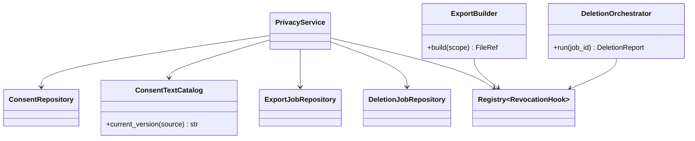
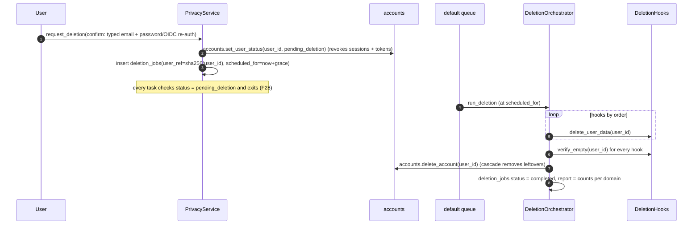

# LLD — privacy

| | |
|---|---|
| Status | Draft for owner review |
| Version | 0.1 (2026-10-30) |
| Owner module | `jobradar.privacy` |
| PRD stories | US-2.5 AC1 (minimal consent), US-6.2 AC1, US-10.3, US-10.7, US-11.1 |
| ADRs | 0018 (privacy, consent, email access), 0017 (tenancy), 0016 (extension) |
| Phase | 2 (minimal consent records for Gmail alerts), 10 (consent centre, export, deletion) |

## 1. Responsibilities

- Record, check and revoke **consent per data source**, with purpose, scope, consent-text version
  and timestamp.
- On revocation, trigger **immediate** effects through registered revocation hooks: revoke
  tokens, stop ingestion, disable channels.
- Provide `require_consent()` for other services to call before touching a source.
- **Export** all of a user's data (JSON + CSV + documents) as one encrypted archive with an expiry.
- **Delete** a user's account and content: grace period, tombstone (`users.status =
  pending_deletion`), per-domain deletion hooks, verification, and a non-personal deletion report.
- Maintain the personal data inventory `docs/privacy/data-map.md` (what, where, why, retention).
- Record acceptance of terms and privacy policy versions (as consents with source `terms` and
  `privacy_policy`).

### Must NOT do
- Must not delete rows in other domains' tables directly. Each domain registers a deletion hook.
- Must not keep personal data in `deletion_jobs` (only a hashed user reference and counts).
- Must not infer consent from behaviour. Consent is an explicit user action on a versioned text.
- Must not export other users' data or shared-corpus rows beyond the jobs referenced by the user's
  applications.
- Must not block export or deletion because of quotas or suspension.

## 2. Public interface (typed)

```python
class ConsentSource(StrEnum):
    TERMS = "terms"
    PRIVACY_POLICY = "privacy_policy"
    GMAIL_ALERTS = "gmail_alerts"
    GMAIL_INBOX = "gmail_inbox"
    FORWARDING_INBOX = "forwarding_inbox"
    EXTENSION = "extension"
    TELEGRAM = "telegram"
    WEB_PUSH = "web_push"
    RUNNER = "runner"
    # plus dynamic "portal:<host>" values validated against source policies


class ConsentGrant(BaseModel):
    source: str  # ConsentSource value or "portal:<host>"
    purpose_key: str  # i18n key of the purpose text
    scope: frozenset[str]  # e.g. {"gmail.readonly", "query:alert_senders"}
    text_version: str  # must equal the current published version for that source


class ConsentView(BaseModel):
    id: UUID
    source: str
    purpose_key: str
    scope: frozenset[str]
    text_version: str
    granted_at: datetime
    revoked_at: datetime | None


class PrivacyService(Protocol):
    async def grant_consent(self, scope: UserScope, grant: ConsentGrant) -> UUID:
        ...
        # Revokes and replaces any active consent for the same source (one active per source).
        # Raises ValidationFailedError(text_version_outdated)

    async def revoke_consent(self, scope: UserScope, source: str) -> RevocationResult:
        ...
        # Runs every registered RevocationHook for that source synchronously (bounded timeout).

    async def has_consent(
        self, scope: UserScope, source: str, needed: frozenset[str] = frozenset()
    ) -> bool: ...
    async def require_consent(
        self, scope: UserScope, source: str, needed: frozenset[str] = frozenset()
    ) -> UUID:
        ...
        # Raises ConsentRequiredError(source)

    async def list_consents(self, scope: UserScope) -> list[ConsentView]: ...
    async def outdated_consents(
        self, scope: UserScope
    ) -> list[str]: ...  # sources needing re-consent

    async def request_export(self, scope: UserScope) -> UUID: ...  # export_jobs id
    async def export_status(self, scope: UserScope, export_id: UUID) -> ExportStatus: ...
    async def download_export(self, scope: UserScope, export_id: UUID) -> SignedDownload: ...

    async def request_deletion(
        self, scope: UserScope, confirm: DeletionConfirmation
    ) -> DeletionTicket:
        ...
        # Sets users.status = pending_deletion, revokes sessions/tokens, schedules after grace period

    async def cancel_deletion(self, scope: UserScope) -> None: ...  # only during grace period


class RevocationHook(Protocol):
    sources: frozenset[str]

    async def on_revoke(self, scope: UserScope, source: str) -> None: ...


class ExportContributor(Protocol):
    domain: str

    async def export(self, scope: UserScope, sink: ExportSink) -> int: ...  # rows written


class DeletionHook(Protocol):
    domain: str
    order: int  # lower runs first (e.g. files before rows)

    async def delete_user_data(self, user_id: UUID) -> int: ...  # idempotent; returns rows deleted
    async def verify_empty(self, user_id: UUID) -> bool: ...
```

Registries: `jobradar.revocation_hooks`, `jobradar.export_contributors`,
`jobradar.deletion_hooks` (entry points, `Registry[P]` from `core`). A CI test asserts that every
table with a `user_id` column is covered by exactly one deletion hook and one export contributor.

Revocation hooks other modules must register:

| Source | Module | Effect |
|---|---|---|
| `gmail_alerts`, `forwarding_inbox` | connectors | `alert_inboxes.status = revoked`, delete `oauth_token_enc`, cancel queued `ingest_alerts` |
| `gmail_inbox` | lifecycle | stop `inbox_sync`, keep already linked events |
| `extension` | accounts + extension | revoke all `client_tokens` of kind `extension`; installs marked stale |
| `telegram` | notify | `channel_links.status = disabled`, revoke telegram token |
| `web_push` | notify | disable all `push_subscriptions` |
| `runner` | runner | revoke runner tokens; `runner_tasks` queued → `expired` |
| `portal:<host>` | apply | cancel pending tasks for that host |

### API request/response models

Mirrors `docs/openapi.yaml` `components/schemas`: same names, fields, enums and optionality (Step 4 review: the LLD is the single source of truth, the spec must match it). Optional fields are `T | None = None` and serialized with `exclude_none`; `XPage = Page[X]` is the cursor envelope from `docs/lld/README.md`; `# read-only` fields are ignored on input. Types not defined here come from their owning module (see the shared-model ownership table in `docs/lld/README.md`).

```python
class ConsentGrantRequest(BaseModel):
    model_config = ConfigDict(extra="forbid")
    source: ConsentSource
    text_version: str
    scope: list[str] | None = None


ConsentViewPage = Page[ConsentView]


class DeletionJob(BaseModel):
    status: DeletionStatus
    requested_at: datetime
    scheduled_for: datetime


class DeletionRequest(BaseModel):
    """Re-authentication: password (or a fresh Google sign-in) and TOTP when enabled."""
    model_config = ConfigDict(extra="forbid")
    password: str | None = None
    totp_code: str | None = None
    confirm: bool


class DeletionStatus(StrEnum):
    SCHEDULED = "scheduled"
    RUNNING = "running"
    COMPLETED = "completed"
    FAILED = "failed"


class ExportJob(BaseModel):
    id: UUID  # read-only
    status: ExportStatus
    requested_at: datetime
    completed_at: datetime | None = None
    expires_at: datetime | None = None


class ExportStatus(StrEnum):
    QUEUED = "queued"
    RUNNING = "running"
    READY = "ready"
    EXPIRED = "expired"
    FAILED = "failed"


class LegalDoc(StrEnum):
    PRIVACY_POLICY = "privacy_policy"
    TERMS = "terms"
    CONSENT = "consent"


class LegalDocument(BaseModel):
    doc: LegalDoc
    version: str
    locale: str
    content_markdown: str
    effective_from: date
```

## 3. Internal design



### Revoking a consent

```mermaid
sequenceDiagram
    autonumber
    participant U as User (web)
    participant P as PrivacyService
    participant DB as Postgres
    participant H as Revocation hooks
    U->>P: revoke_consent("gmail_alerts")
    P->>DB: UPDATE consents SET revoked_at = now() (active row)
    P->>H: on_revoke(scope, "gmail_alerts") (each hook, 10 s timeout)
    H->>DB: alert_inboxes.status = revoked; token deleted
    H-->>P: ok
    P->>DB: audit consent.revoked
    P-->>U: RevocationResult(effects=[...], all_ok=true)
```

### Deletion



## 4. Data owned

Tables (`database.md` §3.2): `consents` (Phase 2), `export_jobs` and `deletion_jobs` (Phase 10).
Uses `files` (kind `export`, encrypted) through `core.files` (`FileStore`).

- `consents`: one active row per (user, source) via `uq_consents_user_id_source_active`.
  `ix_consents_user_id_source` for checks.
- `export_jobs.status` in (`queued`,`running`,`ready`,`expired`,`failed`); `expires_at` default
  7 days after `completed_at`.
- `deletion_jobs`: no FK to `users` (survives deletion); `user_ref` = SHA-256 of the user ID;
  `report` model `DeletionReport {domain: rows_deleted, files_deleted, verified: bool}`.

Export archive layout (`ExportSink`): `manifest.json` (schema version, generated_at),
`<domain>/<table>.json` and `.csv`, `documents/` (rendered CVs, uploads), `README.txt`
(plain-language description). Encrypted with a per-export key; the download link is signed and
single-use within the expiry.

## 5. Error handling, retries, idempotency

| Situation | Behaviour |
|---|---|
| Consent check fails | `ConsentRequiredError(source)` → API 409 with `consent_required` and the source; UI opens the consent sheet |
| Revocation hook error or timeout | consent stays revoked; failure logged, dead-lettered hook task retried; user sees "some effects pending" — the source's own services also check `has_consent` before every run, so ingestion stops regardless |
| Export failure | task retried 3× with backoff; then `failed` and the user is notified |
| Deletion hook failure | retried with backoff until verified; deletion job remains `running`; alert after 24 h (SEV2) |
| Deletion during in-flight tasks | tasks check `users.status` at start and before commits (tombstone) |

Idempotency: `grant_consent` replaces the active row; `revoke_consent` no-op if none active;
`request_export` returns the running job if one exists in the last hour; deletion hooks are
idempotent and re-runnable; `request_deletion` no-op if already pending.

## 6. Config and feature flags

| Setting | Default |
|---|---|
| `privacy.deletion_grace_days` | 7 |
| `privacy.export_ttl_days` | 7 |
| `privacy.consent_texts_dir` | `config/consents/` (versioned markdown per source and locale) |
| `privacy.revocation_hook_timeout_s` | 10 |
| `privacy.screenshot_retention_days_after_close` | 365 |

No feature flag can disable export or deletion.

## 7. Metrics and log events

Metrics: `consents_active{source}`, `consent_revocations_total{source}`,
`exports_total{status}`, `deletions_total{status}`, `deletion_duration_seconds`,
`revocation_hook_failures_total{source}`.

Log events: `privacy.consent_granted`, `privacy.consent_revoked`, `privacy.hook_failed`,
`privacy.export_ready`, `privacy.deletion_scheduled`, `privacy.deletion_completed` (counts only).
Audit actions: `consent.granted`, `consent.revoked`, `export.created`, `export.downloaded`,
`deletion.requested`, `deletion.cancelled`, `deletion.completed` (subject = hashed ref in detail).

## 8. Security and privacy notes

DPDP Act 2023 / GDPR mapping:

| Principle / right | Mechanism |
|---|---|
| Consent, specific and informed | per-source purpose text, version, scope |
| Withdrawal as easy as giving | one click in consent centre; immediate hooks |
| Purpose limitation, minimisation | narrow scopes; alert bodies never stored; sensitive fields optional |
| Access and portability | export (JSON + CSV + documents) |
| Correction | profile editing (profile domain) |
| Erasure | deletion with grace period and verification |
| Grievance redressal | contact published in privacy policy (US-11.1) |
| Retention limits | `database.md` §6 schedule enforced by retention tasks |

Re-authentication is required for deletion and export download. Export archives are encrypted and
expire. The data map in `docs/privacy/data-map.md` is created in Phase 10 and kept current by a CI
check that lists user-owned tables missing from it.

## 9. Test plan

Unit: consent replace semantics; `require_consent` raises with correct source; outdated
text version detection; deletion confirmation validation.

Integration:
- Grant `gmail_alerts` → `has_consent` true; revoke → hook sets inbox `revoked` and removes token
  within the request; a queued `ingest_alerts` task then exits without fetching.
- Revoke `telegram` → channel link disabled; digest falls back to other channels.
- Hook timeout → consent still revoked; dead letter created.
- Export for a synthetic user with data in every domain: archive contains every user-owned table
  (checked against the table list) and no other user's rows.
- Deletion end to end: after the job, every user-owned table has zero rows for the user, files are
  removed from object storage, `deletion_jobs.report.verified = true`, audit retained without PII.
- Cancel during grace period restores `active` status but not revoked tokens (user re-pairs).

Coverage tests (CI): every `user_id` table has a deletion hook and export contributor; every
consent source has a revocation hook and a consent text per supported locale.

Isolation: user B can't read user A's consents, export jobs or download links.

## 10. Open questions

1. Grace period length (7 days proposed) and whether users can choose immediate deletion.
2. Legal review of consent texts before Stage 2.
