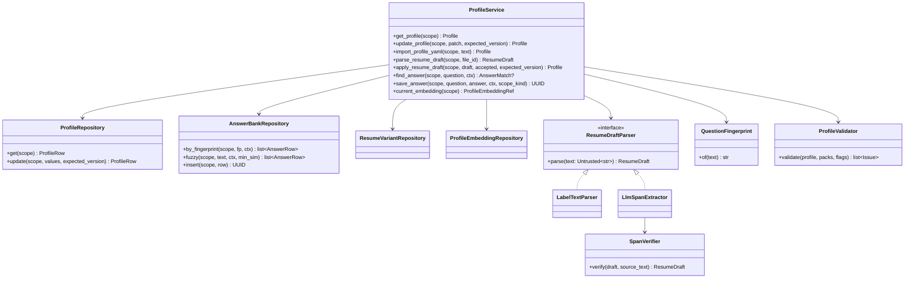
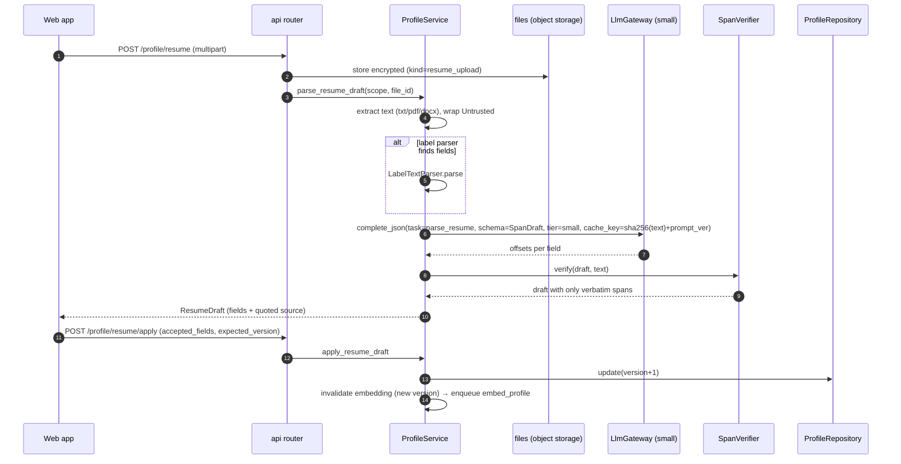
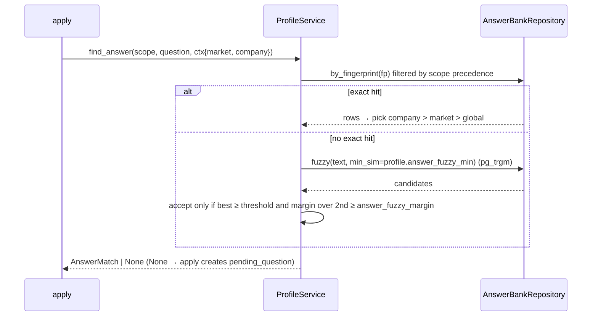

# LLD — `profile`

| | |
|---|---|
| Status | Draft for owner review |
| Version | 0.1 (2026-10-30) |
| Owner module | `src/jobradar/profile/` |
| PRD stories | US-1.1, US-1.3, US-1.4, US-5.1 (variants), US-5.4 (answer reuse), US-3.7 AC2 (profile embeddings), US-10.2 (onboarding data steps) |
| ADRs | 0007 (YAML + facts-only parsing), 0010 (UAE CV field defaults), 0013, 0017 (tenancy), 0018 (sensitive data), 0023 (embeddings) |
| Phase | 1 (done: YAML loaders), 3 (DB profile, embeddings), 5 (variants, answer bank use) |

## 1. Responsibilities

- Hold the **single source of facts** about a user: profile, credentials, skills, preferences,
  per-country visa status, salary expectations, resume variants and the answer bank.
- Validate every fact with Pydantic (`extra="forbid"`) before it is stored.
- Produce a **resume draft** from an uploaded resume: facts only, every field citing its source
  span; the draft becomes profile data only after the user confirms it (ADR-0007).
- Look up reusable screening answers: exact fingerprint → trigram fuzzy → none.
- Version the profile (`profiles.version`) on every change and maintain the profile embedding
  for the current version (ADR-0023).
- Import and export the profile as YAML (Phase 1 format) for the owner and for portability.

### Must NOT do
- Never infer, guess or generate a fact (skill, credential, date, salary, visa status,
  nationality, gap reason). The LLM may only **locate and copy** text from the resume into the
  draft schema; it may never produce an answer for the answer bank (`answer_bank.source` is
  `user` or `imported`, never `llm`).
- Never turn on sensitive fields (photo, date of birth, marital status, nationality) by default
  or because a market pack suggests it; packs only set the *default toggle*, and a field can be
  toggled on only if the user has supplied it.
- Never read another user's data; never call matching, apply or notification code directly.
- Never log profile content (names, emails, phone numbers, CV text, answers).

## 2. Public interface (typed)

Exported from `jobradar.profile` (`__init__.py`). All functions take a `UserScope` and are
`async` (they use the async DB session).

```python
class SeniorityLevel(StrEnum):
    INTERN = "intern"
    ENTRY = "entry"
    JUNIOR = "junior"
    MID = "mid"
    SENIOR = "senior"
    LEAD = "lead"
    PRINCIPAL = "principal"
    MANAGER = "manager"
    DIRECTOR = "director"
    EXECUTIVE = "executive"


class SalaryExpectation(BaseModel):  # extends the Phase 1 model
    currency: CurrencyCode  # ISO 4217
    minimum: Decimal | None = None
    maximum: Decimal | None = None
    period: Literal["hour", "day", "month", "year"] = "year"
    basis: Literal["gross", "ctc", "package", "basic", "net"] = "gross"


class Skill(BaseModel):
    name: NonEmptyString
    years: Decimal | None = None
    evidence: str | None = None  # user-written or copied from resume span


class Credential(BaseModel):
    code: NonEmptyString  # taxonomy credential code, e.g. "dha_nursing_licence"
    market: MarketCode | None = None
    number_ref: UUID | None = None  # pointer to encrypted value, never the number itself
    valid_until: date | None = None


class LocationPref(BaseModel):
    country: CountryCode
    city: str | None = None
    remote_ok: bool = False


class SensitiveFields(BaseModel):  # all optional, never inferred (ADR-0010, ADR-0018)
    photo_file_id: UUID | None = None
    date_of_birth: date | None = None
    marital_status: str | None = None


class Profile(BaseModel):  # mirrors profiles table (database.md §3.4)
    id: UUID
    version: int
    persona: PersonaCode
    seniority: SeniorityLevel
    years_exp: Decimal | None
    field_code: str | None
    role_family_code: str | None
    target_markets: list[MarketCode]
    target_roles: list[RoleCode]
    locations: list[LocationPref]
    skills: list[Skill]
    credentials: list[Credential]
    salary_expectations: list[SalaryExpectation]
    notice_period_days: int | None
    earliest_join_date: date | None
    visa_status: dict[CountryCode, VisaStatusCode]  # e.g. {"AE": "needs_sponsorship"}
    languages: list[LanguageSkill]
    nationality: CountryCode | None
    sensitive: SensitiveFields
    india_tax_regime: Literal["new", "old"] = "new"
    min_fit_score: int  # ≥ global floor (validated in service)
    excluded_keywords: list[str] = []
    excluded_industries: list[IndustryCode] = []  # codes in config/industries.yaml


class ProfilePatch(BaseModel):  # partial update (If-Match); omitted fields unchanged
    persona: PersonaCode | None = None
    seniority: SeniorityLevel | None = None
    years_exp: Decimal | None = None
    target_markets: list[MarketCode] | None = None
    target_roles: list[RoleCode] | None = None
    locations: list[LocationPref] | None = None
    skills: list[Skill] | None = None
    credentials: list[CredentialView] | None = None  # numbers are never sent or returned by the API
    salary_expectations: list[SalaryExpectation] | None = None
    notice_period_days: int | None = None
    earliest_join_date: date | None = None
    visa_status: dict[CountryCode, VisaStatusCode] | None = None
    languages: list[LanguageSkill] | None = None
    nationality: CountryCode | None = None
    india_tax_regime: Literal["new", "old"] | None = None
    min_fit_score: int | None = None
    excluded_keywords: list[str] | None = None
    excluded_industries: list[IndustryCode] | None = None
    # field_code / role_family_code are derived from target_roles; sensitive fields have their own flow


class DraftField[T](BaseModel):
    value: T
    source_span: SourceSpan  # (file_id, page, start, end, quoted_text)


class ResumeDraft(BaseModel):
    file_id: UUID
    fields: dict[str, DraftField[Any]]  # only fields found verbatim; absent = not found
    unparsed_sections: list[SourceSpan]


class AnswerMatch(BaseModel):
    answer_id: UUID
    answer: str
    method: Literal["exact", "fuzzy"]
    similarity: float  # 1.0 for exact
    scope: Literal["global", "market", "company"]


class AnswerContext(BaseModel):
    market: MarketCode | None = None
    company_id: UUID | None = None


# --- service functions ---
async def get_profile(scope: UserScope) -> Profile: ...  # NotFoundError
async def update_profile(
    scope: UserScope, patch: ProfilePatch, *, expected_version: int
) -> Profile: ...  # ConcurrencyConflictError, ValidationFailedError
async def import_profile_yaml(scope: UserScope, text: str) -> Profile: ...  # Phase 1 format → DB
async def export_profile_yaml(scope: UserScope) -> str: ...


async def parse_resume_draft(scope: UserScope, file_id: UUID) -> ResumeDraft: ...
async def apply_resume_draft(
    scope: UserScope, draft: ResumeDraft, accepted_fields: set[str], *, expected_version: int
) -> Profile: ...


async def get_profile_view(
    scope: UserScope,
) -> ProfileView: ...  # for matching, strategy, documents
async def list_resume_variants(scope: UserScope) -> list[ResumeVariant]: ...
async def get_resume_variant(
    scope: UserScope, variant_id: UUID
) -> ResumeVariant: ...  # NotFoundError
async def upsert_resume_variant(scope: UserScope, variant: ResumeVariantInput) -> ResumeVariant: ...


async def find_answer(
    scope: UserScope, question: Untrusted[str], ctx: AnswerContext
) -> AnswerMatch | None: ...
async def list_answers(
    scope: UserScope, ctx: AnswerContext
) -> list[AnswerView]: ...  # scope-filtered, for one-tap packs
async def save_answer(
    scope: UserScope,
    question: str,
    answer: str,
    ctx: AnswerContext,
    *,
    scope_kind: Literal["global", "market", "company"],
) -> UUID: ...  # always source = "user"


async def current_embedding(scope: UserScope) -> ProfileEmbeddingRef: ...  # computes if missing


class ProfileView(BaseModel):
    """Non-sensitive projection used by other modules and in LLM prompts.

    Excludes name, contact details, nationality, sensitive fields and credential numbers.
    """

    profile_id: UUID
    version: int
    persona: PersonaCode
    seniority: SeniorityLevel
    years_exp: Decimal | None
    target_markets: list[MarketCode]
    target_roles: list[RoleCode]
    locations: list[LocationPref]
    skills: list[Skill]
    credentials: list[CredentialCode]  # codes + market only
    languages: list[LanguageSkill]
    visa_status: dict[CountryCode, VisaStatusCode]
    notice_period_days: int | None
    earliest_join_date: date | None
    min_fit_score: int
    excluded_keywords: list[str]
    excluded_industries: list[str]
    india_tax_regime: Literal["new", "old"]  # passed on as CompProfile
    embedding: ProfileEmbeddingRef | None  # None until computed for this version
```

`ResumeVariant` mirrors `resume_variants` (`market_format`, `role_code`, `locale`,
`structured_content: CvContent`, `field_toggles_default`). `CvContent` is defined here and reused
by `documents`: a list of sections, each item carrying `source_ref` (profile path or resume span).

### API request/response models

Mirrors `docs/openapi.yaml` `components/schemas`: same names, fields, enums and optionality (Step 4 review: the LLD is the single source of truth, the spec must match it). Optional fields are `T | None = None` and serialized with `exclude_none`; `XPage = Page[X]` is the cursor envelope from `docs/lld/README.md`; `# read-only` fields are ignored on input. Types not defined here come from their owning module (see the shared-model ownership table in `docs/lld/README.md`).

```python
class Answer(BaseModel):
    id: UUID  # read-only
    question_canonical: str
    question_variants: list[str]
    answer: str
    scope: AnswerScope
    scope_value: str | None = None
    last_used_at: datetime | None = None
    created_at: datetime  # read-only


class AnswerCreate(BaseModel):
    model_config = ConfigDict(extra="forbid")
    question_canonical: str
    question_variants: list[str] | None = None
    answer: str
    scope: AnswerScope
    scope_value: str | None = None


AnswerPage = Page[Answer]


class AnswerPatch(BaseModel):
    model_config = ConfigDict(extra="forbid")
    question_variants: list[str] | None = None
    answer: str | None = None
    scope: AnswerScope | None = None
    scope_value: str | None = None


class AnswerScope(StrEnum):
    GLOBAL = "global"
    MARKET = "market"
    COMPANY = "company"


class CredentialView(BaseModel):
    """Credential numbers are never returned by the API."""
    code: str
    market: str | None = None
    valid_until: date | None = None


class CvContent(BaseModel):
    items: list[CvItem]


class CvItem(BaseModel):
    """Every CV item maps to a profile fact via source_ref."""
    section: str
    text: str
    source_ref: str


class LanguageSkill(BaseModel):
    code: str
    level: str | None = None


class OnboardingStatus(BaseModel):
    persona: str | None = None
    steps: list[OnboardingStep]
    completed: bool


class OnboardingStep(BaseModel):
    code: str
    done: bool
    title: MessageRef


class ProfileResponse(BaseModel):
    """visa_status is keyed by ISO 3166-1 alpha-2 country code."""
    id: UUID  # read-only
    version: int
    persona: str
    seniority: SeniorityLevel
    years_exp: float | None = None
    field_code: str | None = None
    role_family_code: str | None = None
    target_markets: list[str]
    target_roles: list[str]
    locations: list[LocationPref]
    skills: list[Skill]
    credentials: list[CredentialView]
    salary_expectations: list[SalaryExpectation]
    notice_period_days: int | None = None
    earliest_join_date: date | None = None
    visa_status: dict[str, str]
    languages: list[LanguageSkill]
    nationality: str | None = None
    excluded_keywords: list[str]
    excluded_industries: list[str]
    india_tax_regime: Literal["new", "old"]
    min_fit_score: int
    sensitive_fields_supplied: list[Literal["photo", "date_of_birth", "marital_status"]]
    updated_at: datetime  # read-only


class ResumeDraftAccepted(BaseModel):
    draft_id: UUID
    status: Literal["parsing", "ready", "failed"]


class ResumeDraftApply(BaseModel):
    """Field paths from the draft the user confirmed."""
    model_config = ConfigDict(extra="forbid")
    draft_id: UUID
    fields: list[str]


class ResumeUpload(BaseModel):
    model_config = ConfigDict(extra="forbid")
    file: bytes  # PDF or DOCX, ≤ 10 MB


class ResumeVariant(BaseModel):
    id: UUID  # read-only
    name: str
    market_format: str
    role_code: str | None = None
    locale: str
    structured_content: CvContent
    field_toggles_default: FieldToggles
    created_at: datetime  # read-only
    updated_at: datetime  # read-only


class ResumeVariantCreate(BaseModel):
    model_config = ConfigDict(extra="forbid")
    name: str
    market_format: str
    role_code: str | None = None
    locale: str


ResumeVariantPage = Page[ResumeVariant]


class ResumeVariantPatch(BaseModel):
    model_config = ConfigDict(extra="forbid")
    name: str | None = None
    structured_content: CvContent | None = None
    field_toggles_default: FieldToggles | None = None
```

## 3. Internal design



- `LabelTextParser` is the existing Phase 1 parser (`text_parser.py`): explicit labels only.
- `LlmSpanExtractor` (after the LLM gateway exists; adds `pypdf`, `python-docx`): asks the
  `small` tier to return, per schema field, **character offsets** into the extracted text. The
  `SpanVerifier` then copies the value from those offsets itself and drops any field whose
  offsets are invalid or whose text does not match the schema type. The model's own wording is
  never stored, so it cannot add facts.
- `QuestionFingerprint`: lowercase, Unicode NFKC, strip punctuation and stop words for the
  question's locale, collapse whitespace, SHA-256 → hex.
- `ProfileValidator` checks cross-field rules: `target_markets` exist and are enabled, `target_roles`
  exist, `min_fit_score ≥ matching.global_min_fit_floor`, salary min ≤ max, credentials reference
  known codes.

### Sequence — resume upload to confirmed profile



### Onboarding support (US-10.2)

The onboarding wizard (screens in `docs/ux.md`) is a sequence of service calls, driven by the
persona pack's `onboarding_steps`:
1. upload resume → `parse_resume_draft` → review → `apply_resume_draft` (facts only);
2. markets and roles (only enabled flags offered) and field-specific credential questions from
   the role packs → `update_profile`;
3. channels and consents → `notify.set_prefs`, `privacy.grant_consent` per source;
4. lanes and caps → user flags through the flag service (≤ plan limits);
5. first matches preview → `strategy.current_plan` + `matching.match_user` in dry-run.

Each step is resumable: progress is derived from which profile fields, consents and flags exist,
not from a separate table.

### Sequence — answer lookup during apply



Scope precedence: `company` (scope_value = company ID) > `market` (scope_value = market code) >
`global`. A market-scoped answer never matches outside its market.

## 4. Data owned

| Table | database.md | Written by this module | Notes |
|---|---|---|---|
| `profiles` | §3.4 | all columns | `version` incremented in the same UPDATE (`WHERE version = :expected`) |
| `profile_embeddings` | §3.4 | all | one row per (profile, version); older versions deleted after 7 days |
| `resume_variants` | §3.4 | all | `structured_content` = `CvContent` |
| `answer_bank` | §3.4 | all | `question_fingerprint`, GIN trigram on `question_canonical` |
| `files` (kind `resume_upload`, `photo`) | §3.4 | rows of these kinds | upload and delete only; storage via `core.files` (the shared `FileStore` used by every module) |

Phases: `profiles`, `profile_embeddings`, `files` arrive in Phase 3; `resume_variants` and
`answer_bank` in Phase 5 (database.md §9). Until Phase 5, `list_resume_variants`, `find_answer`,
`list_answers` and `save_answer` are not exposed.

jsonb models defined here: `LocationPref`, `Skill`, `Credential`, `SalaryExpectation`,
`LanguageSkill`, `SensitiveFields`, `CvContent`, `FieldToggles`.

**From YAML to DB.** Phase 1 reads `config/profile.yaml`. From Phase 3 the profile lives in
`profiles`; `jobradar profile import --profile config/profile.yaml --user <email>` calls
`import_profile_yaml`, and `jobradar profile show` reads from the DB (with `--profile` still
validating a YAML file offline). The Phase 1 `Profile` model is extended, not replaced:
`salary_expectations` moves from a currency-keyed map to a list with period/basis (import maps
old entries with `period=year`, `basis=gross`), and `visa_status` keys become ISO country codes
(import maps market codes via the market pack's country).

## 5. Error handling, retries, idempotency

| Situation | Behaviour |
|---|---|
| Concurrent edits | `expected_version` mismatch → `ConcurrencyConflictError` (UI reloads and shows the diff) |
| Invalid patch | `ValidationFailedError` with field paths; nothing written |
| Resume text extraction fails (encrypted PDF, scan without text) | `ValidationFailedError(code="resume_unreadable")`; user is asked to upload another format; no OCR in v1 |
| LLM unavailable / budget exhausted | Draft returns label-parser fields only, flag `partial=True`; never blocks manual entry |
| LLM returns invalid offsets | Dropped by `SpanVerifier`; counted in metrics |
| Embedding call fails | `embed_profile` task retried (backoff, max 3); matching falls back to Tier 0 + recency until present |
| Duplicate answer save | Same fingerprint + scope → update the existing row (idempotent upsert) |

Idempotency keys: `parse_resume_draft` is cached by (sha256 of text, prompt version);
`embed_profile` by (profile_id, version, model).

## 6. Config and feature flags

| Setting / flag | Default | Use |
|---|---|---|
| `profile.answer_fuzzy_min` | 0.82 | minimum trigram similarity |
| `profile.answer_fuzzy_margin` | 0.05 | best must beat runner-up by this margin |
| `profile.resume_max_bytes` | 5 MB | upload limit |
| `profile.resume_types` | txt, pdf, docx | accepted types |
| `matching.global_min_fit_floor` | 60 | lower bound for `min_fit_score` |
| `llm.models.small`, `llm.models.embedding` | config | draft extraction, embeddings |
| flag `profile.llm_resume_parser.enabled` | off until LLM gateway exists | switches to `LlmSpanExtractor` |
| Packs | persona (`onboarding_steps`), market (`cv_fields_default_on/off`, `photo_on_cv`, country), role (credential codes) | validation, toggle defaults |

## 7. Metrics and log events

Metrics (exported with the `jobradar_` namespace, see README): `profile_updates_total{source=web|yaml|draft}`, `resume_parse_total{parser,outcome}`,
`resume_draft_fields_dropped_total`, `answer_lookup_total{method=exact|fuzzy|none}`,
`profile_embedding_age_seconds` (histogram).

Log events (IDs and counts only): `profile.updated {user_id, version, fields_changed:[names]}`,
`profile.resume_parsed {user_id, file_id, parser, fields_found, fields_dropped}`,
`profile.answer_lookup {user_id, method, similarity}`, `profile.yaml_imported {user_id, version}`.

## 8. Security and privacy notes

- Resume text, answers and sensitive fields are personal data: encrypted files at rest, never in
  logs, never in error messages, never sent to the LLM except resume text for span extraction
  (minimum needed, under the user's consent for parsing).
- Resume text is `Untrusted`: instructions inside it are ignored; output is offsets only.
- Credential numbers are stored encrypted and referenced by `number_ref`.
- All repositories require `UserScope`; RLS on every owned table.
- Export includes everything here; deletion cascades from `users`.

## 9. Test plan

| Kind | Cases |
|---|---|
| Unit | Validator: market not enabled, unknown role, min ≤ max salary, `min_fit_score` below floor; fingerprint stability across case, punctuation, Unicode forms, Arabic text |
| Unit | Answer precedence: company > market > global; market answer never used for another market; fuzzy accept/reject by threshold and margin |
| Unit | `SpanVerifier`: offsets out of range, mismatched type, overlapping spans, injected "ignore instructions" text in resume yields no extra fields |
| Unit | YAML import: Phase 1 `config/profile.example.yaml` and the owner's format map to the DB model (salary period/basis defaults, visa key mapping) |
| Integration (testcontainers Postgres) | `update_profile` optimistic concurrency; version increments; `profile_embeddings` invalidated on change; trigram query uses the GIN index |
| Fixtures | `tests/fixtures/resumes/`: synthetic txt, pdf, docx resumes (labels, no labels, two-column, Arabic) with expected drafts |
| LLM recordings | `parse_resume` recorded responses keyed by (prompt version, input hash) |
| Conformance | Every persona pack's `onboarding_steps` reference profile fields that exist |
| Synthetic users | `syn-01` … `syn-10` profiles load, validate and import; `syn-02` (nurse → KSA) credential with market; `syn-07` gap text stored only as user-written |
| Isolation | User B cannot read A's profile, variants or answers via service or raw SQL with B's `app.user_id` |
| Privacy | Logs captured during tests contain no fixture names, emails or phone numbers |

## 10. Open questions

1. OCR for scanned resumes: out of scope for v1; revisit after Stage 2 feedback.
2. Multiple profiles per user (e.g. two different career tracks): v1 enforces one; schema allows
   relaxing the unique constraint later.
