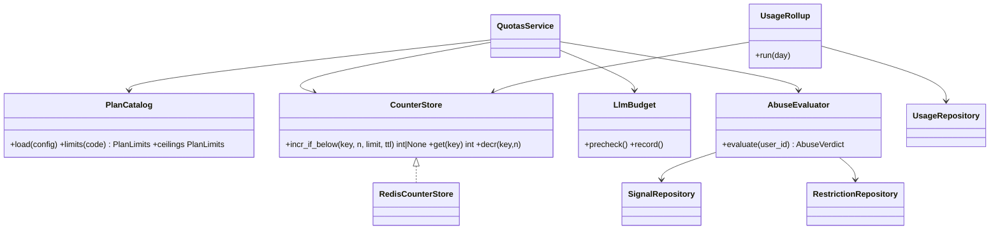

# LLD — quotas

| | |
|---|---|
| Status | Draft for owner review |
| Version | 0.1 (2026-10-30) |
| Owner module | `jobradar.quotas` |
| PRD stories | US-3.6, US-3.7 AC7, US-6.1, US-10.5, US-10.6, US-11.5 |
| ADRs | 0019 (quotas, budgets, anti-abuse), 0023 (tiered matching, cost target), 0017 |
| Phase | 3 (LLM metering + soft budget), 5–6 (apply caps), 10 (plans, anti-abuse, restrictions) |

## 1. Responsibilities

- Load **plans** (config → `plans` table) and validate every limit ≤ **global ceilings**.
- Resolve a user's effective limits: plan + `user_plans.overrides`, capped by global ceilings.
- `check` and `consume` usage for every metered action, atomically, with clear denial reasons
  and reset times.
- Keep hot counters in Redis and roll them up nightly to `usage_counters`.
- Enforce the **LLM budget**: pre-check before a call, record actual usage after, and expose the
  degradation level.
- Enforce the **per-employer cap** and the global daily ceiling for applications.
- **Anti-abuse:** record `abuse_signals`, evaluate rules, apply `user_restrictions` (cooldown,
  suspend), lift them on expiry.
- Provide **usage meter** data for the UI.

### Must NOT do
- Must not decide eligibility, fit or duplicates (those are matching/apply guards); it only counts
  and evaluates limits and abuse rules.
- Must not let a plan or override exceed a global ceiling.
- Must not fail **open** for apply metrics when counters are unavailable.
- Must not block export, deletion, tracking (lifecycle) or notifications for budget reasons.
- Must not store PII in signal `detail` (IDs and counts only).

## 2. Public interface (typed)

```python
class Metric(StrEnum):
    APPLICATIONS_AUTO = "applications.auto"  # per day
    APPLICATIONS_ASSISTED = (
        "applications.assisted"  # per day (extension assist + runner careful lane)
    )
    APPLICATIONS_TOTAL = "applications.total"  # per day, global ceiling
    APPLICATIONS_PER_EMPLOYER = "applications.per_employer"  # rolling 30 days, keyed by company
    DOCUMENTS_TAILORED = "documents.tailored"  # per day
    LLM_TOKENS = "llm.tokens"  # per day
    LLM_COST = "llm.cost_usd_micros"  # per month
    LLM_SCORE_ON_DEMAND = "llm.score_on_demand"  # per day
    ALERTS_INGESTED = "alerts.ingested"  # per day
    STORAGE_BYTES = "storage.bytes"  # absolute


class LimitKey(StrEnum):  # non-metered plan settings (no counters)
    MATCHING_LLM_TOP_N = "matching.llm_top_n"  # Tier 2 jobs per run (ADR-0023)
    DOCUMENTS_PREMIUM_MODEL = "documents.premium_model_allowed"  # 0 or 1


PlanLimits = dict[Metric | LimitKey, int]  # plans.limits, user_plans.overrides


class DegradationLevel(IntEnum):
    NONE = 0  # full service
    NO_TAILORING = 1  # untailored variants only
    RULES_ONLY = 2  # Tier 0/1 only; "scoring paused" badge
    # tracking and notifications never degrade


class QuotaDecision(BaseModel):
    allowed: bool
    metric: Metric
    remaining: int | None
    limit: int | None
    resets_at: datetime | None
    reason_key: str | None  # e.g. "quota.cap_reached.applications_auto"


class AbuseVerdict(BaseModel):
    restricted: bool
    restriction: Literal["cooldown_automation", "suspend"] | None
    ends_at: datetime | None
    reason_key: str | None


class QuotasService(Protocol):
    async def plan_limits(
        self, scope: UserScope
    ) -> PlanLimits: ...  # plan + overrides, capped by ceilings
    def global_ceilings(self) -> PlanLimits: ...  # config; strategy, admin
    async def check(
        self, scope: UserScope, metric: Metric, n: int = 1, *, key: str | None = None
    ) -> QuotaDecision:
        ...
        # key = company_id for APPLICATIONS_PER_EMPLOYER

    async def consume(
        self,
        scope: UserScope,
        metric: Metric,
        n: int = 1,
        *,
        key: str | None = None,
        idempotency_key: str,
    ) -> QuotaDecision:
        ...
        # Atomic check-and-increment. Raises QuotaExceededError(metric, resets_at)

    async def release(
        self, scope: UserScope, metric: Metric, n: int, *, idempotency_key: str
    ) -> None:
        ...
        # Compensation when an action was reserved but not performed (e.g. pre-submit failure)

    async def llm_precheck(
        self, scope: UserScope, est: TokenEstimate, tier: ModelTier
    ) -> LlmBudgetDecision:
        ...
        # Raises BudgetExceededError; LlmGateway calls this before every user-attributed call

    async def llm_record(self, scope: UserScope | SystemScope, usage: LlmUsage) -> None: ...
    async def degradation_level(self, scope: UserScope) -> DegradationLevel: ...

    async def active_restriction(self, scope: UserScope) -> AbuseVerdict: ...
    async def record_signal(
        self, user_id: UUID, kind: AbuseKind, severity: int, detail: Mapping[str, object]
    ) -> None: ...
    async def evaluate_abuse(
        self, user_id: UUID, *, now: datetime
    ) -> AbuseVerdict: ...  # rules engine
    async def usage_meter(self, scope: UserScope) -> UsageMeter: ...  # for the UI


# Pure functions (no I/O), unit-tested exhaustively
def cap_limits(
    plan: PlanLimits, overrides: PlanLimits | None, ceilings: PlanLimits
) -> PlanLimits: ...
def period_window(metric: Metric, tz: ZoneInfo, now: datetime) -> tuple[datetime, datetime]: ...
def degradation_for(spent_ratio: float, thresholds: DegradationThresholds) -> DegradationLevel: ...
def abuse_rules(
    signals: Sequence[AbuseSignal], stats: ApplyStats, cfg: AbuseConfig
) -> AbuseVerdict: ...
```

### API request/response models

Mirrors `docs/openapi.yaml` `components/schemas`: same names, fields, enums and optionality (Step 4 review: the LLD is the single source of truth, the spec must match it). Optional fields are `T | None = None` and serialized with `exclude_none`; `XPage = Page[X]` is the cursor envelope from `docs/lld/README.md`; `# read-only` fields are ignored on input. Types not defined here come from their owning module (see the shared-model ownership table in `docs/lld/README.md`).

```python
class Plan(BaseModel):
    code: str
    name_key: str
    limits: PlanLimits
    active: bool


PlanPage = Page[Plan]


class Usage(BaseModel):
    plan_code: str
    meters: list[UsageMeter]
    degraded: Literal["none", "rules_only", "budget"]


class UsageMeter(BaseModel):
    metric: str
    used: int
    limit: int | None = None
    period: Literal["day", "month", "rolling_30d"]
    resets_at: datetime
```

## 3. Internal design



**Counter keys:** `q:{user_id}:{metric}:{period_start}` (plus `:{company_id}` for per-employer).
`incr_if_below` is a Lua script: increment only if `value + n ≤ limit`; returns the new value or
`nil`. TTL = end of period + 2 days. Consumption is recorded with its `idempotency_key` in a Redis
set (`q:idem:{user_id}:{day}`) so retries never double-count.

**Rolling 30-day per-employer cap:** counted from `applications` (indexed
`ix_applications_user_id_company_id_applied_at`) as the source of truth, with a Redis cache of the
count invalidated on each submission. This keeps the cap exact across Redis loss.

**Redis unavailable:** apply metrics → recompute from Postgres (`applications`,
`application_events`) inside the check; if Postgres also fails → deny (fail closed, F14).
LLM and document metrics → recompute from `llm_calls` / `document_renders`; on failure allow up to
a small emergency allowance (config) and log.

### Apply submission check

```mermaid
sequenceDiagram
    autonumber
    participant A as apply (guards)
    participant Q as QuotasService
    participant R as Redis
    participant DB as Postgres
    A->>Q: active_restriction(scope)
    Q->>DB: user_restrictions (active)
    A->>Q: consume(APPLICATIONS_AUTO, idempotency_key=attempt_id)
    Q->>R: incr_if_below(lane counter)
    A->>Q: consume(APPLICATIONS_TOTAL, ...)
    A->>Q: consume(APPLICATIONS_PER_EMPLOYER, key=company_id, ...)
    Q->>DB: count applied in 30 d (cache miss)
    alt any denied
        Q-->>A: QuotaExceededError(metric, resets_at)
        A->>Q: release(previous reservations)
    else ok
        Q-->>A: decisions
    end
    Note over A: on pre-submit failure apply calls release(); after the click usage is never released
```

### LLM budget

```mermaid
sequenceDiagram
    participant G as LlmGateway
    participant Q as QuotasService
    G->>Q: llm_precheck(scope, est_tokens, tier)
    Q-->>G: allowed / BudgetExceededError
    G->>G: call provider (or cache hit)
    G->>Q: llm_record(scope, actual tokens, cost_usd_micros)
    Q->>Q: update counters; recompute degradation level
```

Degradation thresholds (share of monthly `llm.cost_usd_micros` spent): ≥ 80% →
`NO_TAILORING`; ≥ 100% → `RULES_ONLY`. User gets a notification at each step with the reset date.
System-scope usage (shared normalization, job embeddings) is recorded against the deployment
budget only.

### Anti-abuse rules (evaluated on each signal and daily)

| Rule | Signal / condition | Action |
|---|---|---|
| Burst | > `burst_per_hour` application attempts in 1 h | signal `burst`; 2 in 24 h → `cooldown_automation` 3 days |
| Low response | ≥ 40 applications in 30 d and response rate < `min_response_rate` (default 2%) | signal `low_response_rate`; cooldown 7 days + strategy tip |
| Employer report | admin-confirmed `employer_report` | cooldown 14 days; second confirmed → `suspend` (admin) |
| Duplicate probing | ≥ 5 `duplicate_attempt` in 24 h | signal; cooldown 1 day |
| Cap probing | ≥ 10 denied consumes in 1 h | signal `cap_probe` |

Cooldown turns off automated and assisted lanes only; one-tap, tracking and everything else keep
working. `suspend` is only applied by an admin (or owner) and blocks all writes except export and
deletion.

## 4. Data owned

Tables (`database.md` §3.3): `plans`, `user_plans`, `usage_counters`, `abuse_signals`,
`user_restrictions`. Reads `applications`, `llm_calls`, `document_renders` through their owning
services' read APIs for recomputation.

- `plans.limits` / `user_plans.overrides`: `PlanLimits` = `dict[Metric | LimitKey, int]`.
- `usage_counters` PK (user_id, metric, period, period_start); `period` in (`day`,`month`,
  `rolling_30d`).
- `abuse_signals.kind` in (`burst`,`low_response_rate`,`employer_report`,`duplicate_attempt`,
  `cap_probe`).
- `user_restrictions.kind` in (`cooldown_automation`,`suspend`);
  `ix_user_restrictions_user_id_ends_at`.

## 5. Error handling, retries, idempotency

- `QuotaExceededError` / `BudgetExceededError` → API 429 with body `{metric, resets_at,
  reason_key}`; tasks treat them as non-retryable and set `state_reason = blocked_by_guard`.
- Every `consume` requires an `idempotency_key` (attempt ID, render cache key, LLM call ID).
- `release` is idempotent on the same key and only valid before the action's point of no return.
- Nightly `quota_rollup` is idempotent (upsert per PK), safe to re-run for any day.

## 6. Config and feature flags

```yaml
quotas:
  global_ceilings:                      # cannot be exceeded by any plan or override
    applications.total: 25
    applications.auto: 15
    applications.assisted: 25
    applications.per_employer: 5        # rolling 30 days; plans default to 3
    documents.tailored: 20
    llm.tokens: 200000                  # per day
    llm.cost_usd_micros: 10000000       # per user per month (US$10.00); owner plan soft budget
                                        # 250000 per day (US$0.25), decision 2026-11-06
    llm.score_on_demand: 30
    matching.llm_top_n: 25
    documents.premium_model_allowed: 1
  plans: config/plans.yaml              # free, supporter, friends_beta, owner
# the global fit-score floor is matching.global_min_fit_floor (60); users can only raise it
  degradation: {no_tailoring_at: 0.8, rules_only_at: 1.0}
  abuse: {burst_per_hour: 10, min_response_rate: 0.02, ...}
  deployment_llm_budget_usd_month: 15   # Stage 1 cap (decision 2026-11-06); alerts at 50/80/100%
```

Flags: `quotas.enforce` (`soft` in Stage 1: log and notify, don't deny LLM metrics; apply metrics
always hard), `abuse.auto_cooldown.enabled`.

## 7. Metrics and log events

Metrics: `quota_denials_total{metric,plan}`, `quota_usage_ratio{metric,plan}` (histogram),
`llm_cost_usd_micros_total{tier,task,attribution=user|system}` (cost per MAU is owned by insights),
`degradation_users{level}`,
`restrictions_active{kind}`, `abuse_signals_total{kind}`.

Log events: `quota.denied` (metric, plan, remaining), `quota.released`, `llm.budget_denied`,
`llm.degradation_changed`, `abuse.signal_recorded`, `abuse.restriction_applied`,
`abuse.restriction_lifted`. Audit: `quota.override_changed`, `restriction.applied`,
`restriction.lifted`, `plan.changed`.

Alerts: deployment LLM budget 50/80/100%; cost per MAU above target 3 days in a row (ADR-0023).

## 8. Security and privacy notes

- All enforcement is server-side in services; UI meters are informational only.
- Counters keyed by opaque user IDs. Signal details hold IDs and counts only.
- Admin overrides are audited and capped by global ceilings.

## 9. Test plan

Unit (pure functions):
- `cap_limits`: plan above ceiling → ceiling; override above ceiling → ceiling; missing metric →
  ceiling default.
- `period_window` across the user's time zone midnight (Asia/Kolkata, Asia/Dubai, America/Toronto)
  and DST transitions.
- `degradation_for` thresholds 0.79 / 0.8 / 1.0.
- `abuse_rules` table-driven for every rule and combinations.

Integration (Redis + Postgres):
- Concurrent `consume` ×50 with limit 10 → exactly 10 allowed.
- Same `idempotency_key` twice → counted once.
- `release` after pre-submit failure restores the count.
- Redis down: apply metric recomputed from Postgres; Postgres also down → denied.
- Per-employer cap: 3 applications to one company in 30 days, 4th denied, another company allowed.
- LLM pre-check denies at budget; degradation level moves to `NO_TAILORING` then `RULES_ONLY`;
  digest still produced (synthetic user test).
- Rollup produces `usage_counters` equal to Redis totals; re-run is idempotent.
- Cooldown blocks `matched → queued (S)` and assisted lanes; one-tap still works.

Synthetic: `syn-01` run over 30 simulated days stays under the per-MAU token and cost targets with
recorded LLM responses (ADR-0023 check).

Isolation: user B can't read user A's usage, signals or restrictions.

## 10. Open questions

1. Final numbers for plans and global ceilings (owner decision before Stage 2).
2. Whether users see their abuse-signal history or only the restriction and reason.
