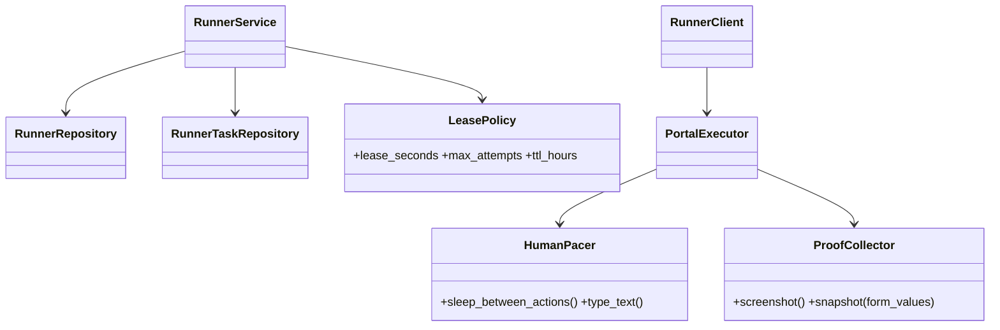

# LLD — runner (optional home mode)

| | |
|---|---|
| Status | Draft for owner review |
| Version | 0.1 (2026-10-30) |
| Owner module | `jobradar.runner` (API side) + `runner/` client package |
| PRD stories | US-8.1 |
| ADRs | 0002 (home runner, amended), 0016 (extension default, runner optional), 0017 (tokens), 0019 (caps), 0022 (source policies) |
| Phase | 8 |

## 1. Responsibilities

- **API side:** create `runner_tasks` for applications whose lane is `careful` and whose host
  policy allows logged-in automation; lease tasks to the user's runner; accept heartbeats and
  results; expire tasks; detect offline runners.
- **Client side (home machine):** authenticate with a runner token, pull tasks, execute them with
  a persistent local Playwright profile, apply human-like delays, take screenshots, report results.
- Respect careful-lane caps (via `quotas`) and the global pause, checked on the server at lease
  time and again at report time.

The runner is an **optional, off-by-default** mode for power users (ADR-0016). The browser
extension is the default for logged-in portals.

### Must NOT do
- Must never upload cookies, passwords, browser storage or the browser profile.
- Must never execute tasks in the cloud. Expired tasks are not moved to cloud workers (F17).
- Must never act on `one_tap`-only hosts (source policy) — the server never creates such tasks and
  the client refuses them.
- Must not accept inbound connections. It only makes outbound HTTPS requests to the API.
- Must not decide to submit on its own: the server-side guard decision travels with the lease, and
  the client follows `mode` (`dry_run` or `live`) exactly.
- Must not store task payloads after reporting (local logs contain IDs only).

## 2. Public interface (typed)

### API service (Python)

```python
class RunnerTaskKind(StrEnum):
    APPLY_CAREFUL = "apply_careful"
    CHECK_STATUS = "check_status"


class RunnerTaskStatus(StrEnum):
    QUEUED = "queued"
    LEASED = "leased"
    DONE = "done"
    FAILED = "failed"
    EXPIRED = "expired"


class RunnerTaskPayload(BaseModel):  # stored in runner_tasks.payload; no secrets
    application_id: UUID
    attempt_id: UUID  # apply_attempts row created by apply when enqueuing
    host: str
    apply_url: HttpUrl
    form_plan: FormPlan  # from apply.prepare(); field → value refs
    files: list[SignedFileRef]  # short-lived signed URLs for the CV render
    mode: Literal["dry_run", "live"]
    delays: DelayProfile  # min/max per action, typing speed range
    min_client_version: str


class Lease(BaseModel):
    task_id: UUID
    kind: RunnerTaskKind
    lease_expires_at: datetime  # default 10 minutes; heartbeat extends
    payload: RunnerTaskPayload


class RunnerResult(BaseModel):
    task_id: UUID
    outcome: Literal["submitted", "dry_run_done", "failed", "needs_review", "aborted"]
    error_code: str | None = None
    unknown_questions: list[UnknownQuestion] = []
    screenshot: UploadRef | None = None  # uploaded to /runner/uploads first
    payload_snapshot: UploadRef | None = None
    client_version: str


class RunnerService(Protocol):
    async def register(
        self, scope: UserScope, name: str, version: str
    ) -> UUID: ...  # scope via runner token
    async def heartbeat(
        self,
        scope: UserScope,
        runner_id: UUID,
        version: str,
        leased: Sequence[UUID],
        submitting: Sequence[UUID] = (),
    ) -> HeartbeatReply:
        ...
        # extends leases; tasks listed in `submitting` set their apply_attempts row to `submitting`
        # (the reconciler then treats them like server attempts); returns pause state

    async def pull_task(self, scope: UserScope, runner_id: UUID) -> Lease | None:
        ...
        # Raises PermissionDeniedError(scope_missing), GuardFailedError (paused etc. → None returned instead)

    async def report_result(
        self, scope: UserScope, runner_id: UUID, result: RunnerResult
    ) -> None: ...
    async def enqueue(
        self, scope: UserScope, application_id: UUID, attempt_id: UUID, kind: RunnerTaskKind
    ) -> UUID: ...  # called by apply (lane careful)
    async def expire_tasks(self, now: datetime) -> int: ...  # periodic
    async def mark_offline(
        self, now: datetime
    ) -> list[UUID]: ...  # periodic; >2 h without heartbeat
```

HTTP (versioned under `/api/v1/runner`, bearer runner token, scopes `runner:pull`,
`runner:report`): `POST /register`, `POST /heartbeat`, `POST /tasks/lease`,
`POST /tasks/{id}/result`, `POST /uploads` (screenshot / snapshot, size-limited).

### Client (Python package `jobradar-runner`)

```python
class RunnerClient:
    def __init__(
        self, api_base: HttpUrl, token: SecretStr, profile_dir: Path, clock: Clock
    ) -> None: ...
    async def run_forever(
        self,
    ) -> None: ...  # heartbeat every 60 s; lease when idle; backoff when empty
    async def execute(self, lease: Lease) -> RunnerResult: ...


class PortalExecutor(Protocol):  # one per allowed host
    host: str

    async def run(self, page: Page, payload: RunnerTaskPayload) -> RunnerResult: ...
```

The token is stored in the OS keychain (Windows Credential Manager / macOS Keychain / Secret
Service), never in a plain file.

### API request/response models

Mirrors `docs/openapi.yaml` `components/schemas`: same names, fields, enums and optionality (Step 4 review: the LLD is the single source of truth, the spec must match it). Optional fields are `T | None = None` and serialized with `exclude_none`; `XPage = Page[X]` is the cursor envelope from `docs/lld/README.md`; `# read-only` fields are ignored on input. Types not defined here come from their owning module (see the shared-model ownership table in `docs/lld/README.md`).

```python
class DelayProfile(BaseModel):
    min_action_ms: int
    max_action_ms: int
    typing_cps_min: float
    typing_cps_max: float


class HeartbeatAck(BaseModel):
    server_time: datetime
    paused: bool
    min_client_version: str


class LeaseRequest(BaseModel):
    model_config = ConfigDict(extra="forbid")
    wait_seconds: int | None = None
    kinds: list[RunnerTaskKind] | None = None


class Runner(BaseModel):
    id: UUID  # read-only
    name: str
    version: str
    status: Literal["online", "offline", "revoked"]
    last_heartbeat_at: datetime | None = None


class RunnerHeartbeat(BaseModel):
    model_config = ConfigDict(extra="forbid")
    version: str
    busy_task_id: UUID | None = None
    submitting_attempt_id: UUID | None = None


class RunnerRegister(BaseModel):
    model_config = ConfigDict(extra="forbid")
    name: str
    version: str


class RunnerResultReport(BaseModel):
    model_config = ConfigDict(extra="forbid")
    outcome: Literal["submitted", "dry_run_done", "failed", "needs_review", "aborted"]
    error_code: str | None = None
    unknown_questions: list[UnknownQuestion] | None = None
    screenshot_upload_id: UUID | None = None
    payload_upload_id: UUID | None = None


class RunnerResultAck(BaseModel):
    task_id: UUID
    status: RunnerTaskStatus


class RunnerUpload(BaseModel):
    model_config = ConfigDict(extra="forbid")
    file: bytes
    kind: Literal["screenshot", "payload_snapshot"]
    task_id: UUID


class UnknownQuestion(BaseModel):
    field_id: str
    question_text: UntrustedText
    field_type: FieldType
    options: list[str] | None = None
```

## 3. Internal design



### Lease and execute

```mermaid
sequenceDiagram
    autonumber
    participant C as Runner client (home)
    participant API as api /runner
    participant S as RunnerService
    participant G as apply guards + quotas
    participant L as lifecycle
    C->>API: POST /heartbeat (version, leased ids)
    API-->>C: {paused: false, min_version ok}
    C->>API: POST /tasks/lease
    API->>S: pull_task()
    S->>G: lifecycle.evaluate_guards(stage=lease) + quotas.consume(applications.assisted, idempotency_key=attempt_id) for live mode
    alt guard fails
        S-->>C: 204 No Content
    else ok
        S->>S: UPDATE runner_tasks SET status=leased, runner_id, lease_expires_at (SKIP LOCKED)
        S-->>C: Lease(payload)
    end
    C->>C: open local persistent profile; navigate; fill with HumanPacer
    opt unknown questions
        C->>API: result(needs answers) → apply creates pending_questions
    end
    C->>API: POST /heartbeat (submitting=[task_id]) → attempt status submitting
    C->>C: mode=live: re-check pause flag in the reply, then click submit; screenshot
    C->>API: POST /uploads (screenshot, snapshot)
    C->>API: POST /tasks/{id}/result
    API->>S: report_result()
    S->>L: apply.complete_external_attempt(ExternalAttemptResult) → keeps quota if submitted, else quotas.release; lifecycle.transition(trigger=runner, applied_via=runner) or failed/needs_review
```

**Lease rules:** one active lease per runner; lease 10 minutes, extended by heartbeats that list
the task. Lease expiry while `status = leased` → back to `queued` with `attempts + 1` (quota
reservation released), unless its `apply_attempts` row is `submitting` (reported by heartbeat),
in which case → `failed` with application `state_reason = needs_review` (never retried
automatically after the click, F10). `max_attempts` 3 → `failed`.

**TTL:** `expires_at` = created + 48 h (config). `expire_tasks` sets `expired`; the application stays
`queued` with a notification offering the extension or one-tap path. Tasks are never executed by
cloud workers.

**Offline detection:** `mark_offline` every 15 minutes sets `runners.status = offline` when
`last_heartbeat_at` is older than 2 hours, publishes an ops alert (Telegram ops chat, runbook
"home runner offline") and a user notification once per offline period.

**Version handling:** the client sends `X-Client-Version`; below `runner.min_version` the API
returns `426` and the client stops leasing and tells the user to update.

## 4. Data owned

Tables (`database.md` §3.12): `runners`, `runner_tasks`. Uses `client_tokens` (kind `runner`) via
accounts and `files` (kinds `screenshot`, `payload_snapshot`) via the file service.

- `runner_tasks.status` in (`queued`,`leased`,`done`,`failed`,`expired`); `kind` in
  (`apply_careful`,`check_status`); index `ix_runner_tasks_user_id_status_created_at`.
- `runners.status` in (`online`,`offline`,`revoked`).
- `payload` model `RunnerTaskPayload`; `result` model `RunnerResult` (without upload bytes).

## 5. Error handling, retries, idempotency

| Situation | Behaviour |
|---|---|
| Network error on client | exponential backoff with jitter (1 s → 5 min); heartbeat keeps trying |
| Duplicate `report_result` | idempotent on `task_id`; second report ignored if status already terminal |
| Result for an expired or reassigned lease | `409 ConflictError`; client discards |
| Portal page changed | executor returns `failed` with `error_code`, screenshot; apply flags adapter |
| CAPTCHA or login required | `aborted` with `error_code = login_required`/`captcha`; user notified; no solving |
| Pause turned on mid-task | client checks pause on every heartbeat and right before submit; aborts if set |
| Client crash after submit | lease expires with last heartbeat "submitting" → `needs_review` |

## 6. Config and feature flags

| Setting / flag | Default |
|---|---|
| Flag `runner.enabled` (per user) | off |
| Flag `lane.careful.enabled` (per user and global) | off |
| `runner.lease_seconds` | 600 |
| `runner.task_ttl_hours` | 48 |
| `runner.offline_after_minutes` | 120 |
| `runner.min_version` | set per release |
| `runner.delays` | per host, from source policy: action delay 1.5–6 s, typing 40–90 ms/char |
| Careful-lane caps | `applications.assisted` via quotas (plan ≤ ceiling) |

## 7. Metrics and log events

Metrics: `runner_online` (gauge), `runner_tasks_total{kind,outcome}`,
`runner_lease_expired_total`, `runner_task_latency_seconds`, `runner_heartbeat_age_seconds`
(max).

Log events (API): `runner.registered`, `runner.leased`, `runner.result` (outcome, error_code),
`runner.lease_expired`, `runner.offline`, `runner.version_rejected`. Client logs locally:
task ID, host, outcome; never field values.

## 8. Security and privacy notes

- Pull-only; the home network never accepts connections.
- Runner token scopes `runner:pull`, `runner:report` only; it can't read profile data beyond what
  the leased payload contains, and payloads hold field values the user's own profile supplies.
- Signed file URLs expire in 10 minutes.
- Page content is untrusted: the executor follows the server's `FormPlan`; it never interprets page
  text as instructions.
- Uploads are size-limited (5 MB screenshot, 256 KB snapshot) and content-type checked.

## 9. Test plan

API (integration):
- Lease is exclusive under concurrency (two runners, one task → one lease).
- Paused user → lease returns 204; un-pause → next lease works.
- Lease expiry without submit → back to `queued`, attempts incremented; after 3 → `failed`.
- Lease expiry after "submitting" heartbeat → `needs_review`, no retry.
- TTL expiry → `expired`, application notification; no cloud worker picks it up (assert no task
  enqueued on `apply` queue).
- Duplicate result → idempotent.
- Runner token without `runner:report` → 403 on result.
- `426` below min version.
- Source policy `one_tap` host → `enqueue` refused with `GuardFailedError(source_policy)`.
- Offline detection at 2 h boundary; single alert per offline period.

Client (unit, with recorded Playwright pages):
- Executor fills fields from `FormPlan` and stops before submit in `dry_run`.
- Pacer delays within configured ranges (fake clock).
- Upload never includes cookies or storage (assert request bodies).

Isolation: user B's runner token can't lease or report user A's tasks.

## 10. Open questions

1. Which portals (if any) get careful-lane executors after Naukri's terms review (ADR-0022).
2. Packaging of the client (pipx vs single-file installer) for non-developers.
