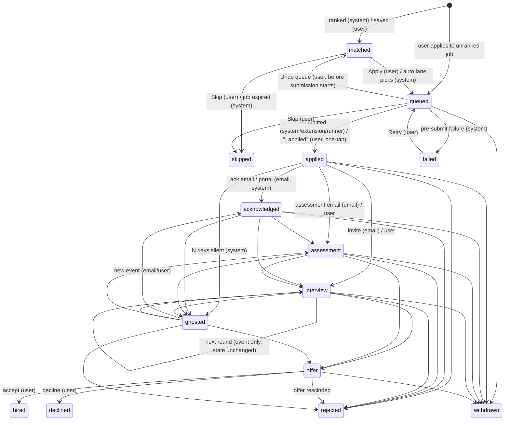

# LLD — Application state machine

| | |
|---|---|
| Status | Draft for owner review |
| Version | 0.1 (2026-10-30) |
| Inputs | `CLAUDE.md` §6, `docs/prd.md` v0.4 (US-5.4, US-5.5, US-6.1 … US-6.5), `docs/lld/database.md` §3.8 |
| Owner module | `lifecycle` (`lifecycle.state_machine.transition()` is the only writer of `applications.state`) |

## 1. Scope and differences from CLAUDE.md §6

- `discovered` is a **job** status (a row in `jobs`), not an application state. An `applications`
  row is created when a job enters a user's ranked list (Tier 2 scored and eligible) in state
  `matched`, or when the user saves or applies to any job directly.
- **Additions approved by the owner (2026-10-30):**
  - `hired` and `declined`: terminal outcomes after `offer`, needed for insights and the offer
    screen.
  - `state_reason` sub-states instead of more states: `awaiting_answer`, `needs_review`,
    `cooldown`, `blocked_by_guard`, `awaiting_user`.
- Lane `assisted` is added (browser extension; the user clicks submit), alongside `auto`,
  `careful` and `one_tap`.

## 2. States

| State | Kind | Meaning |
|---|---|---|
| `matched` | active | Eligible and ranked for this user; no action taken |
| `queued` | active | User (or an enabled automated lane) chose to apply; preparation or submission pending |
| `applied` | active | Submitted (server, extension, runner) or confirmed by the user (one-tap) |
| `acknowledged` | active | Employer confirmed receipt (email or portal) |
| `assessment` | active | Test, assignment, case study or practical requested |
| `interview` | active | Interview scheduled or held (any round) |
| `offer` | active | Offer received |
| `skipped` | terminal | User skipped, or the job expired before action |
| `failed` | terminal* | Submission failed and was not retried; *can be re-queued by the user |
| `rejected` | terminal | Employer declined |
| `ghosted` | terminal* | No events for N days (default 21) after `applied` or later; *revived by any new event |
| `withdrawn` | terminal | User withdrew |
| `hired` | terminal | User accepted an offer |
| `declined` | terminal | User declined an offer |

## 3. Diagram



## 4. Transition table (authoritative)

`T` = trigger allowed: **S** system · **E** email · **U** user · **X** extension · **R** runner ·
**A** admin (corrections only, always audited).

| From | To | Triggers | Guards (all must hold) | Side effects |
|---|---|---|---|---|
| — | `matched` | S, U, X | S: job eligible, Tier 2 scored. U/X: user saves a job (`saved = true`; web, Telegram or extension "Save this job"). No existing application for (user, job) | event row; enters digest candidates (S) |
| — | `queued` | U | user applies to a job that has no application yet (requires `lane`) | event row |
| `matched` | `queued` | U, S | **S only if**: lane enabled for user, not `PAUSE_ALL`, no active restriction, fit ≥ max(user min, global floor), eligible, under lane + global + per-employer caps, no duplicate (user, employer, normalized title) | enqueue `apply_one` or create one-tap pack / runner task |
| `matched` | `skipped` | U, S | S only when job `status` becomes `expired`/`removed` | feedback prompt (optional) |
| `queued` | `applied` | S, X, R, U | S/X/R: `detail.attempt_id` refers to an attempt with status `submitted` and proof stored (screenshot + payload); all apply guards re-checked at submit time by `apply` (ADR-0019). U: lane = `one_tap` or manual, user confirmation (`applied_via = manual`) | `applied_at`, `applied_via`; copy `document_render_id`, `resume_variant_id`, `submitted_payload`, `screenshot_file_id`, `payload_file_id` from the attempt; audit `application.submitted`; follow-up schedule. Quota was already consumed by `apply` before the click (quotas.md) |
| `queued` | `failed` | S, X, R | attempt failed **before** submit click | user notification with reason; offer one-tap fallback |
| `queued` | `matched` | U | no attempt in `filling`/`submitting` | cancel pending tasks |
| `queued` | `skipped` | U | no attempt in `submitting` | cancel pending tasks |
| `failed` | `queued` | U | same guards as `matched → queued` (automated lanes) | new attempt |
| `applied` | `acknowledged` | E, U, R | email classified `acknowledgement` with link confidence ≥ threshold, or user | — |
| `applied`/`acknowledged`/`ghosted` | `assessment` | E, U | classified `assessment` or user | extract deadline → reminder |
| `applied`/`acknowledged`/`assessment`/`ghosted` | `interview` | E, U | classified `interview_invite` or user | create `interviews` row; prep pack task; celebration event (in-app) |
| `interview` | `interview` | E, U | — | **no state change**: new `interviews` round + event row with `to_state = interview`, `detail.round` |
| `interview`/`assessment`/`ghosted` | `offer` | E, U | classified `offer` or user | create `offers` row (user completes figures); celebration event |
| `offer` | `hired` | U | — | insights; suggest pausing all lanes |
| `offer` | `declined` | U | — | — |
| active (`applied` … `offer`) | `rejected` | E, U | classified `rejection` with confidence ≥ threshold, or user | stop follow-ups |
| `applied`/`acknowledged`/`assessment`/`interview` | `ghosted` | S | `now - last_event_at ≥ ghosting_days` (default 21, configurable per user) | stop follow-ups; insights |
| `ghosted` | any of `acknowledged`, `assessment`, `interview`, `offer`, `rejected` | E, U | a new event arrives | revival event `detail.revived = true` |
| `queued` … `offer` | `withdrawn` | U | — | optional withdrawal email draft (user sends) |
| any | any | A | admin correction with reason; never creates a submission | audit `application.corrected` |

Any pair not in this table is **invalid** and raises `InvalidTransitionError` (no state change,
no event row).

## 5. Sub-states (`applications.state_reason`)

| State | `state_reason` | Set when | Cleared when |
|---|---|---|---|
| `queued` | `awaiting_answer` | adapter found unknown questions (`pending_questions` open) | all questions answered or dismissed → apply resumes |
| `queued` | `needs_review` | attempt in `submitting` without result (crash after click, F10) | user confirms outcome: → `applied` (U) or → `failed` |
| `queued` | `blocked_by_guard` | a guard failed at submit time (cap reached, paused, cooldown) | guard clears; the next batch retries automatically (no new attempt for one-tap) |
| `queued` | `cooldown` | user under `cooldown_automation` restriction | restriction ends |
| `queued` | `awaiting_user` | one-tap pack ready, waiting for "I applied" | user confirms or skips; auto-reminder after 3 days |

## 6. API of the state machine

```python
class TransitionTrigger(StrEnum):
    SYSTEM = "system"
    EMAIL = "email"
    USER = "user"
    EXTENSION = "extension"
    RUNNER = "runner"
    ADMIN = "admin"


class TransitionRequest(BaseModel):
    application_id: UUID
    to_state: ApplicationState
    trigger: TransitionTrigger
    reason: str | None = None  # message key
    detail: EventDetail = EventDetail()  # email_id, attempt_id, round, revived, undo_of, dedupe_key
    expected_from: ApplicationState | None = None  # optimistic concurrency (UI drag and drop)
    lane: Lane | None = None  # required for → queued; written to applications.lane
    applied_via: AppliedVia | None = (
        None  # required for → applied: server | extension | runner | manual
    )


class EventDetail(BaseModel):  # stored in application_events.detail (owned by lifecycle)
    reason: str | None = None
    email_id: UUID | None = None
    attempt_id: UUID | None = None
    round: int | None = None
    revived: bool = False
    undo_of: UUID | None = None
    dedupe_key: str | None = None


async def transition(
    scope: UserScope, request: TransitionRequest, *, now: datetime
) -> ApplicationView:
    """Validates and applies one transition atomically.

    Raises:
        NotFoundError: application not visible in this scope.
        InvalidTransitionError: (from, to, trigger) not allowed by the table.
        GuardFailedError: a guard failed; carries the guard code for the UI.
        ConcurrencyConflictError: expected_from given and does not match current state.
    """
```

The guards in §7 are also exported for callers that must check them **before** a transition
(apply at pre-start and pre-submit, runner at lease time, extension assist plans):

```python
class GuardSnapshot(
    BaseModel
):  # owned by lifecycle; stored by apply in apply_attempts.guard_snapshot
    evaluated_at: datetime
    stage: Literal["queue", "pre_start", "pre_submit", "lease", "assist", "proof"]
    results: dict[GuardCode, bool]  # True = pass
    values: dict[str, str | int | float | bool]


async def evaluate_guards(
    scope: UserScope, application_id: UUID, *, stage: str, now: datetime
) -> GuardSnapshot: ...
```

Implementation rules:
- One DB transaction: `SELECT … FOR UPDATE` the application row, validate against the table
  (pure function `is_allowed(from, to, trigger) -> bool` generated from §4), evaluate guards (pure
  functions over a `GuardContext` loaded beforehand), update `state`, `state_reason`,
  `last_event_at`, insert `application_events`, insert `notifications` outbox rows and audit
  entries as side effects in the same transaction.
- Side effects that call external systems (enqueue apply task, send notification) happen via the
  outbox or after commit (`on_commit` hooks), never inside the transaction.
- **Idempotency:** a transition identical to the last event (same `to_state`, trigger and
  `detail.dedupe_key`, e.g. the same email ID) is a no-op returning the current application.
- **Undo (UI):** destructive user transitions (`skipped`, `withdrawn`) are applied immediately;
  the UI offers undo for 10 seconds, which issues the reverse transition `skipped → matched`
  or `withdrawn → <previous state>` with trigger U and `detail.undo_of = <event id>`. These two
  reverse transitions are allowed only with a valid `undo_of` less than 60 seconds old.

## 7. Guards (pure functions)

| Guard code | Checks | Source of truth |
|---|---|---|
| `paused` | global `PAUSE_ALL` or user-scoped pause flag | `settings_flags` |
| `lane_disabled` | lane flag for this user, global lane flag, live-submit flag (`dry_run: false`) | `settings_flags` |
| `restricted` | active `user_restrictions` (guard added in Phase 10 with the table; database.md §9) | quotas |
| `below_quality` | not eligible, or fit < max(user min, global floor) | `job_scores`, config |
| `cap_reached` | lane daily cap, user global daily ceiling, per-employer rolling cap | quotas |
| `duplicate` | existing application for (user, job) or (user, employer, normalized title) in window | applications |
| `source_policy` | lane/mode allowed by the job's `apply_host` policy | `config/source_policies.yaml` |
| `consent_missing` | required consent for the channel/source | privacy |
| `deleting` | user `status = pending_deletion` | users |

## 8. Ghosting and follow-ups

- `followups_and_ghosting` runs daily at 09:00 in each user's time zone (fan-out per user).
- Follow-up nudges: at `applied + 7 days` and `+ 14 days` without events (configurable per
  persona), a `followup_due` notification with a draft message the user sends themselves.
- Ghosting: at `last_event_at + ghosting_days` → `ghosted` (S).

## 9. Tests

- **Table-driven:** every (from, to, trigger) combination (14 states × 14 × 6 triggers) is tested
  for allowed or invalid against §4.
- **Guards:** each guard has unit tests for pass and fail, and `matched → queued (S)` is tested
  with every guard failing independently.
- **Property tests (Hypothesis):** random valid event sequences never reach an invalid state,
  never create two `applied` events for one application, and `last_event_at` is monotonic.
- **Concurrency:** two parallel transitions on the same application → one succeeds, one gets
  `ConcurrencyConflictError` or a no-op.
- **Isolation:** user B cannot transition user A's application (`NotFoundError`).
