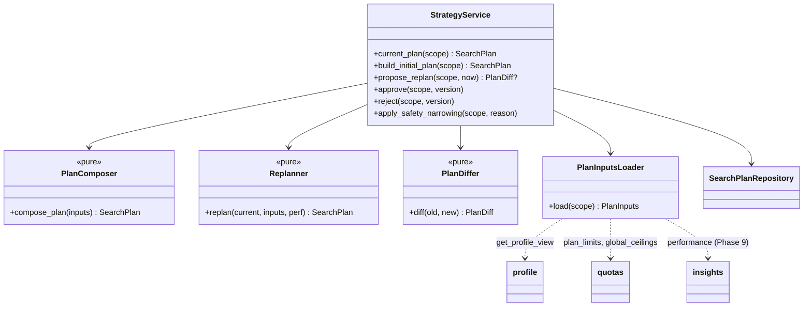

# LLD — strategy

| | |
|---|---|
| Status | Draft for owner review |
| Version | 0.1 (2026-10-30) |
| Owner module | `jobradar.strategy` |
| PRD stories | US-9.2; supports US-3.4 (strategy weight), US-3.7 (top N), US-4.4 (digest size) |
| ADRs | 0006, 0013 (packs and plug-ins), 0019 (limits ≤ plan ≤ global ceilings), 0023 (top N), 0024 (market/role flags) |
| Phase | 3 (plan computed in memory from profile + packs; no table), 9 (`search_plans` table, stored versions, weekly re-plan) |

## 1. Responsibilities

- Build a **`SearchPlan`** for each user from their profile, persona/market/role packs, enabled
  market and role flags, and their plan limits.
- Provide the active plan to matching (weights, top N, minimum fit), connectors (which
  queries and sources to run for this user's markets and roles), apply (lanes and caps) and
  notify (digest size).
- Each week, **propose** a re-plan from insights as a diff. Activate it only after the user
  approves it.
- Version plans in `search_plans`.

### Must NOT do
- Never change a plan without user approval. The exception is the initial plan at onboarding,
  which the user also confirms, and automatic **narrowing** for safety (a market flag turned off,
  a plan limit lowered), which is applied immediately with a notification.
- Never set caps above plan limits or global ceilings, or a minimum fit below the global floor.
- Never enable a market or role whose rollout flag is off (ADR-0024).
- Never call an LLM. Strategy is deterministic and pure (explanations come from message keys).
- Never touch applications, jobs or scores directly.

## 2. Public interface

```python
class LanePlan(BaseModel):
    lane: Lane  # auto | careful | assisted | one_tap
    enabled: bool
    daily_cap: int = Field(ge=0)


class SourcePlan(BaseModel):
    source: str  # connector or channel code
    weight: float = Field(ge=0, le=1)
    markets: list[str]


class SearchPlan(BaseModel):
    version: int
    markets: list[str]  # enabled market codes, priority order
    market_weights: dict[str, float]  # sum to 1
    roles: list[str]  # role codes (incl. adjacent roles for switchers)
    role_weights: dict[str, float]
    sources: list[
        SourcePlan
    ]  # channel weights from persona pack, filtered by market sources + policies
    lanes: list[LanePlan]
    daily_application_target: tuple[int, int]  # from persona daily_volume_range, ≤ caps
    min_fit_score: int  # ≥ global floor
    llm_top_n: int  # ≤ plan limit (ADR-0023)
    digest_max_items: int
    tailoring_depth: Literal["light", "standard", "deep"]
    explanations: list[ExplanationKey]  # message keys explaining each choice


class PlanDiffItem(BaseModel):
    path: str  # e.g. "market_weights.uae"
    old: JsonValue
    new: JsonValue
    reason: MessageRef  # core API transport type (key + params)


class PlanDiff(BaseModel):
    from_version: int
    to_version: int
    items: list[PlanDiffItem]


async def current_plan(scope: UserScope) -> SearchPlan:
    """Phases 3–8: computed by compose_plan and cached (no table). Phase 9+: the active stored plan.

    Raises NotFoundError before onboarding (no profile).
    """


async def build_initial_plan(scope: UserScope) -> SearchPlan: ...  # Phase 9+: status=proposed
async def propose_replan(scope: UserScope, *, now: datetime) -> PlanDiff | None: ...
async def approve(scope: UserScope, version: int) -> SearchPlan: ...  # proposed → active
async def reject(scope: UserScope, version: int) -> None: ...
async def apply_safety_narrowing(
    scope: UserScope, reason: NarrowingReason
) -> SearchPlan | None: ...


# pure core (no I/O)
def compose_plan(inputs: PlanInputs) -> SearchPlan: ...
def replan(current: SearchPlan, inputs: PlanInputs, perf: PerformanceSnapshot) -> SearchPlan: ...
def diff(old: SearchPlan, new: SearchPlan) -> PlanDiff: ...


class PlanInputs(BaseModel):
    profile: ProfileView  # profile.get_profile_view (non-sensitive)
    persona: PersonaPack
    markets: list[MarketPack]
    roles: list[RolePack]
    enabled_markets: set[str]
    enabled_roles: set[str]
    plan_limits: PlanLimits
    global_ceilings: GlobalCeilings
    source_policies: Mapping[str, SourcePolicy]
    user_lane_settings: dict[Lane, bool]


class PerformanceSnapshot(BaseModel):  # from insights, last 28 days
    callbacks_by_market: dict[str, RateStat]
    callbacks_by_source: dict[str, RateStat]
    callbacks_by_role: dict[str, RateStat]
    tier2_coverage: float | None
    applications_per_day: float
```

### API request/response models

Mirrors `docs/openapi.yaml` `components/schemas`: same names, fields, enums and optionality (Step 4 review: the LLD is the single source of truth, the spec must match it). Optional fields are `T | None = None` and serialized with `exclude_none`; `XPage = Page[X]` is the cursor envelope from `docs/lld/README.md`; `# read-only` fields are ignored on input. Types not defined here come from their owning module (see the shared-model ownership table in `docs/lld/README.md`).

```python
class PlanProposal(BaseModel):
    version: int
    status: PlanStatus
    plan: SearchPlan
    diff: list[PlanDiffItem]
    created_at: datetime  # read-only


PlanProposalPage = Page[PlanProposal]


class PlanStatus(StrEnum):
    PROPOSED = "proposed"
    ACTIVE = "active"
    SUPERSEDED = "superseded"
    REJECTED = "rejected"
```

## 3. Internal design



### 3.1 Composition rules (`compose_plan`)
1. **Markets** = profile targets ∩ enabled market flags. Equal weights unless the profile ranks
   them. Disabled targets are listed in explanations (`strategy.market_not_enabled`).
2. **Roles** = profile targets ∩ enabled role flags. The `switcher` persona adds role pack
   `adjacent_roles` at weight 0.25 of the primary.
3. **Sources** = persona `channel_weights` mapped onto each market's sources, keeping only
   sources whose policy allows a discovery mode (`api`, `ats_feed`, `alert_email`), then
   renormalized to sum to 1.
4. **Lanes:** `one_tap` is always enabled. `assisted` is enabled if an extension is paired.
   `auto`/`careful` only if the user enabled them **and** the live-submit and lane flags allow.
   `daily_cap = min(user setting, plan limit, global ceiling)`.
5. **Volume** = persona `daily_volume_range`, clamped to the sum of lane caps.
6. **min_fit_score** = max(profile `min_fit_score`, global floor, persona default).
7. **llm_top_n** = min(persona default, plan limit). `digest_max_items` = min(10, top N).
8. **tailoring_depth** from the persona pack (`tailoring_depth`) and plan (premium model allowed
   or not).

### 3.2 Weekly re-plan

```mermaid
sequenceDiagram
    autonumber
    participant B as beat (Sun 18:30 local, before weekly report)
    participant S as StrategyService
    participant I as insights
    participant R as Replanner (pure)
    participant DB as search_plans
    participant N as notify
    participant U as User
    B->>S: propose_replan(scope, now)
    S->>I: performance(scope, last 28 days)
    S->>R: replan(current, inputs, perf)
    R-->>S: candidate plan
    S->>S: diff(current, candidate) → empty? stop
    S->>DB: INSERT search_plans(status=proposed, diff_from_previous)
    Note over S,N: no notification here: insights.weekly_report (19:00) includes the proposal
    U->>S: approve(version) (web, or action token `approve_plan` from the weekly report)
    S->>DB: active → superseded; proposed → active (one transaction; partial unique index)
```

Re-plan rules (pure, bounded so the plan doesn't swing):
- Each market/source/role weight moves at most ±0.15 per week, toward its share of callbacks,
  with a minimum sample of 10 applications in that dimension. Below the sample size it stays
  the same (`strategy.insufficient_data`).
- If the callback rate < 5% over 28 days with ≥ 30 applications: propose raising `min_fit_score`
  by 5 (up to 85) and lowering the volume target by 20%.
- If Tier 2 coverage < 90%: propose raising `llm_top_n` by 5, if the plan limit allows.
- Never proposes enabling a market or role, or raising caps above limits.
- Proposals older than 7 days expire (`rejected` with reason `expired`).

## 4. Data owned

`search_plans` (database.md §3.11, created in Phase 9): `plan` = `SearchPlan` JSON,
`diff_from_previous` = `PlanDiff` JSON. Before Phase 9 nothing is stored. `uq_search_plans_user_id_active` guarantees one active plan. The current plan
is cached in Redis (`plan:{user_id}:{version}`, TTL 1 h) for hot readers (matching, apply).

## 5. Error handling, retries, idempotency

- `propose_replan` is idempotent per ISO week: if a `proposed` plan for this week exists, it
  returns that plan.
- `approve` of a non-proposed version → `ConflictError`; concurrent approvals are serialized by
  the partial unique index (the loser gets `ConflictError`).
- Missing packs or flags at load → `ValidationFailedError` with the pack code. The current plan
  stays active and an admin alert fires (pack conformance should have prevented it).
- Safety narrowing (a market flag turned off) runs from the `flags.changed` domain event. It creates
  and activates a new version immediately (Phase 9+; before that the in-memory plan simply
  recomputes) and publishes a `status_change` notification.

## 6. Config and feature flags

| Setting (prefix `STRATEGY_`) | Default |
|---|---|
| `weight_step_max` | 0.15 |
| `min_sample_per_dimension` | 10 |
| `low_callback_threshold` | 0.05 |
| `min_fit_step` | 5; ceiling 85 |
| `proposal_ttl_days` | 7 |
| `replan_local_time` | Sunday 18:30 |

Global config read: `matching.global_min_fit_floor`; plan limits and global ceilings from
`quotas.plan_limits(scope)` and `quotas.global_ceilings()`. Flags read: `market.<code>.enabled`,
`role.<code>.enabled`, `lane.<lane>.enabled`, `apply.live_submit.enabled`,
`strategy.replan.enabled`.

## 7. Metrics and log events

Metrics: `strategy_plans_proposed_total`, `strategy_plans_approved_total`,
`strategy_plans_rejected_total{reason}`, `strategy_safety_narrowing_total{reason}`.
Log events: `strategy.plan_composed` (version, markets count, roles count),
`strategy.replan_proposed` (diff item count), `strategy.plan_activated`, `strategy.plan_narrowed`
(reason). No profile content in logs.

## 8. Security and privacy

Plans contain codes and numbers only. Approval through an action token is limited to that
version and that user. RLS on `search_plans`.

## 9. Test plan

- **compose_plan (pure, table-driven):**
  - `syn-01` (mid, India + UAE, Java) → markets `[india, uae]` with weights 0.5/0.5; one-tap on;
    caps ≤ plan.
  - UAE flag off → only India, with explanation key `strategy.market_not_enabled`.
  - `switcher` persona adds adjacent roles at 0.25.
  - A user setting a cap of 50 with plan limit 10 and global ceiling 25 → 10.
  - A profile `min_fit_score` of 40 with global floor 60 → 60.
  - A source whose policy has only `one_tap` is excluded from discovery sources.
- **replan:** weight moves capped at ±0.15; insufficient data → no change; low callbacks → +5 min
  fit and −20% volume; never exceeds limits (Hypothesis property over random snapshots).
- **diff:** stable ordering; identical plans → empty diff → no proposal stored.
- **Service integration:** propose twice in one week → one row; approve → previous superseded;
  concurrent approve → one `ConflictError`; expired proposal rejected.
- **Conformance:** every persona pack produces a valid plan for every enabled market × role
  (part of the ADR-0024 suite).
- **Isolation:** user B cannot read or approve user A's plans.

## 10. Open questions

1. Should the owner be able to set per-market daily targets (for example more UAE than India)?
   Proposal: yes, through profile priority order, which maps to `market_weights`.
